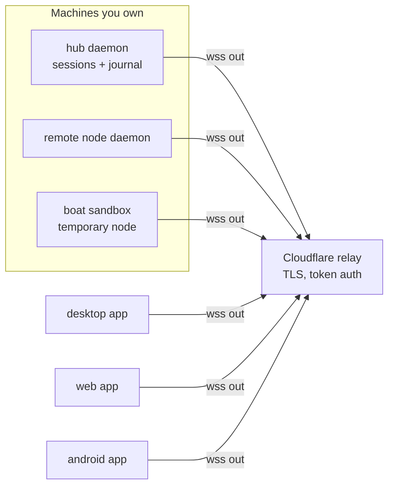

# ormicode

**One place to run, watch and steer all your coding agents — from your desk or your phone.**

A small daemon on your own machine (the *hub*) runs Claude Code, Codex, OpenCode, pi, Grok and Vibe in their own worktrees. The desktop app, web app, Android app, `ormi` CLI and chat bots are just views of it, and they reach it from anywhere through a Cloudflare relay. Sessions keep running when your laptop closes. Approvals reach your phone. Opening the app should feel better than opening a terminal.

This README is the whole spec: what every feature does, how the code is built, and how decisions get made. If something isn't written here, decide it using [Making decisions](#making-decisions). It's long, so **read only what you need**: every feature section starts with a status line (*now*, *next* or *later*) and the sections it depends on.

## Start here

- **What and why:** [Product](#product) → [How you actually use it](#how-you-actually-use-it) → [Topology](#topology) → [Glossary](#glossary).
- **Writing code:** [What to build first](#what-to-build-first), then [Building ormicode](#building-ormicode). It covers how to take a goal, the repo rules, the package map, the protocol and the tooling.
- **Shipping:** [Developer experience: CI/CD and releases](#developer-experience-cicd-and-releases). For now it's just "push to main".
- **Stuck on a choice:** [Making decisions](#making-decisions).
- **What others learned:** [Lessons from similar projects](#lessons-from-similar-projects).
- **Need a doc, repo or library pick:** [References](#references) and [Research by feature](#research-by-feature). Look there before searching the web.

## Contents

- [Overview](#overview)
  - [Product](#product)
  - [How you actually use it](#how-you-actually-use-it)
  - [Topology](#topology)
  - [Glossary](#glossary)
- [Pairing and security](#pairing-and-security)
  - [Pairing](#pairing)
  - [Tokens and transport](#tokens-and-transport)
  - [Security](#security)
- [The hub](#the-hub)
  - [Daemon](#daemon)
  - [Sessions](#sessions)
  - [Journal](#journal)
  - [Reboot recovery](#reboot-recovery)
  - [Eviction](#eviction)
  - [Resources](#resources)
  - [Storage and settings](#storage-and-settings)
  - [Sessions without a project](#sessions-without-a-project)
  - [Checkpoints](#checkpoints)
  - [Replay](#replay)
  - [Costs](#costs)
  - [Raw logs](#raw-logs)
- [Agents](#agents)
  - [Agent adapters](#agent-adapters)
  - [Agent details](#agent-details)
  - [ACP](#acp)
  - [Handoff](#handoff)
  - [Models](#models)
- [Approvals and safety](#approvals-and-safety)
  - [Approvals](#approvals)
  - [Destructive commands](#destructive-commands)
  - [Rate limits](#rate-limits)
  - [Leases](#leases)
  - [Secrets](#secrets)
- [Many agents together](#many-agents-together)
  - [Teams](#teams)
  - [Automations](#automations)
  - [Bots](#bots)
  - [Workflows](#workflows)
- [Machines and connections](#machines-and-connections)
  - [Machines](#machines)
  - [Boat sandboxes](#boat-sandboxes)
  - [Windows](#windows)
  - [Linux](#linux)
  - [Relay](#relay)
  - [Push notifications](#push-notifications)
- [Git, terminal and tools](#git-terminal-and-tools)
  - [Git rules](#git-rules)
  - [Git tab](#git-tab)
  - [Terminal](#terminal)
  - [Browser preview](#browser-preview)
  - [GitHub](#github)
  - [MCP](#mcp)
  - [Review](#review)
  - [Files](#files)
  - [Artifacts](#artifacts)
- [Clients](#clients)
  - [CLI](#cli)
  - [Chat bots](#chat-bots)
  - [Re-entry digest](#re-entry-digest)
  - [Observability](#observability)
  - [Performance](#performance)
  - [Design use](#design-use)
  - [Voice](#voice)
  - [Desktop and web layout](#desktop-and-web-layout)
  - [Web app](#web-app)
  - [Views](#views)
  - [Plugins](#plugins)
  - [First screens](#first-screens)
  - [Later screens](#later-screens)
- [Agent superpowers](#agent-superpowers)
  - [Computer use](#computer-use)
  - [Chrome](#chrome)
  - [Device lab](#device-lab)
  - [Desktop streaming](#desktop-streaming)
- [Extending it](#extending-it)
  - [Skills](#skills)
  - [Themes](#themes)
  - [Marketplace](#marketplace)
- [Integrations](#integrations)
  - [Trackers](#trackers)
- [Quality](#quality)
  - [Eval](#eval)
- [Building ormicode](#building-ormicode)
  - [Working on this repo](#working-on-this-repo)
  - [What to build first](#what-to-build-first)
  - [Owner setup checklist](#owner-setup-checklist)
  - [Layering](#layering)
  - [Packages](#packages)
  - [Project structure](#project-structure)
  - [Package layout](#package-layout)
  - [Tooling and rules](#tooling-and-rules)
  - [Protocol](#protocol)
- [Making decisions](#making-decisions)
  - [Ask (add an open question) only when the choice is](#ask-add-an-open-question-only-when-the-choice-is)
  - [Otherwise: decide and move on](#otherwise-decide-and-move-on)
  - [Open questions](#open-questions)
- [Lessons from similar projects](#lessons-from-similar-projects)
  - [Who's doing what](#whos-doing-what)
  - [Patterns everyone converged on (we already do these)](#patterns-everyone-converged-on-we-already-do-these)
  - [Ideas worth adopting](#ideas-worth-adopting)
  - [Where we deliberately differ](#where-we-deliberately-differ)
  - [Pitfalls others hit (avoid them)](#pitfalls-others-hit-avoid-them)
- [References](#references)
  - [Agents](#agents-1)
  - [Protocols](#protocols)
  - [Platform and infrastructure](#platform-and-infrastructure)
  - [Runtime and tooling](#runtime-and-tooling)
  - [Clients](#clients-1)
  - [Research by feature](#research-by-feature)
- [Developer experience: CI/CD and releases](#developer-experience-cicd-and-releases)
  - [Stage 0: now (solo)](#stage-0-now-solo)
  - [Stage 1: a safety net (turn on when the code base grows)](#stage-1-a-safety-net-turn-on-when-the-code-base-grows)
  - [Stage 2: real releases (turn on when someone else installs it)](#stage-2-real-releases-turn-on-when-someone-else-installs-it)
  - [Stage 3: polish (when it has regular users)](#stage-3-polish-when-it-has-regular-users)
  - [Targets](#targets)
  - [Good DX rules](#good-dx-rules)

---

# Overview

## Product

**A control plane for the coding agents already working on your machines.**

**Who it's for:** one developer, one account. A Windows laptop, a Linux desktop, an Ubuntu VPS, sometimes a rented sandbox.

**The problem:** Claude Code, Codex, OpenCode, pi, Vibe and Grok are all installed and logged in, but there's no one place that knows what they're all doing, keeps going when the laptop closes, and lets you answer "should it run the tests?" from your phone.

**Principles**
1. The hub owns the work. Desktop and phone are just views; neither holds session state.
2. The app never touches provider logins. It uses whatever the machine is already logged into.
3. Honest state. Interrupted says interrupted. Offline says offline with a timestamp, not a spinner.
4. Small parts, one job each. A file doing two things gets split.
5. Reversible. Updates roll back, worktrees stay until you remove them, transcripts are pruned on a timer you set.
6. Features live in the daemon and reach every client through the protocol. A feature that only exists as a screen isn't finished ([Layering](#layering)).

**Not doing:** human teams or sharing, multi-tenant hosting, macOS/iOS, a hosted cloud agent, managing anyone's API keys or subscriptions, Docker on the hub, a shallow generic ACP client instead of real adapters, our own agent loop.

**Success looks like**
- Start work from the phone in under 10 seconds.
- Kill the hub mid-turn and lose nothing already written.
- Close the laptop and keep working from somewhere else.
- Answer an approval from a train with one tap.
- Never store a provider credential.
- **Opening the app feels better than opening a terminal.** This is the real bar.

**It is not** a terminal multiplexer, kanban board, chat app or dashboard. No status bar, no metrics strip — the session list *is* the status.

## How you actually use it

- **10–15 sessions a day**, peaks around 20, across 4–5 projects, every day.
- Sessions get abandoned mid-turn and resumed hours later or the next morning. Leaving one open for days is normal.
- Tasks come from memory, not a tracker. Prompts start vague and get corrected while the agent works.
- Usually works on the branch already checked out; a new branch or worktree when the task deserves one.
- You watch the transcript (with a setting for how much is shown) and jump between tasks. Interrupting mid-turn is rare.
- Tests get run, diffs read sometimes, commits usually made by the agent.
- **Desk:** one laptop screen, app full screen, two or three terminals, no tmux.
- **Phone:** couch, bed, commute. A real working device, not just notifications.
- **Notifications** are fine at any hour.

**What that means for the design**
- The session list must handle 20 live sessions without scrolling.
- Resuming across days is a first-class action, not a search.
- Transcript density is a setting (detail while debugging, quiet while triaging).
- One full-screen window is the normal mode. Never assume a second monitor.
- The phone must be good enough that the couch isn't a downgrade.
- The warm process pool should cover the 20-session peak, or waking must be fast enough that eviction is invisible — ideally both ([Resources](#resources)).

## Topology



**Everything dials out to Cloudflare on port 443.** Nothing listens on a public port. No LAN discovery, port forwarding or tunnels.

**Roles**
- **Hub:** exactly **one** always-on machine that runs the daemon, owns the account's store, leases and device list, and is the one clients talk to. Normally the VPS. (A second hub would be a second, separate account with nothing shared, so don't build hub-to-hub sync.)
- **Node:** the same daemon on any other machine you own (your laptop, your desktop), paired to the hub so you can run sessions on projects that live there. Nodes keep their own journal and report to the hub. Until node pairing is built, the hub is the only machine.
- **Sandbox:** a Boat VM, treated as a temporary node. Work comes back by pushing a branch.
- **Clients:** Electron (Windows, Linux), web, Expo (Android). The hub is authoritative; clients may store credentials, preferences, per-session cursors and disposable cached summaries. Label cached data with its age. On local sign-out, remove the token and account cache. Revocation blocks access but cannot erase data already stored on an offline device. Do not persist transcripts, artifacts or terminal output in client caches by default.
- **Relay:** Cloudflare Worker + one Durable Object per account + R2 for history. Trusted; see [Security](#security).

**Why a hub:** a closed laptop runs nothing. Something has to be awake for sessions to outlive the desktop app — and that makes phone and desktop equal.

**Connecting**
1. Hub starts, connects to the relay, announces itself.
2. Clients connect with their device token.
3. Client asks for the session list; hub answers from its summary index.
4. Client opens a session; hub streams it from a sequence number.
5. Client leaves; hub unsubscribes.

**When things are down**
- **Relay down:** hub keeps working, writes the journal, buffers outgoing frames. Clients see their link failing and the hub's last heartbeat age.
- **Hub down:** clients show last known state with its age and cached summaries. Nothing pretends to be live.
- **Hub restarting:** same, plus sessions whose process died show `interrupted`.

## Glossary

| Term | Means |
| --- | --- |
| **Hub** | The one always-on machine running the daemon. It owns the store and is what clients talk to (normally the VPS). |
| **Node** | Any other machine you own running the daemon, paired to the hub, so sessions can run on its projects. |
| **Daemon** | The `ormi` background service: one *supervisor* plus one *worker* per live session. |
| **Session** | A lasting record of work on one project in one place: transcript, branch, worktree, state. |
| **Worker** | The process running one session's agent. It comes and goes (see [Eviction](#eviction)); the session stays. |
| **Turn** | One prompt and everything the agent does until it stops. |
| **Agent / vendor** | Claude Code, Codex, OpenCode, pi, Grok or Vibe. |
| **Adapter / transport** | Our code that drives one agent through one interface (SDK, CLI or ACP). |
| **Worktree** | A separate git checkout under `.ormi/worktrees/` that one session owns. |
| **Journal** | The append-only event log in SQLite. It's the source of truth. |
| **Relay** | The Cloudflare Worker that connects clients to the hub from anywhere. |
| **Client** | Desktop, web, Android, CLI or chat bot. All are views, and none holds state. |
| **Approval** | A question the agent asks before acting, forwarded word for word. |
| **Destructive list** | Matching requests the adapter can intercept come to you, never to a parent agent. |
| **Lease** | One session's claim on a file, folder or repo, so agents don't overwrite each other. |
| **Checkpoint** | An automatic restore point after each tool call. |
| **Artifact** | A page an agent publishes (chart, table, mockup) shown inline. |
| **Extension / view / plugin** | Agent-added panels, then your own replacement screens, then installed code with permissions (from least to most power). |
| **Team / bot / automation** | A parent session with children; a long-lived named teammate; a session started by a schedule or event. |
| **Utility call** | A small hidden model call the daemon makes (titles, digests, briefs) through an installed agent. |

# Pairing and security

## Pairing

> **Status:** built — `ormi pair`, `pair.create`/`pair.join`, `devices.list`/`rename`/`revoke`, `ormi connect`; verified end-to-end locally through the relay. · **Needs:** [Relay](#relay), [Tokens and transport](#tokens-and-transport)

**A 12-digit code, 10 minutes, one use. Enter it on the new device and it gets a device token.**

**The code**
- The hub makes 12 random digits, shown as `4821 0937 5562` (~40 bits).
- Lives 10 minutes, works once. 5 wrong tries burns it (the hub keeps the count).
- The relay also limits pairing attempts per IP (20 a minute).

**Steps**
1. On the hub, `ormi pair` (or the desktop app) shows the code, a QR code and a link `ormi://pair?c=<digits>`. For the web: `https://app.<domain>/pair#c=<digits>` (in the `#` part, so it never reaches server logs).
2. The hub gives the relay the SHA-256 of the code so it can route the join.
3. The client enters/scans the code and sends it with a device name.
4. The hub checks it. If right, it makes a **device token** (32 random bytes, base64url), stores only its SHA-256 with the device name, tells the relay to accept that hash, and sends the token back.
5. The client stores the token and uses it from then on. The code is burned.

Later devices pair the same way. With exactly one hub, the client connects on launch and shows `studio, connected`.

**Revoking and recovery**
- Lost a device: revoke it from the hub or any other client. Its token hash is deleted on the hub and relay.
- Lost every device: run `ormi pair` on the hub again. No recovery words.
- Devices are named by you and can be renamed.

## Tokens and transport

> **Status:** built — `packages/crypto` (WebCrypto SHA-256, constant-time compare), token-first-message ws auth, hashes-only on the relay. · **Needs:** [Relay](#relay)

**TLS for transport, random tokens for auth. No custom crypto.**

| Token | What | Stored |
| --- | --- | --- |
| Pairing code | 12 random digits, 10 min, one use | Shown on the hub only |
| Device token | 32 random bytes, base64url | Device's secure storage; hub and relay keep only SHA-256 |
| Hub token | 32 random bytes, made on first run | Hub's secure storage; relay keeps SHA-256 |

- Randomness: `globalThis.crypto.getRandomValues` (or `node:crypto`). Hashing: SHA-256. Compare tokens in constant time.
- **Connecting:** open `wss://relay/connect` and send the token as the first message (never in the URL). The relay hashes it and accepts or closes.
- Everything over TLS (`wss://`, `https://`). No extra encryption on top, so the relay can read frames and stored history. IndexedDB does not protect web tokens from malicious same-origin code; XSS or a compromised deployment can use them. Enforce a configured origin allowlist for browser connections.
- **Where tokens are kept:** hub → OS keychain or a 0600 file in `~/.ormicode`; desktop → Electron `safeStorage`; Android → `expo-secure-store`; web → IndexedDB (never a URL or `localStorage`).
- **Rotation:** revoking deletes the hash. `ormi token rotate` replaces the hub token. Device tokens are replaced by pairing again.

## Security

**One user, so the threat model is small but real.** What's protected: source code, prompts and transcripts. The relay is trusted (it's your own Cloudflare account) — that's the simplicity trade-off.

| Threat | Protection | What's left |
| --- | --- | --- |
| Relay operator reads data | Your own Cloudflare account; TLS | Relay can read content |
| Relay compromised | Only token hashes stored at rest | Attacker can read traffic and capture tokens at authentication, then impersonate a device until revoked |
| Guessing the pairing code | 12 digits, 10 min, 5 tries, rate limit | Someone who sees the screen |
| Stolen device token | Revoke the device | Access until revoked |
| Lost phone | Revoke | Data already on it stays readable |
| Malicious repo | Runs with your user permissions | An agent can run anything you can |
| Prompt injection | Approvals and autonomy policy | A determined attack can still ask for harm |
| pi has no approvals | Worktree + OS user limits | Bad tool calls run without asking |
| Secrets in agent stderr | Logs never leave the machine | Anyone with the disk can read them |
| Terminal from phone | Device token guards it | Full shell access |
| Custom/agent-written views | Webview sandbox, method allowlist, hash pin, safe mode | Reads whatever its allowlist exposes |
| Agent-published UI | Additive slots only, no approvals, marked, one allow per session | A panel can still mislead visually |
| Agent layout changes | Validated, marked, history and reset; approvals can move but never hide; safe mode | Confusing, but can't hide approvals or add actions |
| Web client | Strict CSP, self-hosted assets, token in IndexedDB, no third-party scripts | XSS = stolen token |
| Web deployment | Static Worker assets, no secrets, versions and rollback | Bad deploy changes the client, never hub data |
| Installed plugin | Worker sandbox, declared permissions, network via proxy, pinned updates | Reads whatever its allowlist exposes |
| Plugin from a repo | Install shows files, permissions, commit; nothing auto-enables | The code runs, by design |
| Plugin daemon hook | Allowlisted hooks, one journal event each, hangs skipped | Can delay or nudge a tool call |
| Computer use | Sandbox by default, banner, kill switch | Wrong click isn't in the transcript |
| Chrome extension | Allowlist, opt-in, sensitive-action confirms | Acts as your logged-in self |
| Voice | Local speech-to-text by default | Cloud speech is opt-in |
| Stolen hub | — | Full plaintext history on disk; disk encryption is your job |

**No credential handling:** the app never stores, copies or refreshes provider credentials. Boat sandboxes are logged in from Boat's side.

**The terminal is the sharp edge** (a remote shell on your phone):
- Pairing is the only way in.
- Revoking a device ends its terminal access.
- Every terminal open is logged with the device.
- Optional: confirm on the hub the first terminal from a new device.

**Logging:** the hub logs session events, tool calls and terminal opens locally. The relay logs connection metadata only. Telemetry is anonymous, off by default, and drops prompts, paths, repo names and titles ([Observability](#observability)).

**Never:** send prompts to a third-party proxy, store provider tokens, send telemetry with content, or default to "remember this approval forever".

**Reporting a bug:** `SECURITY.md` points to GitHub private vulnerability reporting. No bounty.

# The hub

## Daemon

> **Status:** now · **Needs:** nothing (start here)

**Node 26 LTS, TypeScript, ESM, source maps, no bundler.** Shipped as a versioned tarball (not npm), because a readable stack trace beats a neat single binary.

**Two kinds of process**
- **Supervisor** — one per machine. Owns the relay connection, the store, the machine registry, the process pool and the local socket. Small and long-lived. **The only process that writes the store.**
- **Session worker** — one per live session. Runs one agent process, sends its events to the supervisor, reports health. Never opens the store. A worker crash only kills its session.

**Daemon implementation status:** `apps/daemon` runs the supervisor + worker pair (`supervisor.ts` lifecycle/state machine, `dispatch.ts` client `session.*`/`daemon.*` routing, `recovery.ts` boot, workspace leases in `packages/leases`, git workspaces in `packages/git-core`, `proctree.ts`, `registry.ts`, `socket.ts`, `worker-main.ts`): NDJSON-framed protocol on a named pipe / unix socket (or `127.0.0.1:<port>` when `ORMICODE_SOCKET` looks like `host:port`), `worker.*` RPC from `worker-main.ts`, session state machine, journal writes via `journal.append` (seq assigned in the supervisor, event+outbox+last_seq in one tx), ephemeral `text_delta`/`thinking_delta` forwarded to subscribers unjournaled, `worker.native`/`worker.health` handled, clean vs crashed stream-end distinguished, boot marks only in-flight sessions `interrupted`/`host_restart`. Client surface: `daemon.status`, `session.start/get/list/prompt/steer/abort/decide/answer/subscribe/unsubscribe/archive/delete`, `session.pause`/`resume` (held prompts replay in order), `session.retry`, `session.handoff` (see [Handoff](#handoff)), `session.setModel/setEffort/setMode/setOption` (forwarded to the worker, persisted on the row), notes get/set/delete. Workspace leases (`apps/daemon/src/leases.ts`): one live session owns a checkout path, dead holders are reclaimed, conflicts reply `lease.conflict`. Idle sessions evict their worker after `ORMICODE_IDLE_TIMEOUT_MS` (default 20 min) or when the pool exceeds `ORMICODE_POOL_MAX` (default 8). Boot recovery (`apps/daemon/src/recovery.ts`): in-flight sessions become `interrupted`/`host_restart`, pending approvals/questions get `interaction_expired` with their request id, stale worker pids are reaped, and `ORMICODE_RESUME_POLICY` (`safe` default / `wait` / `all`) auto-respawns completed sessions whose transport passed the live resume smoke (`all` also respawns sessions without a native resume — those come up fresh, get a journaled `handoff_brief` recap, and the brief is sent to the new agent as its first prompt so it continues with context) — `resumed` is journaled on `worker.ready`; a failed native reload arrives as `interrupted`/`resume_failed` plus a journaled `handoff_brief` recap (session row + last durable events, `handoff.ts`). Client `ack` frames advance per-device replay cursors in `device_cursors` (`ormi session tail` acks each event); the device comes from the `hello` frame's `device` field and the CLI persists one in `~/.ormicode/device-id` (`ORMICODE_HOME` overrides the base dir). `workspace: {kind: 'scratch'}` starts a no-project session in `~/.ormicode/scratch/<session>` (`ormi session start --scratch`); `session.delete` removes the pad. Remote access (`pair.ts`/`relay.ts`): `pair.create` mints a 10-min code (relay gets only the SHA-256), `pair.join` issues a device token (hash in the `devices` table), `devices.list/rename/revoke` work locally + relay revoke closes live sockets; `RelayClient` keeps one outbound wss to the account DO (auth first frame, reconnect backoff), pushes journaled evts to subscribed devices, and routes remote `req` frames into the same dispatch via `RemoteLink`; the hub identity lives in `~/.ormicode/hub.json` (0600). Git workspaces (`git.ts`): `current` records the resolved branch + exact commit in `base_commit` (migration 0002), detached HEAD is rejected (`workspace.detached`), a busy branch atomically reserves `ormi/<slug>` + `<project>/.ormi/worktrees/<slug>` at that commit, `kind: 'branch'` switches a named new branch in place, `kind: 'worktree'` bases off the named branch, failed `worktree add` prunes the partial dir/catalog/branch, and non-git projects reject branch/worktree (`workspace.not_repo`). Rate limits: an `error` event with `code` `rate_limited`/`plan_limit` and a `resetAt` parks the session in `paused_rate_limited` and the supervisor resends the held prompt when the timer fires (timers re-arm from the journal on boot, no burst at startup); adapter-internal retries still emit `rate_limited`/`retry_scheduled` and keep the turn in `retrying`. Workers are spawned as process-group leaders (`detached` on POSIX) and killed via `killTree` — `taskkill /PID /T /F` on Windows, group SIGKILL elsewhere — so agent grandchildren can't be orphaned. Tests: real fake-agent turn through the socket, journal continuity across a supervisor restart, SIGKILL mid-turn → `interrupted` with committed events kept, delete/lease/pause-replay/retry/notes/eviction/setModel method tests, kill-tree grandchild reaping, and the journal crash harness (`packages/journal/test/crash.test.mjs`) which injects a fault at each append phase (`afterSeqAssign`/`afterEventInsert`/`afterOutboxInsert`/`afterSeqBump`) and asserts the tx leaves zero trace, plus committed-but-unsent frames resyncing via the outbox. Verified live through `ormi daemon` + `ormi session start/prompt/get/list` with the fake vendor.

**UI checking tools** (`scripts/ui/`, need a built desktop: `pnpm --filter @ormicode/desktop build`; output goes to the git-ignored `.ui-out/`):
- `pnpm ui:shot [home] [session] [--scale 2] [--clip x,y,w,h] [--hover "selector"]` — launches the app at the mockup size (1441×901) and saves screenshots.
- `pnpm ui:geometry [home|session]` — prints x, y, w, h of the sidebar, tab, card, rail, greeting, composer and search pill.
- `pnpm ui:mockup <screen> [--find text] [--tsv]` — dumps every text (size, weight, colour) and shape with absolute position from `designs/desktop/Desktop — <screen>.svg`. Needs Edge or Chrome (or set `UI_BROWSER`).
- `pnpm ui:motion` — checks maximize frame pacing and the minimize/restore round trip.
Compare `ui:geometry` with `ui:mockup` numbers instead of asking for screenshots.

**Dev note:** this repo's `pnpm` resolves Node 26 (`v26.x` via vite-plus) while the Git Bash `node` is v24 — always run tests through `pnpm test`. `better-sqlite3` prebuilds match the *installing* node: after a Node-24 install, restore the Node 26 binary with `npx prebuild-install --target=26.x` inside `node_modules/better-sqlite3`.

**Local socket**
- `\\.\pipe\ormicode` on Windows, a unix socket on Linux.
- Newline-delimited JSON with the same envelope as [Protocol](#protocol), opened by a `hello` with protocol version and role. A line over 1 MB or that doesn't parse closes the connection.
- Same-user only (pipe ACL / socket file mode). No token — anything running as you is already trusted.
- Workers terminate when the supervisor exits or crashes; a replacement supervisor never adopts them.

**Lifecycle**
- `ormi daemon install` sets up auto-start: a Task Scheduler logon task on Windows; a systemd user unit + `loginctl enable-linger` on Linux.
- On start: open the store, check journals, connect to the relay (with backoff), listen on the socket. On Linux, delete a stale socket file first.
- Prints one JSON line on start: `{"socketPath","storePath","version"}` so the installer and CLI can find it.
- `daemon.status` returns version, uptime, live workers, relay state, last error.
- `agents.list` returns `{agents: [{vendor, transports}]}` — the vendor/transport pairs with an installed adapter (plus `fake`), so clients only offer what `session.start` accepts.
- Shutdown drains, closes workers gracefully, and marks sessions interrupted only if mid-turn.

**Worker messages** (local only, never over the relay)
| Message | Direction | Does |
| --- | --- | --- |
| `worker.ready {session, pid}` | worker → sup | Records the pid and process identity for cleanup. Reply `{ok:true}` |
| `worker.event {session, kind, origin?, payload, ts?}` | worker → sup | Supervisor assigns `seq`, writes the journal, queues the outbox, fans out. Reply `{seq}` = it's saved |
| `worker.state {session, state, reason?}` | worker → sup | Writes a `state` event, updates the session. Reply `{seq}` |
| `worker.native {session, nativeId}` | worker → sup | Records the agent's own session id for resume |
| `worker.health {pid, rssBytes, lastError?}` | worker → sup | Every 10 s |
| `worker.prompt {session, text}` | sup → worker | Reply `{accepted:true}` once the agent has it; the turn arrives as events |
| `worker.abort {session}` | sup → worker | Calls the agent's interrupt; `agent.failed` if it has none |
| `worker.evict {session}` | sup → worker | Worker shuts the agent down and exits; supervisor writes `evicted` and sets `idle` |
| `worker.configure {session, kind, value}` | sup → worker | kind = `model`/`effort`/`mode`; `agent.failed` if unsupported |

If a worker loses the supervisor it stops (no unbounded buffering).

**Spawning:** `node apps/daemon/src/worker-main.ts` with env vars `ORMICODE_SOCKET`, `ORMICODE_SESSION`, `ORMICODE_VENDOR`, `ORMICODE_CWD`, `ORMICODE_ADAPTER` (and agent settings). Exits before `ready` → session `failed` with the exit code. The built-in `fake` vendor is a test agent (one text turn, then ends) used by the crash tests; real sessions never pick it.

**Self-update**
1. `ormi upgrade` downloads into `versions/<semver>` and runs `ormi --self-check` against a temp store.
2. Wait until no turn is running. Stop idle workers and the old supervisor, switch versions, and start the new supervisor.
3. If startup or its health check fails, switch back and start the old version. Sessions wake on demand; no worker is adopted.
- The background check runs every 3 hours (`update.channel`: `stable` default, `nightly` opt-in). It is off until releases exist. Before then, `ormi upgrade --from <dir>` installs a local build the same way.

**Utility calls** (titles, re-entry digest, handoff brief)
- The daemon has no API keys, so it borrows an installed agent: a hidden `kind: "utility"` session with no worktree, title or approvals, a temp folder, and only the journal text it needs.
- Uses the `utility` agent setting (default: machine's default agent, cheapest model). In-process SDK where available, otherwise a hidden CLI worker.
- One at a time per machine, 10 s cap, no retries, limited by `utility.dailyCapUsd`.
- On failure, fall back: first 8 words for a title, journal extraction for a brief, plain fields for the digest. **Nothing you do ever waits on one.** Cost is logged as `usage` with `origin: "utility"` on the session that caused it.

**Logging**
- JSON lines in `~/.ormicode/logs/daemon.log`, rotated at 20 MB, 5 files. Level from `log.level` (`debug`/`info`/`warn`/`error`, default `info`).
- `daemon.logs {limit?, after?}` (default 100, max 1000) returns `{entries, cursor}`; the cursor survives rotation. `ormi logs [-f] [--limit N]`.
- **Never** prompt or tool content — only ids and sizes.
- Optional local metrics on loopback port 9464 ([Observability](#observability)).

**Doctor:** `ormi doctor` checks Node version, git and gh (installed + logged in), each agent binary, shell (Git Bash on Windows), socket permissions, relay reachability, store integrity, long-path support. `daemon.health` adds store/migrations, search index, socket, workers, relay, version. `ormi doctor --repair` rebuilds the search index and trims a torn journal tail.

**Config:** machine settings in `~/.ormicode/config.json` (validated, migrated on start). Account settings live in the store ([Storage](#storage-and-settings)).

**When things fail**
- **Worker crash:** restart with backoff, up to 5 times where recovery is safe. Then mark it `failed`, preserving its journal and workspace. Never switch vendors automatically; offer a manual handoff when available, showing the target vendor, model and available cost information.
- **Supervisor crash:** workers terminate. The OS restarts the supervisor, which marks affected turns interrupted and applies the recovery policy.
- **Agent binary missing:** fail fast, naming the binary and its install command.

**Memory limits per worker:** Windows job object (memory cap, kill-on-close so no orphans); Linux `systemd-run --user --scope -p MemoryMax=...`. Default = half of RAM ÷ warm pool size.

## Sessions

> **Status:** now · **Needs:** [Daemon](#daemon), [Journal](#journal)

**A session is a lasting record of work on one project in one place. A worker is just how it runs.**

**States**
| State | Meaning |
| --- | --- |
| `idle` | Exists, nothing running, safe to wake |
| `starting` | Worker spawning |
| `running` | A turn is in progress |
| `awaiting_approval` | Waiting on a decision |
| `awaiting_input` | Agent asked a question |
| `retrying` | Retrying after a rate limit (attempt shown) |
| `paused_rate_limited` | Initial call and 5 retries failed; resumes at the reset time |
| `interrupted` | Process died mid-turn |
| `failed` | Fatal error, kept for inspection |
| `done` | Agent says it's finished |
| `archived` | Hidden from lists, kept until retention |

States with several causes carry a `reason` (e.g. `interrupted`: `host_restart`, `resume_failed`, `worker_crash`; `evicted`: idle timeout or full pool), and clients show it.

**Transitions:** Define the source state, resulting state, events and errors for every operation in the protocol schemas. Prompting `idle` or `done` starts a turn; prompting `running` is rejected unless explicitly queued or sent as a supported steer. Archiving hides a session without stopping it. If an adapter cannot interrupt, abort returns `agent.unsupported` and the client says the turn may still be running. Define approval, pause, retry, deletion and simultaneous-request transitions before implementing them.

**Turns**
- `session.prompt` returns once the worker has the input; follow the turn via `turn_start` … `turn_end` events.
- **pause** finishes the current tool call and holds new prompts (state doesn't change). **resume** sends held prompts in order; if one fails, it and the rest stay queued.
- **abort** requests an immediate stop; if supported, the tool call is marked `interrupted`. If unsupported, return `agent.unsupported` and do not claim it stopped.
- **steer** goes into the running turn if the agent supports it; otherwise it's queued (visibly) for the next turn. Nothing is dropped.
- **answer** replies to a pending clarifying question with `session.answer {session, request, answers}`. `answers` maps each original question text to the user's answer. The adapter preserves the question's own text and choices; the first valid response wins. A question is not an approval.

**Starting a session** takes: machine, project, vendor, transport, model, effort, mode, optional workspace name, and workspace choice (current branch / new branch / worktree from a branch). ACP sessions can also carry `agentCommand` and `agentArgs`.
- `session.start` returns the id. `session.list`/`session.get` return id, title, state, project, vendor, transport, last update and branch (null for scratch/no-git); `get` also returns the current model, effort and `mode`.
- No branch given → resolve and save the checked-out branch and exact starting commit. If HEAD is detached, require an explicit workspace choice.
- If that branch is busy with another running session, atomically reserve a unique worktree and branch at the recorded commit. Never copy or move uncommitted changes into it. If creation fails, leave existing files untouched and do not start the agent.

**Workspace rules**
- The main checkout has at most one live session; a worktree has exactly one.
- Worktrees go in `<project>/.ormi/worktrees/<slug>`. Slug from your name or the title, with a number on collision.
- Agents' own worktree features (Codex, Grok) are turned off — one owner per workspace.

**Capabilities:** maintain a per-vendor, per-transport matrix, versioned with the tested agent. Record streaming, steering, approval interception, interruption, native resume, model discovery and usage as supported, unsupported or unverified. Unsupported operations return a typed error; test adapters with recorded contract fixtures and local smoke tests.

**Agent settings:** each session stores the vendor's own values for model, effort, mode/agent (and ACP `configOptions`). Never invented.

**Titles:** 4–6 words from the first prompt via a utility call (fallback: first 8 words). Renameable.

**Branch names:** choose a unique name before starting the agent, using a supplied workspace name or a stable session-id suffix. Add a number on collision. Never rename a branch automatically after work begins.

**Notes**
- Named markdown notes per session in `~/.ormicode/notes/<session>/`, outside the worktree, never committed. For things like "remember the API is behind a flag".
- Each note: `n_` id, title, body, updated time; stored as `<id>.md` with the title in front matter.
- `session.getNotes {session}` → list; `session.setNotes {session, id?, title, body}` creates (no id) or replaces; `session.deleteNote {session, id}`.
- An old single `<session>.md` becomes one note called "Untitled".
- Editable from any client; carried through handoffs and moves.

**Display:** transcript is full while running, summarized when idle (adjustable per session and globally). Sort: carry-over and things waiting on you first, then most recent. Done sessions fade after a day.

**Ending**
- `done` when the agent finishes with nothing pending. `archived` when you say so or after an inactivity sweep. Archiving never deletes; retention does.
- `session.list` hides archived unless `{archived:true}`.
- `session.delete` hides the session and keeps its record and journal until retention. For a no-project session it also deletes the scratchpad folder, after a warning that names the folder (decided, was G8).

**Carry-over:** unfinished sessions stay at the top until archived. After 7 days untouched they sink into the normal list.

**Scratchpads:** see [Sessions without a project](#sessions-without-a-project).

**Children:** a session can own child sessions and form a team ([Teams](#teams)).

**How many at once:** unlimited records. Live workers are capped by RAM ([Resources](#resources), max 20). When the pool is full, the oldest idle worker is evicted; if none is idle, the start waits in a visible queue.

**Terminals** belong to a project, not a session. A session's terminal just opens in its worktree; closing a session never closes a terminal.

## Journal

> **Status:** now · **Needs:** [Daemon](#daemon)

**SQLite (WAL) at `~/.ormicode/store.db`, one per machine. The journal is the source of truth.** Agents' own session files are only used for native resume.

**Tables**
```sql
sessions(
  id TEXT PRIMARY KEY, title TEXT, machine TEXT, project TEXT,
  vendor TEXT, transport TEXT, kind TEXT DEFAULT 'session', acp_version INTEGER,
  agent_command TEXT, agent_args TEXT,
  model TEXT, effort TEXT, mode TEXT, native_id TEXT,
  cwd TEXT, worktree TEXT, branch TEXT, base_branch TEXT,
  state TEXT, reason TEXT, options TEXT, parent TEXT, attempt INTEGER DEFAULT 1,
  handed_off INTEGER DEFAULT 0, worker_pid INTEGER,
  pinned INTEGER DEFAULT 0, archived INTEGER DEFAULT 0,
  last_seq INTEGER DEFAULT 0, log_dir TEXT, created_at INTEGER, updated_at INTEGER
)
events(session TEXT, seq INTEGER, ts INTEGER, kind TEXT, origin TEXT,
  payload TEXT, crc INTEGER, PRIMARY KEY(session, seq))
blobs(id TEXT PRIMARY KEY, session TEXT, size INTEGER NOT NULL, created_at INTEGER NOT NULL)
tool_calls(session TEXT, call_id TEXT, seq INTEGER, name TEXT, kind TEXT,
  input TEXT, output TEXT, status TEXT, exit_code INTEGER,
  started_at INTEGER, ended_at INTEGER, bytes INTEGER, PRIMARY KEY(session, call_id))
projects(id TEXT PRIMARY KEY, machine TEXT, path TEXT, remote TEXT, default_branch TEXT)
machines(id TEXT PRIMARY KEY, name TEXT, kind TEXT, last_seen INTEGER, meta TEXT)
devices(id TEXT PRIMARY KEY, name TEXT, token_hash TEXT, trusted_at INTEGER, revoked_at INTEGER)
device_cursors(device TEXT, session TEXT, seq INTEGER, PRIMARY KEY(device, session))
settings(key TEXT PRIMARY KEY, value TEXT, scope TEXT)
outbox(session TEXT, seq INTEGER, frame TEXT, created_at INTEGER, PRIMARY KEY(session, seq))
leases(path TEXT, session TEXT, machine TEXT, kind TEXT,
  acquired_at INTEGER, renewed_at INTEGER, PRIMARY KEY(path, session))
replay_frames(session TEXT, seq INTEGER, frame TEXT, created_at INTEGER, PRIMARY KEY(session, seq))
eval_suites(id TEXT PRIMARY KEY, project TEXT, name TEXT, fixture TEXT, body TEXT, created_at INTEGER)
eval_runs(id TEXT PRIMARY KEY, suite TEXT, vendor TEXT, model TEXT, effort TEXT,
  state TEXT, metrics TEXT, started_at INTEGER, ended_at INTEGER)
bots(id TEXT PRIMARY KEY, name TEXT, avatar TEXT, persona TEXT, agent TEXT, model TEXT,
  effort TEXT, budget_usd REAL, "primary" INTEGER, created_at INTEGER, updated_at INTEGER)
bot_memory(bot TEXT, key TEXT, value TEXT, updated_at INTEGER, PRIMARY KEY(bot, key))
```
- `eval_suites.body` is JSON (prompt, setup, checks, attempts, notes) so new checks need no migration.
- Indexes: `sessions(machine, updated_at)`, `sessions(project, state)`, `events(session, seq)`, `tool_calls(session, started_at)`, `leases(session)`, `replay_frames(session, seq)`, `eval_runs(suite, started_at)`, `bot_memory(bot)`, `blobs(session)`.
- Teams, automations, MCP, views and plugins add tables when they land. Never reuse a column; never edit a shipped migration.

**Event kinds:** `turn_start`, `turn_end`, `text`, `thinking`, `plan`, `tool_call`, `tool_result`, `approval_request`, `approval_decision`, `question_request`, `question_answer`, `interaction_expired`, `state`, `model_changed`, `effort_changed`, `mode_changed`, `config_option`, `usage`, `rate_limited`, `retry_scheduled`, `error`, `interrupted`, `resumed`, `evicted`, `compacted`, `terminal_open`, `terminal_close`, `team_message`, `agent_spawned`, `agent_state`, `board_entry`, `automation_run`, `artifact_published`, `artifact_rejected`, `lease_conflict`, `lease_drift`, `digest_ready`, `handoff_brief`, `plugin_hook`, `bot_message`, `bot_started_session`, `bot_memory_changed`.
- Text deltas are merged into blocks before writing (no per-token rows).
- **Live streaming is separate from the journal.** While a turn runs, the worker sends text and thinking deltas, which the supervisor forwards straight to subscribed clients as **ephemeral** frames (`evt` with `kind: "text_delta"` / `"thinking_delta"`, no `seq`, never journaled, never stored on the relay). When a block completes, the merged `text` / `thinking` event is journaled with a `seq` and sent normally. A client that missed deltas (offline, reconnecting) just gets the merged block. Clients replace provisional deltas with the durable block and discard unconfirmed deltas on reconnect. Deltas are throttled to the 50 frames/s cap.

**Write order**
- Supervisor assigns `seq` → writes the journal row and the outbox row **in the same transaction** → sends. The journal is always ahead of the wire, so a crash can't produce an event a client saw but the store lost.
- One row per event in `seq` order. Merge text before writing; batch for the socket after ([Performance](#performance)). Each write also updates `last_seq` and `updated_at` (= the event's `ts`).
- The outbox is a fast path, trimmed after 24 hours (on start and hourly), never by one device's ack. A device further behind gets `session.resync_required` and refetches from the journal.

**Integrity:** each row stores a CRC32C of its payload; mismatches are reported. A torn last row is dropped on open. `ormi doctor --repair` rebuilds search and lists gaps.

**Retention**
- `session.delete` is a soft delete, not immediate erasure. Expiry removes event bodies, tool output, search entries and blobs under their respective settings while retaining the session summary record. Active sessions and pending approvals are exempt until inactive or resolved. Pinned and `keep` archives are exempt. Relay deletion is retried when unavailable; independent exports and backups are not changed. After expiry, summaries come from the retained session record, not deleted events. A permanent-delete operation is not implemented until its semantics are specified.
- Events/transcripts: 60 days (7 days to forever).
- Tool output: separate setting, 60 days default (14 suggested for heavy use).
- Raw logs: 7 days, 5 MB per session.
- Pinned sessions and `keep` archives are exempt.
- `replay_frames` go with their events. `eval_runs` keep their numbers after artifacts expire.
- Leases are dropped on every boot.
- Cleanup runs soon after start and every 24 h, at most 5,000 rows per table per transaction, never deletes a session row. `VACUUM` at most every 30 days and only with no live workers.

**Search:** FTS5 tables `events_fts` (event payloads) and `tool_calls_fts` (tool output), kept in sync by triggers. `search.query` takes text, project, machine, vendor and time range; returns session, seq, snippet with offsets and kind, so the client can jump there.

**Size:** ~1 MB per 100 turns before tool output. Tool output is the big part, hence its own table and retention.

**Backup:** `ormi export` writes a snapshot (database + config, no tokens). Session export as markdown (default) or JSON. Manual only.

## Reboot recovery

> **Status:** now · **Needs:** [Journal](#journal), [Sessions](#sessions)

**Default policy: `safe` — resume only when the previous turn is known to have finished and the adapter supports tested native resume.**

**On start**
1. Supervisor opens the store, checks the journal tail, cuts off a partial row.
2. Loads sessions in `running`, `starting`, `awaiting_approval`, `awaiting_input`, `interrupted`.
3. For each, checks if its worker pid is alive:
   - Terminate surviving worker process trees owned by the previous supervisor; never adopt them. Verify process identity before signaling so a reused pid is not killed.
   - Write `interrupted` (`reason: host_restart`, last pid, last heartbeat) for each active turn.
4. Applies the resume policy.
5. Connects to the relay, replays the outbox from each device's cursor.
6. Sends **one** push if anything is interrupted (not one per session).

**Policies** (per machine, globally, or per session)
- `wait` — nothing resumes; press continue yourself. Everything stays intact.
- `safe` (default) — automatically resume only when a turn is known to have finished and native resume has passed the adapter recovery tests. An uncertain in-flight tool call requires a user decision; a previous read-only result alone does not prove no later side effect occurred.
- `all` — resume with a recap after the user explicitly enables this policy. Never replay an uncertain in-flight tool call automatically; wait for a decision.
- `retrying`/`paused_rate_limited` sessions become interrupted on boot and resume on the [rate limit](#rate-limits) schedule (no burst at startup).

An uncertain in-flight tool call is marked interrupted, never automatically replayed. Show its recorded name and input and explain that its effects are unknown. A pending approval whose worker died expires; the session remains interrupted until the user starts a new turn.

**How resume works**
1. **Native resume first:** spawn the worker with the agent's session id and folder and let the agent reload its own transcript. Write `resumed`. If that fails → `interrupted` with `resume_failed`, still readable.
2. **Recap second** (agent can't resume, or its transcript is gone): build a [handoff brief](#handoff), add it as a system message, continue.

**Guaranteed:** every committed event is there after a crash; durable events are committed before sending. Provisional live deltas may disappear before their block is committed. **Not guaranteed:** the tool call that was running — it shows as `tool_result` with `status: interrupted` and no output, and the agent sees it that way too.

**Clocks:** timestamps come from the hub clock. Clients sort by `seq`, display wall time, never use wall time for logic.

**Tests:** a crash harness kills the supervisor at each write step (`begin`, `insert`, `update`, `commit`, `committed`) — before `commit` nothing must remain; after it, the event and new `last_seq` must exist. A chaos test SIGKILLs workers mid-tool-call with the fake agent. Both use a temp store.

## Eviction

> **Status:** now · **Needs:** [Sessions](#sessions), [Resources](#resources)

**A session process is working, idle, or cold. Only idle wastes memory.**

- **Working:** in a turn. Never evicted.
- **Idle:** process alive at the prompt, holding context, MCP connections and memory. The expensive state.
- **Cold:** no process; journal and agent session id on disk. Waking takes 1–2 s and loses the prompt cache.

**Timers**
- Idle timeout: 20 min on laptops (`idleTimeout.laptop`), 40 on a VPS (`idleTimeout.vps`). Configurable per machine, project or globally.
- Warm pool size is computed from real RAM ([Resources](#resources)) — e.g. 4 on a laptop, 12 on an 8 GB VPS. When full, the least recently used idle worker goes first.
- Never evicted: pinned sessions, anything `running`/`starting`/`awaiting_approval`, anything with a terminal open in its worktree.

**Evicting:** check no turn is running → ask the agent to stop cleanly (or kill it) → write `evicted` with reason and idle time → state `idle` (pid and agent session id kept) → free the job object / cgroup.

**Waking:** on the next prompt, spawn a worker, restore folder and branch, resume the agent session, then send the prompt (it waits for `worker.ready`, so the client sees `starting` → `running`). If resume fails → `interrupted` with `resume_failed`; the prompt stays queued and is offered after the recap, never auto-sent.

**Wake cost:** Claude and Codex reload in 1–3 s and resend the cached prefix (more than a warm turn). pi reopens almost instantly. OpenCode depends on its server. Show a small "waking" state.

**Why:** a Node agent is 200–400 MB; 100 warm ones would need 30 GB. But killing right away loses the cache, so timers keep a normal working loop warm.

**Watch:** `ormi status` shows live workers, pool usage, oldest idle and next eviction. If sessions often wake within 2 minutes of being evicted, the timeout is too short.

## Resources

> **Status:** now · **Needs:** [Daemon](#daemon)

**No hardcoded machine profiles. Measure, then decide; everything can be overridden.**

- **Measured at start and every minute:** logical/physical cores, total/available RAM, free disk, laptop-on-battery, VM or not.
- **Pool size** = (available RAM − reserve) ÷ average worker size.
  - Reserve: 2 GB on Linux, 3 GB on Windows.
  - Average worker size: rolling average of real worker memory per agent, starting at 400 MB. Workers report every 10 s. If an agent gets fatter, the pool shrinks by itself.
  - Example: 8 GB box, 1 GB used, 2 GB reserve, 400 MB each → 12 workers. 16 GB → 32, capped at 20 (`pool.cap`).
- **Resizing a VPS:** noticed within a minute. Growing is instant; shrinking only evicts idle workers.
- **Disk guard:** won't start a worker below 5 GB free, and says why.
- **Battery:** pool halves on battery, back to normal when plugged in. A setting.
- **Overrides:** pool size, worker memory cap, reserve, disk floor — each shown next to the computed value.
- Never guess from hostnames or specs.

## Storage and settings

> **Status:** now · **Needs:** [Daemon](#daemon)

**Everything lives in `~/.ormicode` (`%USERPROFILE%\.ormicode` on Windows).**

```
~/.ormicode/
  store.db            SQLite, WAL
  blobs/              blob files, indexed in the store
  daemon.sock         local socket (Linux)
  config.json         machine settings
  device.token        device or hub token (keychain if available)
  logs/               daemon.log, sessions/<id>/{stdout,stderr}.log, meta.json
  cache/              models.json (1 h), prices.json (1 day)
  fonts/  themes/  views/
  notes/              per-session notes
  scratch/            no-project session folders
  artifacts/  checkpoints/  recordings/
  skills/             machine skill library (a git repo)
  teams/<id>/         board.md and team state
  automations.json    schedules and triggers
  destructive.json    destructive command patterns
  mcp/                MCP catalogue and auth state
  config-backups/     agent configs before each MCP merge
  current -> versions/0.1.0
  versions/
  terminals/          terminal state and scrollback
```

**Where settings live**
- **Machine** (`config.json`): `machine.id` (`m_` id, set once), `machine.name` (hostname until renamed), relay URL, warm pool, idle timeout, memory cap, shell, log level, install path, profile (laptop/VPS — set at install, never guessed), resume policy.
- **Account** (in the store): retention, tool output and log retention, eviction defaults, push and quiet hours, resume policy, terminal confirmation, sandbox cap, approval reminders.
- **Project:** worktree root, agent defaults, base branch.
- **Precedence:** session → project → account → machine → default. One resolver. For keys in both scopes (like `resumePolicy`), account wins when set.
- Values are typed in code: durations in ms, sizes in bytes (MB/GB = 10^6/10^9), booleans for on/off. Unknown keys are ignored.

**Over the wire**
- `settings.get` → list of `{key, value, scope}` for every known key (resolved values).
- `settings.set {key, value}` → validates, saves the account value, applies without restart, returns it.
- Only account keys can be set remotely. Machine keys (relay URL, update settings) are local-only so a paired device can't redirect the hub. Bad key/value → `protocol.invalid_frame`.

**Defaults**
| Key | Default | | Key | Default |
| --- | --- | --- | --- | --- |
| `idleTimeout.laptop` | 20m | | `update.channel` | `stable` |
| `idleTimeout.vps` | 40m | | `update.checkHours` | 3 |
| `pool.mode` | `auto` | | `update.autoInstall` | on |
| `pool.cap` | 20 | | `update.retainVersions` | 2 |
| `retention.days` | 60 | | `digest.awayHours` | 4 |
| `retention.toolOutputDays` | 60 | | `digest.dailyCapUsd` | 2 |
| `retention.logDays` | 7 | | `utility.agent` | `default` |
| `logs.maxBytesPerSession` | 5 MB | | `utility.dailyCapUsd` | 1 |
| `resumePolicy` | `safe` | | `telemetry.enabled` | off |
| `retry.attempts` | 5 | | `metrics.enabled` | off |
| `retry.backoff` | 2,4,8,16,32 s | | `log.level` | `info` |
| `approval.reminderMinutes` | 15 | | `export.format` | `markdown` |
| `approval.staleMinutes` | 60 | | `store.warnBytes` | 10 GB |
| `models.cacheMinutes` | 60 | | `sandbox.dailyCapUsd` | 5 |
| `pricing.cacheMinutes` | 1440 | | `team.children` | 4 |
| `terminal.confirmNewDevice` | off | | `team.childrenMax` | 8 |
| `theme` | `dark` | | `team.depth` | 2 |
| `views.enabled` | on | | `team.concurrent` | 3 |
| `views.remoteInstall` | off | | `team.maxTeams` | 3 |
| `leases.mode` | `advisory` | | `automation.maxConcurrent` | 3 |
| `handoff.confirmUsd` | 1 | | `automation.maxRunsPerDay` | 20 |

**Migration:** `config.json` has `schemaVersion`; small forward-only migrations on start, with a `.bak.1` copy first. The store uses SQL migrations.

**Export/import:** `ormi export` → tar of store, config and daemon log (no tokens, no session logs). `ormi import` merges into a new machine, refusing id collisions unless forced.

**Wipe:** `ormi wipe` deletes store, logs, cache and keys after a typed confirmation.

**Housekeeping:** nightly prune; `VACUUM` monthly or when free pages > 20%; daemon log rotates at 20 MB × 5; two old versions kept; `ormi status` shows total disk use. Test restoring a backup on a throwaway hub now and then.

## Sessions without a project

> **Status:** next · **Needs:** [Sessions](#sessions)

**Sessions for work that isn't code: research, writing, admin, small operational jobs.**

- Same app, same agents, terminal, files, artifacts, approvals. Only the defaults change.
- **No git** — no branches, worktrees, checkpoints or PRs.
- **Scratchpad:** the session gets `~/.ormicode/scratch/<session>/`. Everything it makes goes there until you copy it somewhere. Deleting the session deletes the folder (with a warning).
- **Picking it:** the project dropdown has one extra entry, **No project**. It's drawn by the client only — there's no stored project with that name, so it never shows up in lists, queries or counts. Screens that would be empty are hidden, not greyed out.
- Moving output into a real project later is a copy; nothing is linked back.
- **Permissions:** whatever the agent asks, forwarded word for word ([README: approvals](#approvals)). That includes actions that leave the machine (submitting on a website, computer use, driving the browser).
- **Examples:** draft a letter, dig through a dataset, compare two vendors, plan a trip, summarize a paper, write a small automation script.
- **Not included:** email, calendar, finance or chat integrations.

## Checkpoints

> **Status:** built — conversation restore still to come · **Needs:** [Sessions](#sessions), [Git rules](#git-rules)

**Every tool call leaves a restore point. Go back without losing the conversation, and forward again without redoing work.**

Checking afterwards and rolling back is faster than reviewing every change upfront, and it makes mistakes cheap. That's what makes letting agents run on their own reasonable.

**How it works**
- A separate "shadow" git repo per worktree at `~/.ormicode/checkpoints/<session>/`.
- After each tool call that changes files or runs a command, the daemon commits the working tree there.
- Why a separate repo:
  - your branch and history are never touched
  - untracked files are captured (`git stash` doesn't do that)
  - `.git` is excluded, so your own commits stay yours
  - restoring doesn't move your branch
- It has its own index, so the worktree's index is never read. Files in `.gitignore` are skipped.
- Each checkpoint is a commit under a per-session ref named by journal seq. Its message only has session, seq and tool name.
- Commits run in a background queue per session, off the main event path. No change = no checkpoint.
- Settings: `checkpoints.enabled` (on), `checkpoints.max` (200), `checkpoints.maxBytes` (1 GB).

**Restore — three modes, from the session timeline**
1. **Files only.** Put the files back, keep the conversation. The common one: "the last ten minutes were wrong, redo it".
2. **Files and conversation.** Rewind the session to that turn too, so the agent forgets the failed attempt. *(Not built yet — returns a typed not-implemented error.)*
3. **Fork.** Leave the current session alone and start a new one from that checkpoint on a new branch.

**Diff and inspect**
- Diff any two checkpoints; preview any checkpoint without restoring. The timeline shows which tool call made each one.

**API**
- `checkpoint.list` → `{checkpoints:[{id, seq, tool, ts}]}`, newest first.
- `checkpoint.diff` → stores the patch as a blob (like `git.diff`).
- `checkpoint.restore` with `mode: 'files'` → refused while a turn is running; deletes files the checkpoint doesn't have.
- `checkpoint.fork` takes `{session, id, branch?}` → returns `{session, branch, cwd, from}`.
  - New session, same project/vendor/transport/agent settings, new worktree on a new branch from the source's HEAD.
  - Default branch name: `<branch>-fork-<6 random chars>`.
  - Checkpoint files are written before the worker starts; the new session starts with no conversation.
  - If writing fails, the new worktree, branch and session are removed.
- CLI: `ormi checkpoint list|diff|restore|fork`.

**Storage:** up to 200 checkpoints or 1 GB per session, oldest pruned first. The checkpoint a session was restored to is never pruned. Deleting a session deletes its shadow repo.

**Limits**
- Not a replacement for your own commits. Local, disposable, never pushed.
- Huge binary files can still blow the cap. That's reported, not silently skipped.

**Teams:** each child has its own shadow repo and timeline. Restoring a child doesn't touch the parent or siblings; the parent's timeline notes it.

**Automations:** a bad overnight run can be rolled back to its first checkpoint.

**Implementation status:** `packages/checkpoints` (`ShadowRepo` + per-session `Checkpoints` queue) and `apps/daemon/src/checkpoint-methods.ts`. The supervisor takes a `baseline` checkpoint at a session's first `tool_call`, then one after every `tool_result`, and journals a `checkpoint` event (`checkpoint_restored` after a restore). Checkpoints are parentless commits under `refs/ormi/cp/<seq>`, so pruning a ref frees its objects; the shadow repo also excludes `.ormi/` so sibling worktrees are never captured. Until `settings.*` exists, the settings are env vars: `ORMICODE_CHECKPOINTS=0` (off), `ORMICODE_CHECKPOINTS_MAX`, `ORMICODE_CHECKPOINTS_MAX_BYTES`. Until blob storage exists, `checkpoint.diff` returns the patch inline as `{patch, truncated}`, capped at 1 MiB. `checkpoint.restore` with `mode: 'conversation'` returns `checkpoint.unimplemented`. The desktop timeline shows checkpoint rows; restore/fork buttons are still to come.

## Replay

> **Status:** later · **Needs:** [Journal](#journal), [Checkpoints](#checkpoints)

**Every session is a recording. Scrub through it.**

- A replay rebuilds what the session looked like at any point, from the journal. It does **not** re-run the agent (model calls aren't repeatable). Re-running is [Eval](#eval).
- It's possible because every event has a `seq` and `ts`, tool calls have start/end times, and checkpoints capture the files.

**Seek**
- `session.replayFrame(session, seq)` returns the state at that point: transcript, working diff, session state, pending approvals, model and effort, tool calls still running.
- To keep it fast, the daemon saves a snapshot ("frame") every 50 events or every turn boundary (whichever is first) in `replay_frames`. Seeking loads the nearest frame and applies events forward. Frames are cleaned up with the events.

**Timeline**
- Chapters come straight from events: `turn_start`, `approval_request`, `error`, `interrupted`, `compacted`, `rate_limited`, and failed tool calls.
- Idle time is compressed: a 4-hour gap shows as a gap with a duration.
- Default speed: one turn per screen. `x10` for skimming a day.

**Read only**
- You can't type into a replay. To continue from a point, explicitly fork or restore (the button says which).

**Sharing**
- `session.replayExport` writes a bundle: the event slice, checkpoint commits and referenced artifacts. No secrets, no environment, no tokens.
- Bundles play on desktop and phone.
- Public link: off by default, opt in per session, unlisted, expires after 30 days.

**Gaps:** cleaned-up events, a crash, or a device paired mid-session can leave holes. Those show as `unrecorded` with the seq range. Never guessed.

**API:** `session.replay`, `session.replayFrame`, `session.replayExport`. Frames over 256 KB follow the reference rule in [Protocol](#protocol).

**UI:** one scrubber under the transcript, chapter ticks, keyboard stepping by event or turn. Part of the session view, not a separate screen.

**Storage:** only new table is `replay_frames`. ~1 MB of journal → ~1.2 MB of replay data.

**Tests:** rebuild every seq of a recorded session and check it matches the live state at that seq. Delete a middle event and check the gap shows as `unrecorded` instead of shifting later events.

## Costs

> **Status:** next · **Needs:** [Agent adapters](#agent-adapters), [Models](#models)

**Tokens and turns always. Dollars only where they're real.**

**Two kinds of session**
- **API key sessions** cost real money per token. Show the real amount: from the vendor's usage reports where possible, otherwise from our own token counts.
- **Subscription sessions** don't cost per token. Show an *estimated* dollar figure, clearly labelled as an estimate, using the current API list price for the model that actually ran.

**Always shown:** input tokens, output tokens, cache reads, cache writes (when reported), turn count, and context used as a %.
- Mixed sessions (fell back to an API key partway) split dollars per turn, not per session.

**Price table**
- `packages/pricing` holds model → input/output/cache-read/cache-write prices.
- Fetched from vendors' published prices when the daemon starts, cached for a day, editable by hand.
- Each session stores which price version it used, so old estimates never change.
- Unknown model = no dollar figure. Show tokens and a dash, never a guess.

**Be honest**
- The UI says "estimate". Session details show the model and price version.

**Budgets:** none yet. No caps or hard stops, except the Boat sandbox cap (which is about renting machines, not tokens).

**Where the numbers come from:** each adapter reads usage from its agent. Claude, Codex, OpenCode, pi and Grok all report tokens. ACP agents report through `usage_update`; if they don't send it, only tokens we know are shown.

**Totals:** per session, per project, per day, per machine. Always computed from stored events (not a running counter), so they survive reboots and can be recomputed.

**Never shown:** projected monthly spend, savings, streaks, anything that looks like a business dashboard.

**Implementation status:** `packages/pricing` has a built-in list-price table (version `builtin-2025-08`: Claude Opus/Sonnet/Haiku and GPT-5 family) merged with hand edits from `~/.ormicode/prices.json`; vendor price fetching is still to come. `session.cost {session}` → `{input, output, cacheRead, cacheWrite, turns, usd, source: reported|estimate|none, priceVersion, model}`, summed from stored `usage` events: agent-reported `costUsd` is used as is, other turns are estimated from the price table, and any unpriced turn makes `usd` null. Per-project/day/machine totals and the desktop display are still to come.

**Retries:** a retried turn can be billed twice. Usage is recorded per attempt, the session total is the sum, and retries are marked so a big number has an explanation.

## Raw logs

> **Status:** now · **Needs:** [Daemon](#daemon)

**The agent's own stdout and stderr, kept for debugging.**

- **Captured per session:** the agent process's stderr, its raw stdout, and its exit code. (Our cleaned-up events are in the journal; this is the ugly raw output that explains failures.)
- **Kept 7 days**, then deleted. You can lower it, not raise it. Max 5 MB per session — the oldest bytes are dropped first (a runaway loop can print hundreds of MB).
- **Location:** `~/.ormicode/logs/sessions/<session>/` with `stderr.log`, `stdout.log`, and `meta.json` (command, working directory, agent version, exit codes).
- **Viewing:** from session details, in a plain text viewer with copy and save. On a failed session it's one tap below the error.
- **Never sent anywhere:** not to the relay, not to the phone, not to anyone, not in crash reports. They can contain paths, tokens and anything a tool printed. To see them from your phone, open a terminal.
- **Nothing is scrubbed** — the privacy rule is that they never leave the machine.
- **Cleanup** runs with the journal cleanup. Deleting a session deletes its logs.
- **The daemon's own log** is separate, structured, and never contains prompts or tool output. The one exception: adapter errors include the raw error string, with a pointer to the session log.

# Agents

## Agent adapters

> **Status:** now · **Needs:** [Daemon](#daemon), [Protocol](#protocol)

**Six first-class agents. Each one gets every transport its vendor supports natively, so you can pick SDK, CLI or ACP per session. The daemon never checks vendor names outside the adapter packages.**

| Agent | SDK | CLI | ACP |
| --- | --- | --- | --- |
| Claude Code | ✅ (default) | ✅ | — |
| Codex | ✅ | ✅ (app-server) | — |
| OpenCode | ✅ (server) | ✅ | ✅ (`opencode acp`) |
| pi | ✅ | ✅ | — |
| Grok | — | ✅ | ✅ (`grok agent stdio`) |
| Vibe | — | ✅ | ✅ (`vibe-acp`) |

**Native only.** A transport counts only if the vendor ships it themselves. Third-party bridges such as `claude-agent-acp` or `codex-acp` are **not** first-class transports for Claude or Codex. They can still be run through the generic [ACP](#acp) adapter like any other third-party agent. If a vendor adds a native transport later (for example an official ACP mode), add an adapter for it.

**"First class" means all of:** normalized events, approvals passed through word for word, model/effort discovery, resume, recorded test fixtures, a smoke script, and a handoff brief the next agent can read. Missing pieces are declared in capability flags. ACP packages contain their own ACP client and don't import each other or `agent-acp` — each vendor package (`agent-grok-acp`, `agent-vibe-acp`, `agent-opencode-acp`) is fully self-contained, including its own copy of the option/mode/MCP-server parse helpers (`src/options.ts`). Duplicating those small helpers is deliberate: a shared import would couple vendor adapters to the generic profile's evolution. If a helper changes, update every copy.

**The interface**
```ts
export interface AgentAdapter {
  readonly id: string;
  readonly transport: "sdk" | "cli" | "acp";
  readonly capabilities: Capabilities;

  detect(): Promise<DetectResult>;
  models(): Promise<ModelList>;

  start(spec: StartSpec): Promise<Handle>;
  resume?(ref: NativeRef): Promise<Handle>;
  prompt(h: Handle, input: PromptInput): Promise<void>;
  steer?(h: Handle, input: PromptInput): Promise<void>;
  setModel?(h: Handle, model: string): Promise<void>;
  setEffort?(h: Handle, effort: string): Promise<void>;
  setMode?(h: Handle, mode: string): Promise<void>;
  setOption?(h: Handle, id: string, value: string | boolean): Promise<void>;
  approve?(h: Handle, requestId: string, optionId: string): Promise<void>;
  answerQuestion?(h: Handle, requestId: string, answers: Record<string, string>): Promise<void>;
  interrupt?(h: Handle): Promise<void>;
  compact?(h: Handle, instructions?: string): Promise<void>;
  exportState?(h: Handle): Promise<HandoffState>;

  events(h: Handle): AsyncIterable<AgentEvent>;
  dispose(h: Handle): Promise<void>;
}
```
Optional methods = optional features. No `steer` means the client queues instead.

**Capability flags:** `approvals`, `steer`, `resume`, `model`, `effort`, `modes`, `configOptions`, `images`, `plan`, `subagents`, `nativeWindows`. A missing flag hides the control. Flags are proven by recorded fixtures (`pnpm test`) and the smoke script; unverified ones start off.

**Every adapter must map**
- **Events:** `turn_start`, `text`, `thinking`, `tool_call`, `tool_result`, `approval_request`, `plan`, `usage`, `error`, `turn_end`.
- **Subagents:** events carry `parent` (the tool call that started them). Tool calls/results come by default; subagent text/thinking only with the vendor's forward flag.
- **Approval requests:** `id`, `kind`, `command` or path, `cwd`, `risk` if given, and the vendor's options verbatim. We return the chosen `optionId`.
- **Usage:** input, output, cache read, cache write when reported.
- **Retries** are events: `rate_limited` (attempt) then `retry_scheduled` (delay). Structured limits map by subtype, never message text: budget cap → `plan_limit`; turn cap, refusal, interrupted loop → `unknown`. A denial the agent made without asking → `permission_denied` (never a fake approval).
- **Error codes:** `rate_limited`, `plan_limit`, `auth`, `context_exceeded`, `binary_missing`, `crashed`, `overloaded`, `unknown`. Retry logic uses these, never strings.

**Retry:** `agent-core` owns it — one initial call and up to 5 retries, with backoff 2/4/8/16/32 s, honouring `retry-after`. Then `paused_rate_limited` until the reset ([Rate limits](#rate-limits)). Retry only operations the adapter can repeat without duplicating effects. The daemon owns scheduling a later resume; the core retry helper returns a paused result instead of starting a background timer.

**Current agent-core:** the package provides the adapter interface, capability checks, structured errors, cancellable rate-limit retry, a recorded-turn validator and an in-memory fake adapter. The fake echoes one text turn by default (`echo`) and has scripted modes for the hub crash tests — `slow` (holds mid-turn), `tool` (holds mid-tool-call, leaves an interrupted `tool_result` when killed), `approval` (waits for a verbatim `approve` decision) and `ratelimit` (structured `rate_limited` + `retry_scheduled`). Scripts are chosen by `ORMICODE_FAKE_SCRIPT` or a constructor option with a configurable hold; sessions get deterministic `fake-native-N` ids, still only in memory — no resume, and it is for tests, not a real provider. The validator checks registered event schemas, ordering, tool-call pairing and approval decisions for a completed turn; it is not proof that a vendor adapter works. Real adapter behavior, provider detection and fixtures still need to be implemented per transport.

**Claude SDK adapter status:** `agent-claude-sdk` drives real SDK sessions: one query per turn in streaming-input mode, so `steer` injects into the running turn and queues (via the backlog) when idle; `approve`/`answerQuestion` resolve `canUseTool` prompts; `setModel`/`setMode` call the live `Query` controls and `setEffort` applies to the next turn; raw SDK traffic lands in `spec.logDir` (`~/.ormicode/logs/sessions/<id>/` via `ORMICODE_LOG_DIR`: `stdout.log` JSONL capped at 5 MB, `meta.json`, `stderr.log`) and is removed by `session.delete` plus a 7-day boot sweep. Every spawned-process transport logs the same way via `agent-core/RawLog` + `attachRawLog` (stderr + command/exit in `meta.json`, stdout teed at each adapter's read loop; `codex-sdk` logs raw thread events as JSONL; `opencode-sdk`'s shared server isn't per-session and stays unlogged). The generic and vendor ACP permission brokers flag `destructive`/`rule` on `approval_request` for `rawInput.command` matches. Bash `canUseTool` calls are flagged `destructive`/`rule` on the `approval_request` when they match `~/.ormicode/destructive.json` (`agent-core/destructive.ts` — prefix/regex, substitution-aware, built-in defaults on a missing or broken file). Capabilities claimed: approvals, steer, resume, model, effort, modes — the same set covered by fixtures; `models()` probes a throwaway query's `supportedModels()` and caches the result (14 models live; `supportedEffortLevels` map to `efforts`). Claude's [permission evaluation](https://code.claude.com/docs/en/agent-sdk/permissions) can resolve tool calls before `canUseTool`, so that callback cannot intercept every tool. The [SDK reference](https://code.claude.com/docs/en/agent-sdk/typescript), [question handling](https://code.claude.com/docs/en/agent-sdk/user-input) and [session documentation](https://code.claude.com/docs/en/agent-sdk/sessions) describe the interfaces used here. Anthropic's [authentication policy](https://code.claude.com/docs/en/legal-and-compliance) distinguishes third-party Agent SDK products from a user signing in to the unmodified Claude Code binary; do not assume the same login is permitted for both. ormicode does not collect provider credentials.

**Raw logs:** each worker saves the agent's stderr/stdout ([Raw logs](#raw-logs)).

**Choosing a transport:** each session stores vendor, transport, model, effort, mode. You pick the transport per session (and set a default per agent in settings). Defaults: SDK where one exists (Claude, Codex, OpenCode, pi), otherwise ACP (Grok, Vibe). Every transport in the table above is built and kept working, with its own fixtures and smoke test. If the preferred transport isn't available, fall back and record what actually ran. Effort uses only the levels that vendor offers for that model.

**Version changes:** on worker start the adapter journals one `agent_version` event (binary + version). If it changed since last session, the client shows the update command once.

**Never:** invent an approval or mode, rename a model, hide a vendor option, or auto-approve on our own judgement.

## Agent details

> **Status:** now (Claude SDK first, then every native transport for each agent) · **Needs:** [Agent adapters](#agent-adapters)

**What each one supports**
| Agent | Approvals | Steer | Resume | Model mid-session | Effort | Own worktrees |
| --- | --- | --- | --- | --- | --- | --- |
| Claude Code | permission modes, SDK callback | yes (queued message) | session id | yes | yes | no |
| Codex | `sandbox_mode` + `approval_policy`, or its auto-review | yes (joins turn) | thread id | yes | yes | yes |
| OpenCode | permission rules, `ask` | yes (async prompt) | session id | yes | model-dependent | no |
| pi | none, by design | yes, `steer()` | JSONL session file | yes | yes (thinking level) | no |
| Grok CLI | `--always-approve`; no prompt path in `-p` | no | `-s`/`-r` | `-m` per run | not documented | no |
| Grok ACP | permission modes + `session/request_permission` | no | `loadSession` | `configOptions` model | yes (`reasoning_effort`) | no |
| Vibe CLI | none headless; `--auto-approve` or deny | no | `--resume` | `--model` new sessions | no | yes (`--worktree`) |
| Vibe ACP | 4 modes + `session/request_permission` | no | `loadSession`, fork | `configOptions` model | no | no |

Agents' own worktree features are always off; the daemon makes one worktree per session.

**Claude SDK:** one streaming-input `query()` per session. `canUseTool` → `approval_request` (allow/deny), `approve` resolves it. `Query.setModel`, `setPermissionMode`, `interrupt` for live changes; effort via `applyFlagSettings`. Partial messages and subagent forwarding on. Resume with the SDK `resume` option. The prompt must be an `AsyncIterable<SDKUserMessage>`, not a string: `setPermissionMode()` and `interrupt()` only work in streaming-input mode. `canUseTool` fires only when a permission prompt would otherwise appear. Hooks and rules run first, `acceptEdits` skips it for edits, and `dontAsk` denies instead of asking. Always pass `permissionMode` explicitly ([permissions](https://code.claude.com/docs/en/agent-sdk/permissions), [TypeScript reference](https://platform.claude.com/docs/en/agent-sdk/typescript)).

**Claude CLI:** one `--input-format stream-json --output-format stream-json` process per session.
- Prompt = user message on stdin; `turn_end` from the result line; steer = another user message.
- Dies mid-turn → `crashed`; next prompt respawns with `--resume`.
- `models()` is empty. `setMode` applies to the next prompt.
- Errors from `api_error_status`; `error_max_budget_usd` → `plan_limit`; `error_max_turns`, `error_during_execution`, refusal → `unknown`. `system/api_retry` → `rate_limited` + `retry_scheduled`. `system/compact_boundary` → `compacted`. `system/init` gives the native id and model.
- Runs with `--permission-prompts none` (needs ≥ 2.1.259), so calls needing approval surface as `permission_denied`. `--forward-subagent-text` (≥ 2.1.211) for subagent text; older binaries skip both flags and `subagents` becomes false. **Better option to try first:** Claude Code's `--permission-prompt-tool <mcp tool>` sends each approval to an MCP tool, and the built-in `ormi` server can provide that tool. That gives the CLI transport real, forwarded approvals instead of denials. Confirm the flag with `claude --help` and fall back to `--permission-prompts none` if it's missing (this is the pattern HumanLayer uses).
- Not `--bare` (so it sees the project's CLAUDE.md, skills, MCP). No `--max-turns`/`--max-budget-usd`. Permission mode visible per session, default `default`.
- **Repository trust:** Claude's [programmatic-mode documentation](https://code.claude.com/docs/en/headless) says a non-bare `-p` run can execute project hooks and connect project MCP servers without an interactive workspace-trust prompt. Only start this transport in a project the user has explicitly chosen to trust. `--permission-prompts none` does not disable hooks, MCP servers or existing allow rules.

**Claude CLI implementation status:** `agent-claude-cli` currently starts one print-mode process per turn, sends the prompt on stdin, parses streamed JSON and resumes by native session ID on the next turn. On Windows/Node 24, live tests passed for a no-tools turn, two-turn resume, a read-only `Read` tool call, and an experimental approval bridge with allow, deny and a clarifying question in temporary projects. These do not verify Node 26, Linux, other tool types or long-running approval waits. Model, effort and mode changes are accepted only while idle and apply to the next turn; their events carry `effective: "next_turn"` and do not assert the provider has accepted the choice. By default the adapter denies unresolved permission prompts with `--permission-prompts none`. An opt-in local MCP bridge can forward them. Existing Claude rules can still permit tools before a prompt. It has no steering or process-tree termination guarantee, and all capability flags remain off. A persistent streaming-input process, production-ready approval bridge, safe process-tree cleanup, recorded real tool fixtures and cross-platform tests remain before the target above is met. CLI detection checks `--version` and requires Claude Code 2.1.259 or newer for `--permission-prompts none`; it does not check authentication.

The experimental opt-in bridge binds to loopback, uses a random per-turn bearer token and waits for an explicit approval or answer. It denies pending requests on cancellation or disposal. The token is passed to the Claude process in an environment variable and may be inherited by its child processes; do not treat the bridge as a security boundary against code running as the user. The MCP transport's timeouts can end a long wait; the product's indefinite approval-wait guarantee remains unimplemented. An `interaction_expired` event records a cancelled or disposed pending question or approval.

**Codex**
**Current Codex implementation status:** `agent-codex-sdk` drives `runStreamed` turns with native thread IDs, resume, staged `local_image` inputs (`images`), and per-turn `outputSchema`/`cyberAccessProgram` via `setOption` - claims: resume, images, configOptions. `agent-codex-cli` is a full `CodexCliAdapter` over `codex app-server`: `thread/start`/`resume` with `approvalPolicy: on-request`, `turn/start` (per-turn `model`/`effort`/`outputSchema`), `turn/steer`, `turn/interrupt`, `model/list`, and server-request routing - `item/commandExecution|fileChange|permissions/requestApproval` become `approval_request` (command requests get `destructive`/`rule` from the shared classifier), `item/tool/requestUserInput` becomes `question_request`, unknown requests fail closed. App-server camelCase items and `thread/tokenUsage/updated` are normalized onto the shared exec-style mapper. Claims: approvals, steer, resume, model, effort, configOptions - all 7/7 on live smoke against codex-cli 0.169.0, including `model/list` (8 models) and native resume. `danger-full-access` stays rejected on both transports; `turn/steer` while idle queues into the next prompt. See the official [Codex SDK](https://developers.openai.com/codex/sdk) and [app-server](https://developers.openai.com/codex/app-server) documentation.
- **CLI:** app-server JSON-RPC over stdio (`codex app-server`): `initialize`/`initialized`, `thread/start`/`thread/resume`, `turn/start`, `turn/steer`, `turn/interrupt`. Approvals arrive as server requests. Models from `model/list`. Model, effort, sandbox and approval policy go in thread/turn options.
- The wire format is JSON-RPC 2.0 without the `"jsonrpc"` field. Generate exact types for the installed version with `codex app-server generate-json-schema` and commit them as test fixtures, because the schema changes between Codex versions. Error `-32001` ("Server overloaded") means retry with exponential backoff and jitter ([app-server docs](https://developers.openai.com/codex/app-server)).
- **SDK:** wraps `@openai/codex-sdk` `thread.runStreamed`. Images and resume by thread id; **no approvals or steer**.
- Policies: `on-request` is interactive (`untrusted` is retired and can break startup). Sandbox: `read-only`, `workspace-write`, `danger-full-access`. `.git`, `.agents`, `.codex`, `.aws` stay read-only; network off by default in `workspace-write`. Windows uses MXC. With `approvals_reviewer = "auto_review"` Codex decides some approvals itself.

**OpenCode**
- **CLI:** `opencode run --format json --standalone` per prompt, `--session` to resume, `--model`, `--agent`. Parses `step_start`, `text`, `tool_use`, `step_finish`. Can't answer approvals or steer.
- **ACP:** `opencode acp` (protocol v1). Full turns and two config options work (see [ACP](#acp) known agents). It has its own `agent-opencode-acp` package with its own ACP client.
- **SDK:** use the official v2 HTTP client `@opencode/client` for `opencode serve`; the older `@opencode-ai/sdk` targets v1. The separate `@opencode/sdk` embeds a host and is not the transport used here. The intended adapter prompts with `{text, delivery}`, reads `/api/event` (`session.text`, `session.tool`, `session.usage`, `session.execution`), answers `permission.v2.asked`, steers with `delivery: "steer"`, and resumes by id. Has diffs, abort, fork, revert.
- `opencode serve` listens on `127.0.0.1:4096` by default. Basic auth comes from `OPENCODE_SERVER_PASSWORD` (user `opencode`). The first SSE event is `server.connected`. Reply routes moved between versions (`/session/:id/permissions/:id` is deprecated), so **read the running server's OpenAPI spec at startup** instead of hard-coding paths ([server docs](https://opencode.ai/docs/server/)).
- Permissions: rules give `allow`/`ask`/`deny`; answers are `once`, `always`, `reject`. `always` lasts for that OpenCode session only.

**Current OpenCode implementation status:** `agent-opencode-sdk` starts an owned loopback server (generated basic-auth password, pinned to 2.2.5) and implements sessions, SSE mapping, `permission.asked` routed to `approve` (`once`/`always`/`reject` verbatim), `interrupt`, `steer` (`delivery: "steer"`), `setModel`/`setMode`/`setEffort` (effort is the model `variant` on `switchModel`), resume and `model.list` - claims: approvals, steer, resume, model, effort, modes. `agent-opencode-cli` runs one `opencode run --format json --standalone` per turn with `--model provider/model#variant`, `--agent`, staged `--file` images and `--session` resume - claims: resume, model, effort, modes, images. `agent-opencode-acp` (`opencode acp`, v1) claims approvals + resume. All three went 7/7 on live smoke against opencode 2.2.5. See the official [v2 client](https://opencode.ai/docs/build/client/) and [API](https://opencode.ai/docs/api/).

**pi** (`@earendil-works/pi-coding-agent`)
- **CLI:** `pi --mode json` per prompt, `--session-id` first then `--session`, `--model`, `--thinking`.
- **SDK:** `createAgentSession`: `prompt`, `steer`, `followUp`, `abort`, `waitForIdle`, `session.model`, `session.thinkingLevel`, `SessionManager` for resume, `session.subscribe` for events.
- No approvals and no sandbox — tools run with pi's own permissions. Sessions are JSONL trees in `~/.pi/agent/sessions/`; a killed process loses nothing written.

**Current pi implementation status:** `agent-pi-cli` runs one `pi --mode json` process per turn (`--session-id` then `--session`, LF-only parsing per the [JSON mode docs](https://docs.pi.dev/latest/json)); `--model`, `--thinking` (effort), staged `@file` images and `--list-models` table parsing are wired - claims: resume, model, effort, images. `agent-pi-sdk` wraps `createAgentSession` with `prompt`, `steer`, `abort`, `setModel`, `setThinkingLevel`, `SessionManager` resume and model listing - claims: steer, resume, model, effort. pi has no approvals, so none are forwarded. Both went 7/7 on live smoke against pi 1.5.2 (SDK listed 1636 models, CLI 4). The pi SDK pulls in `@google/genai` and `protobufjs`, whose postinstall scripts are deliberately skipped (`allowBuilds: false` in `pnpm-workspace.yaml`) - nothing in the adapter needs them.

**Grok**
- **CLI flags:** `-p`, `-m`, `-s` (create a named session), `-r` (resume), `-c` (continue), `--cwd`, `--output-format plain|json|streaming-json`, `--always-approve`, `--no-alt-screen`, `--no-auto-update` (use on long runs). Sessions in `~/.grok/sessions`. Use `-r` to resume rather than reusing `-s`.
- Permission modes: default ask, `acceptEdits`, `auto`, `dontAsk`, `bypassPermissions`, plus allow/ask/deny rules and hooks. Sandbox profiles `off`, `workspace`, `devbox`, `read-only`, `strict` (child-network blocking Linux-only).
- **ACP** (`grok agent stdio`): protocol v1, `loadSession`, images, MCP http/sse, session list/resume/close. `session/new` returns models with efforts and `configOptions` for `model` and `reasoning_effort`. Permissions via `session/request_permission`; `_meta.yoloMode` accepted.

**Current Grok implementation status:** `agent-grok-acp` parses `configOptions`/`modes` from `session/new`+`session/load` and applies model/effort via `session/set_config_option` (shared `parseOptions`/`parseModes` from `agent-acp`; effort falls back `thought_level` to `thinking`) - claims: approvals, resume, model, effort, configOptions; Grok advertises `model` and `reasoning_effort`, verified live (set to grok-4.7 + high round-tripped). No modes are advertised, so `modes` stays unclaimed. `agent-grok-cli` runs one headless process per turn (`--permission-mode dontAsk` - interactive approvals cannot be answered), `--model`, `--reasoning-effort`, `--json-schema` via `setOption('outputSchema')`, `grok models` listing - claims: resume, model, effort, configOptions. Both went 7/7 on live smoke against Grok 1.0.77.

**Vibe** (no SDK)
- **CLI:** `vibe --prompt`, `--output text|json|streaming`, `--resume`, `--model` (new sessions), `--agent`, `--auto-approve`, `--worktree`, limits, `--output-dir`. Denies approval-needing calls unless auto-approve, so approvals = false.
- **ACP** (`vibe-acp`): v1, `loadSession`, images, list/fork/close. Four modes: `ask`, `accept-edits`, `smart-approve`, `auto-approve`; `configOptions` for mode and model.
- Config, agents, skills and MCP in `~/.vibe/` and project `.vibe/`.

**Current Vibe implementation status:** `agent-vibe-cli` runs one `vibe --prompt-file --output streaming` process per turn and resumes with `--resume`; `--model` and `--agent` (new sessions only, per vibe docs) are mutable via `setModel`/`setMode` - claims: resume, model, modes. `agent-vibe-acp` (`vibe-acp`, v1) parses `configOptions`/`modes` and applies them via `session/set_config_option` - Vibe advertises `mode`/`model`/`thinking` plus the four modes; `setModel`, `setEffort` (via the `thinking` category fallback) and `setMode` were round-tripped live (model to mistral-medium-3.5, thinking to low, mode to auto-approve). Claims: approvals, resume, model, effort, modes, configOptions. Both went 7/7 on live smoke against vibe 3.1.2 (the earlier Bitdefender virtual_file.log failures did not recur).

**Testing adapters**
- **Recorded fixtures** in `test/fixtures` (vendor events in → normalized events out), replayed by `pnpm test` without credentials. Every first-party adapter has one.
- **Smoke script** (`ormi agent smoke <vendor> --transport <sdk|cli|acp>`, one run per native transport): temp repo, fixed prompt, check a tool call and final state, kill mid-turn, resume, check transcript. Needs real logins, runs locally. It decides the capability flags.
- **Last smoke results (2026-11-15):** Claude CLI 2.1.323 ✓ all; Claude SDK 0.3.325 ✓ incl. approval, steer, resume; Codex 0.169.0 CLI ✓ incl. approval and steer, SDK ✓ (no approval/steer); OpenCode 2.2.5 CLI ✓, SDK ✓ incl. steer; pi 1.5.2 CLI ✓, SDK ✓ incl. steer; Grok 1.0.77 CLI ✓ tool turn, ACP ✓ (permissions not exercised); Vibe CLI ✓, ACP ✓ incl. resume.
- **Harness smoke results (2026-11-19, `ormi agent smoke`, all transports 7/7 live):** claude sdk+cli; codex sdk+cli (cli includes `model/list` and native resume through app-server); opencode sdk+cli+acp; pi sdk+cli (1636 and 4 models listed); grok cli+acp (4 models on cli; `model`/`reasoning_effort` config options on acp); vibe cli+acp (mode/model/thinking options). `capabilities` claims now reflect only live-smoked or fixture-proven operations; `models()` stays `[]` (unverified) where the vendor exposes no listing transport-level (vibe cli/acp, opencode cli/acp).

## ACP

> **Status:** next (needed for the OpenCode, Grok and Vibe ACP transports) · **Needs:** [Agent adapters](#agent-adapters)

**Used for the native ACP transports of OpenCode, Grok and Vibe, and for any third-party agent. Never for Claude, Codex or pi, which have no native ACP.**

**Versions:** Grok's ACP implementation currently lives in `agent-grok-acp`; do not introduce a shared ACP agent package until the owner requests it. The following version profiles are the intended ACP behavior for future transports.
- Send `initialize` with `protocolVersion: 2`. Answer 2 → use v2. Answer 1 → keep the same connection and switch to v1 (never send `initialize` twice, never reconnect). v2 can also fail with `-32022` and a `supported` list.
- v2 is still a draft (first published 2026-07-20; schemas ship as `v2.0.0-alpha.N` beside v1). v1 ships first and stays forever; v2 sits behind negotiation and a flag. Pin the alpha schema you test against ([v2 draft](https://agentclientprotocol.com/announcements/acp-v2-draft), [migration guide](https://agentclientprotocol.com/protocol/v2/migration)).
- **v2 gotcha:** a successful `session/prompt` response only means the message was accepted, not that the turn finished. End the turn from the `state_update` stream, never from the prompt response.
- The negotiated version (`acpVersion`) is stored on the session and shown.

**v1 vs v2**
| | v1 | v2 |
| --- | --- | --- |
| Initialize | `clientCapabilities`, `clientInfo` | `capabilities`, `info` |
| Capabilities | booleans (`loadSession: true`) | objects (`session: {}`) |
| Auth | `authenticate`, `logout` | `auth/login`, `auth/logout` |
| Resume | `session/load` | `session/resume` |
| Modes | `session/set_mode` | config options `category: mode` |
| Model | config options if offered | config options `category: model` |
| List/close | optional | required with `session` |
| Delete | optional | optional |
| Terminals | client runs them (`terminal/*`) | agent runs them, streams state |
| Files | client may serve `fs/*` | not a client capability |
| Cancel | `session/cancel`, `$/cancel_request` | same, done reported as `state_update` |
| Request ids | null allowed | string or integer |
| Batches | allowed | removed |

**Settings (config options):** `session/new` and `session/resume` return the full `configOptions` list; `session/set_config_option` replaces it. Categories `mode`, `model`, `model_config`, `thought_level` map to the same picker as native agents. v1 agents with only `modes` use `session/set_mode`. Unknown option types are shown read-only, not dropped.

**Approvals:** `session/request_permission` in both (v1 sends a `toolCall`; v2 sends `title`, `description`, `subject`). Option kinds `allow_once`, `allow_always`, `reject_once`, `reject_always`. Forward verbatim, return `optionId` or `cancelled`. Never guess scope from the kind.

**Terminals and files**
- v1: we implement `terminal/*`, so commands run through our terminal broker and are journaled. Until the broker exists they run as local child processes (visible as tool events).
- v2: the agent runs processes and streams `terminal_update` / `terminal_output_chunk`; we render them and can `terminal/cancel`.
- `fs/*`: not advertised in v1, so the agent uses its own tools.

**Launching:** run the registry command with piped stdio (e.g. `vibe-acp`, `grok agent stdio`). Override with `agentCommand`/`agentArgs` on `session.start` (recorded and shown). Env fallback `ORMICODE_ACP_COMMAND`/`ORMICODE_ACP_ARGS` for tests. Pass `--no-auto-update` where offered.

**Known agents (checked 2026-11-15)**
| Agent | Command | Version | Protocol | Status |
| --- | --- | --- | --- | --- |
| OpenCode | `opencode acp` | 2.2.5 | v1 | full turn, two config options |
| Goose | `goose acp` | 1.54.0 | v1 | handshake + modes; no reply (provider down) |
| Codex ACP | `codex-acp` (`@agentclientprotocol/codex-acp@2.6.0`) | 2.6.0 | v2 | full v2 turn, five config options |
| Claude ACP | `claude-agent-acp` (`@agentclientprotocol/claude-agent-acp@0.107.0`) | 0.107.0 | v2 | answers v2 initialize; full turn not recorded |
| Vibe | `vibe-acp` | 3.1.0 | v1 | reply, usage, resume |
| Grok | `grok agent stdio` | 1.0.77 | v1 | reply and resume; permissions not exercised |

- Use `@agentclientprotocol/*` packages (the `@zed-industries/*` ones are old). Install globally or pass the real path — don't wrap in `cmd /c npx` (detection runs `--version`/`--help` on the command itself).
```powershell
npm install -g @agentclientprotocol/codex-acp@2.6.0
$env:ORMICODE_ACP_COMMAND = 'codex-acp'
node packages/agent-acp/scripts/smoke.ts --human
```

**Verification:** run each agent through the [ACP test kit](https://agentclientprotocol.com/libraries/testing) and record what it really supports — that table is the truth. TCK v0.3.0 results (in `packages/agent-acp/test/fixtures/`):
| Suite | Agent | Verdict | Failed |
| --- | --- | --- | --- |
| v1 | `opencode acp` 2.2.5 | not conformant (7 failed / 74 passed) | `ACP-PROMPT-003` (mandatory); `ACP-ERROR-003/004/005` |
| v2 | `codex-acp` 2.6.0 | not conformant (7 failed / 151 passed) | `ACP-DELETE-205`, `ACP-ERROR-004`, `ACP-FORK-201/203`, `ACP-LIST-003`, `ACP-PATCH-203`; `ACP-META-204` |

Replay fixtures: a `vibe-acp` v1 and a `codex-acp` v2 capture, each checking one `initialize`, `turn_start`, text, usage, `turn_end`. Recheck the [v2 migration guide](https://agentclientprotocol.com/protocol/v2/migration) while v2 is a draft. No agent needs `session/delete` or `additionalDirectories` yet.

**Current `agent-acp` implementation status:** the generic adapter exists and speaks v1 and v2 through separate protocol profiles (`src/v1.ts`, `src/v2.ts` — no interleaved version checks; the shared layer is only `jsonrpc.ts` framing and `profile.ts` types). Negotiation sends a v2 `initialize` first: a `protocolVersion: 1` answer selects the v1 profile on the same connection, and a `-32022` rejection respawns once at v1 (`preferV1` skips v2 entirely). v2 ends turns on the `idle` `state_update`, never the prompt response; v1 keeps the response `stopReason` contract. Resume is `session/load` on v1 and `session/resume` with `replayFrom: start` on v2; settings go through `session/set_config_option` (v2 `configId`+`type`, v1 value form) with a `session/set_mode` fallback for v1 mode lists. Permissions forward `optionId`s verbatim for both param shapes. The synthetic fixture covers both versions' turns, permissions, resume, config options, cancel and `-32022` fallback; real-agent captures and terminal/file client methods are still missing; the negotiated `acpVersion` is stored per session via `adapter.acpVersion(handle)`. Effort categories fall back `thought_level` to `thinking`.

## Handoff

> **Status:** next · **Needs:** [Agent adapters](#agent-adapters), [Sessions](#sessions)

**Switch model, effort or agent mid-task without losing the thread.**

**Three modes**
1. **In place** — same agent, different model/effort. Session continues, context stays warm. Instant and free. Should be the default ~90% of the time.
2. **Rehydrate** — different agent, same workspace and branch. Old agent stops, a brief is built, the new agent starts with the brief + workspace. Tool history is lost; files, diff and plan survive.
3. **Fork** — different agent, new branch or worktree, copy of the state. For when you want to keep the current direction too.

**The brief** (~2k tokens max)
```
Goal: <one sentence>
Done so far: <completed items>
Files changed: <path — one line each>
Decisions: <choices and why>
Open questions: <unanswered>
Commands run: <the ones that matter, with results>
Current diff: <summary; the workspace has the patch>
Next step: <what the previous agent was about to do>
```
- Written from the journal by the previous agent if possible, otherwise by a utility call. Saved as an event so you and the next agent can read it.
- **Stored as JSON** so any agent (or outside tool) can read/write it:
```json
{"briefVersion":1,"goal":"","done":[],"files":[{"path":"","what":""}],
 "decisions":[],"openQuestions":[],"commands":[{"command":"","result":""}],
 "diffSummary":"","nextStep":"","attempt":1,"parentSession":"s_01J8"}
```
- `briefVersion` changes only on breaking changes; unknown fields are ignored.
- Rendered for the target: first user message (CLI), system preamble (SDK), task field (ACP).

**Attempts:** rehydrate and fork keep `parentSession` and bump `attempt`. Several attempts on one task show as one list entry, each inspectable, with a "what did attempt 2 do differently" comparison.

**Carried over:** folder, worktree, branch, uncommitted changes, permission/agent mode, model and effort (if the new agent has them), ACP config options (if advertised), project MCP config, the brief. **Not carried:** tool history, internal plan, prompt cache, approval history, vendor memory.

**Cost:** a handoff loses the cache and pays for the brief twice. Show an estimate first (tokens, files changed, rough cost) and warn when it's expensive.

**Failure**
- New agent won't start: the old worker stays alive until the new one is ready; if it never is, roll back and say so.
- Brief fails: offer an empty brief + last N messages (marked degraded), or cancel.

**"Try with another agent" button:** when a turn fails, stalls or gives a bad result. Runs a rehydrate into a new session that takes over the worktree; the old session is marked handed off and doesn't run again unless you resume it. Default target = the agent that's done best on this kind of task in your history.

**Agents can hand off themselves** through the `ormi_handoff` tool ([MCP built-in server](#mcp)), e.g. "this needs Codex's sandbox" or "switch to a deeper model for this part".
- The tool takes the target (agent, model, effort), the mode (default: `in_place` when only model or effort changes, otherwise `rehydrate`), and a one-line reason.
- The agent writes the brief itself (it knows the context best). The daemon checks it against the brief schema and fills in anything missing from the journal.
- **Guards:** at most one handoff per turn and three per task. A task can't bounce back to an agent it just left (A→B→A) unless you do it. A handoff whose estimated cost is above `handoff.confirmUsd` (default $1) waits for your OK, like an approval. The reason is shown in the transcript.

**API:** `session.handoff {to: {vendor, transport, model, effort}, mode: "in_place"|"rehydrate"|"fork", branch?}` → new session id + brief. Old session stays readable and linked as parent.

**Handoff implementation status:** `session.handoff` is live in dispatch. `in_place` forwards `worker.configure` for model/effort on the same session; `rehydrate` releases the workspace lease, marks the old row `handed_off`/`done`, creates a child session with `parent` set, spawns its worker and sends the brief as the first prompt; `fork` resolves a new `handoff/<id>` branch via the normal workspace rules. Guards: a chain dies at three ancestors (`handoff.limit`) and can't bounce back to the vendor it just left (`handoff.bounce`). The brief defaults to `handoffBrief` (the same recap builder restarts use); the caller — or the `ormi_handoff` MCP tool — can supply its own. Not yet done vs. the spec: the cost estimate + `handoff.confirmUsd` approval gate, the one-handoff-per-turn guard (only the chain guards exist), the failure rollback (old worker stays alive until the new one is ready), and the "try with another agent" UI flow.

**UI:** always show the mode before committing. In place = dropdown; rehydrate asks once; fork asks for a name.

**Test:** each agent runs the same task and hands off to the next in a ring; the brief survives and the diff is unchanged.

## Models

> **Status:** now · **Needs:** [Agent adapters](#agent-adapters)

**The model list comes from the agent, not from us.**

**Discovery**
- Each adapter asks its vendor which models exist, at runtime (SDK if there is one, otherwise the CLI's list).
- Results are cached for 1 hour. The cache key is agent + version + logged-in account, so switching accounts never shows the wrong list.
- `models.list` takes `{ agent? }` and returns `{ agent, id, label, alias?, efforts, available, reason?, cachedAt }`.
  - `id` and `label` are the vendor's own words.
  - `efforts` is the vendor's own effort words (empty if it has none).
  - `alias` is only there when the alias table maps to this model.
  - `reason` explains why a model is unavailable.
  - No `agent` = every adapter's models.
- You can add a model by hand when a vendor won't list it. Manual entries are per agent and survive cache refreshes.

**What's shown**
- The vendor's real model id and label. No renaming — that name is what you'll paste into an issue or config.

**Aliases: fast, balanced, deep**
- Each alias = a model + an effort level, defined per agent in one table.
- Picking an alias applies that pair. If you hand off to another agent with an alias selected, the new agent's mapping is used — that's how model choice survives a handoff.
- The real model is always shown next to the alias.

**Effort**
- Stored and shown in the vendor's own words. It's mapped to a common level only for the alias table and for comparing agents.

**Defaults**
- One global default model per agent. No per-project defaults yet.
- A session can override it; the override sticks for that session, including across handoffs when the new agent has that model.

**Availability**
- A model you can't use (no auth) is shown greyed out with the reason — never hidden.

**When discovery fails**
- Use the last cache → then manual entries → then the agent's default with no picker. The session always starts.

**ACP agents**
- Use `configOptions` with `category: model` (or modes on older v1 agents), shown in the same picker.

**Cache file:** `~/.ormicode/cache/models.json` (with timestamp and agent version). Deleted by `ormi doctor --repair`.

# Approvals and safety

## Approvals

> **Status:** now · **Needs:** [Agent adapters](#agent-adapters)

**We don't have a permission system — we forward the agent's own.** Each agent keeps its own rules, memory and wording. We show what it asks and return your choice.

| Agent | Where approvals come from |
| --- | --- |
| Claude Code | permission modes + SDK permission callback |
| Codex | `sandbox_mode` + `approval_policy`, requests over app-server |
| OpenCode | rule engine, `ask`, replies `once`/`always`/`reject` |
| Grok | permission modes (`ask`, `auto`, `always-approve`), allow/deny rules |
| Vibe | agent modes and per-tool permissions over ACP |
| pi | none — it never asks |

No approval from the agent = none shown. Before starting a transport without approval interception, show the missing protections and require an explicit choice to run it under its OS permissions. Remember that choice per transport; do not claim it intercepts actions it cannot see.

**Default autonomy:** sessions run in their own worktree, so each agent starts in its most autonomous mode (its own auto-accept/auto-approve for edits and commands in the worktree). Fewer prompts, no stalling. The [destructive list](#destructive-commands) reaches you only for requests the adapter can intercept. A project or session can switch back to normal asking. **Never use a full bypass mode** (`bypassPermissions`, `--always-approve`, `--auto-approve`, `danger-full-access`) for agents that can ask. In those modes the agent never asks, so the destructive list can't reach you. Use the mode that auto-accepts edits and ordinary commands but still asks for the rest: `acceptEdits` for Claude, `on-request` with `workspace-write` plus `approvals_reviewer = "auto_review"` for Codex (Codex answers routine requests itself, so fewer reach you), and allow rules plus `ask` for OpenCode and Grok.

**What we add (none of it decides anything)**
- **Reminders:** a notification at 15 minutes, a stale badge after an hour. Waits forever — no auto-deny or timeout.
- **Reach:** the request shows on every device; answering on one answers everywhere (and records which device).
- **Record:** every request and decision is journaled (agent, tool, command/path, option, device).

**Parents answering for children:** a parent session may answer its children's requests, only with the options the agent offered and never "always". Destructive requests skip the parent and come to you. Each one is journaled as parent-decided with the parent's reason.

**Scope:** whatever the agent offers ("once", "always"…). We never invent "allow for this project".

**Wire:** `session.decide` with the request id and the vendor's option id (never an index or label). First answer wins and is journaled; later answers get "already decided".

**Rules**
- An answered request is final. To undo, interrupt the turn or revert the change.
- **Deny** = the agent's reject option (it continues or stops by its own rules). **Cancel** = dismissed; the agent must not proceed. Kept as two different actions.
- A pending request whose worker died is marked expired on reboot and not re-asked; the next turn asks again if needed.
- Phone and desktop can both answer everything.

**Never:** auto-approve using our own risk rules, rewrite the agent's text, hide an option, or show an approval the agent didn't ask for.

**Settings:** reminder delay, stale badge delay, sound, quiet hours, and default autonomy per project. Everything else is the agent's own config.

## Destructive commands

> **Status:** now · **Needs:** [Approvals](#approvals)

**Matching requests that an adapter can intercept come to you on every device; a parent cannot approve them.** This list is an additional protection, not a sandbox. Scripts, indirect tools and transports without interception can bypass it. pi has no approvals and runs with the OS user’s permissions. Each adapter reports its interception capabilities and the client warns before starting an unsupported transport.

**Filesystem**
- `rm -rf`/`rm -r` outside the worktree, or on `~`, `/`, or a variable that might be empty. (Deleting inside the worktree is fine.)
- `dd`, `mkfs`, `fdisk`, `parted`, `shred`, `truncate`.
- `chmod -R`, `chown -R`, `chmod 777`.
- Any write/delete/`mv` outside the worktree, including through symlinks.

**Git**
- `git push --force`, `--force-with-lease`, `-f`.
- `git reset --hard` / `git clean -fdx` on a branch the session didn't create.
- `git branch -D`, `git tag -d` on a pushed tag.
- `git filter-branch`, `git filter-repo`, rebasing pushed history.
- `git remote remove`, `git remote set-url`.

**System**
- `sudo`, `su`, `doas`.
- `shutdown`, `reboot`, `halt`, `systemctl stop`, `service restart`.
- `kill -9` on a process the session didn't start (its own dev servers and tests are fine).
- `crontab -r`, `userdel`, `passwd`, `iptables -F`. Fork bombs.

**Network**
- Piping a download into a shell (`curl … | sh`, `bash -c "$(curl …)"`).
- Uploading files, environment dumps or keys to a remote host.
- Inline scripts containing any of the above.

**Packages and cloud**
- `npm publish`, `pip publish`, releases and tags.
- `docker system prune -a`, `docker rm -f`, `docker volume rm`.
- `kubectl delete`, `terraform destroy`, `aws s3 rm --recursive`, `gcloud projects delete`.
- `gh repo delete`, `gh release delete`.
- Database `DROP`, `TRUNCATE`, `FLUSHALL`.

**Matching**
- Prefix and pattern match by the daemon, before the parent sees it. Case-insensitive, whitespace collapsed, command substitutions checked.
- Windows: also matched against PowerShell and `cmd` with aliases: `Remove-Item -Recurse`, `ri`, `rm`, `del /s`, `rd /s`, `diskpart`, `format`, `Clear-Disk`, `Stop-Computer`, `taskkill /f`, `Set-ExecutionPolicy`, `iex` on a download.
- Check paths in structured tool calls the adapter exposes before execution; outside the worktree is destructive. Do not claim coverage of calls the adapter cannot intercept.
- The list lives in `~/.ormicode/destructive.json`: `{"version":1,"patterns":[{"kind":"prefix","value":"rm -rf"}]}` (`kind` = `prefix` or `regex`). Adding or removing a pattern is a one-line edit. Missing or broken file → built-in defaults, and `ormi doctor` reports it.
- **Keep it short** — every false positive stalls an agent until you check your phone.

**Automations:** a run that hits the list skips that step, keeps going, and lists skipped steps in its end-of-run summary. Never self-approves.

## Rate limits

> **Status:** now · **Needs:** [Agent adapters](#agent-adapters)

**Two kinds of failure:**
- **Provider limits:** HTTP 429 with `retry-after`, or a temporary overload. The vendor says when to come back.
- **Plan limits:** your subscription window is used up (Claude's 5-hour/weekly, Codex, Mistral). Retrying doesn't help.

**Policy**
- One initial call and up to 5 retries, backoff 2/4/8/16/32 s (or `retry-after` if longer). State `retrying` with the retry number.
- If the initial call and all 5 retries fail → `paused_rate_limited`: worker stays alive, turn unfinished, badge shows the reason and reset time.
- **Resumes on its own** at the reset time; if none was given, one try every 15 minutes. Continues the turn where it stopped. You can also resume or cancel by hand.
- Never switches model silently — the paused session offers a "switch model" button.

**Detection:** each adapter maps errors to `rate_limited`, `plan_limit`, `auth`, `context_exceeded`, `overloaded` or `unknown`. No string matching on our side.

**Events:** `rate_limited` (attempt), `retry_scheduled` (delay), `state` (reason `rate_limited`/`plan_limit`). Journaled and sent to clients, so the phone shows a countdown.

**Badge:** retrying (with number), paused (with reason), resumed. Never a vague spinner.

**Notify once** when it pauses, not per retry.

**Eviction:** a paused session is protected from eviction for 1 hour.

**Tests:** fake adapters that 429 twice then succeed, always 429, and return a plan limit — checking state, events, and no notification storm.

## Leases

> **Status:** later · **Needs:** [Sessions](#sessions)

**Worktrees separate checkouts but don't stop two agents rewriting the same file. Leases do.**

- A **lease** is one session's claim on one path, stored on the hub so every machine sees it. Taken automatically when a write tool names its target; released when the session ends, the worker dies, or it expires. Exclusive.
- **Sizes:** a file (edit), a directory (bulk operation like a formatter or rename), a repo (rebase, merge, history rewrites — the only kind that can block reads, and only in enforced mode).

**Modes**
- **Advisory (default):** the write goes ahead; both sessions are told who else touched the file (transcript and Review).
- **Enforced (opt-in):** the write is refused with `lease.held` (holder, path, age). Only works for tools the daemon intercepts — shell commands can't be stopped.

**When blocked, the session decides by itself:**
- **Wait** (default for files and repos): resumes when released, re-reading the file first.
- **Elsewhere:** copies the file into its own worktree and continues; merge later. Used automatically after 30 minutes of waiting.
- **Take:** steals the lease; the holder pauses at its next tool boundary (never mid-write). Only when you choose it.

**Expiry:** renewed on every write; expires after 10 minutes without one, or when the worker exits. All leases are dropped on reboot.

**Across machines:** remote nodes and Boat use the hub's lease table. Offline, a node works in advisory mode and reports anything it wrote blind when it reconnects.

**Limits:** the terminal isn't intercepted — `sed -i` in a shell bypasses leases. If a session changes a path leased by another, `lease_drift` shows up in Review.

**API:** `lease.list`, `lease.release`, `lease.steal`. Events `lease_conflict`, `lease_drift`.

**Tests:** two sessions on one file with all three resolutions; kill a lease holder and check it clears; offline node writes blind, reconnects, drift is reported.

## Secrets

> **Status:** next · **Needs:** [Daemon](#daemon)

**Give agents, tests and dev servers their environment variables without ever writing them into a worktree, snapshot or transcript.** (This isn't about agent logins — those stay with the agents.)

**The broker**
- Named secrets live in the OS keyring on the hub — never in the repo or the store.
- At process start, the daemon injects the secrets a project declares as environment variables into the worker and its services. Memory only.
- Projects declare names, not values:
```yaml
secrets:
  - STRIPE_TEST_KEY
  - DATABASE_URL
```
- Missing secrets are reported before the session starts.
- Secrets are never passed as tool-call arguments.

**Redaction:** transcripts, logs and tool output are scanned for loaded values and replaced with `[redacted:STRIPE_TEST_KEY]`. If one shows up in a tool call, it's replaced and the session gets a warning.

**Scopes**
- **Project:** that project's sessions and services.
- **Machine:** any project on that machine (e.g. a registry token).
- **Automation:** only automated runs.

**Remote machines:** each node has its own keyring entries; values travel over TLS at session start, held in memory only. Boat gets secrets at bootstrap, never baked into a snapshot.

**Editing:** CLI and app. `ormi secret set NAME` reads from stdin (never an argument — those end up in shell history). Importing a `.env` shows a diff first.

**Audit:** every access is logged (session, secret name, time) — never the value.

**Implementation status:** `packages/secrets` + `apps/daemon/src/secrets.ts`. Keyring backends: macOS Keychain (`security`), Linux libsecret (`secret-tool`); other platforms report `secrets.unavailable` (Windows Credential Manager still to come). Entries are service `ormicode`, account `project:<path>:NAME` or `machine:NAME`; project scope wins. Projects declare names in `<project>/.ormi/secrets.yaml` (only the `secrets:` list form above is read). `session.start` refuses with `secrets.missing` when a declared secret has no value. Values are injected into the worker env at spawn (the agent and its tools inherit them) and redacted from every journaled event; a payload that needed redaction carries `redacted: [names]`. Audit lines go to `~/.ormicode/logs/secrets-audit.jsonl`. Methods: `secret.set {name, value, project?}`, `secret.delete`, `secret.status {project}` → `{keyring, declared, missing}`; CLI `ormi secret set|delete|status`. Automation scope, `.env` import, remote nodes and the app editor are still to come.

**Not:** a password manager, vault service, sharing, or rotation engine.

# Many agents together

## Teams

> **Status:** later · **Needs:** [Sessions](#sessions), [Approvals](#approvals)

**A session can own child sessions. Together they're a team.** Same session type, plus a parent and a team id.

**Talking**
- Mesh: children can message the parent and any sibling; the parent reaches everyone.
- Messages arrive at the recipient's next step, never mid-edit. One **urgent** flag can interrupt a turn (for "stop, wrong branch").
- The parent sees a quiet line whenever two children talk.

**Board:** one shared document per team at `~/.ormicode/teams/<id>/board.md` (outside every worktree). Append-only timestamped entries, plus a current-state section only the parent writes. Children use tools to read/write it.

**Limits (settings):** 4 children by default, max 8, depth 2, 3 running at once, max 3 teams. Caps instead of token budgets, since chatter grows fast.

**Tools**
| Tool | Does |
| --- | --- |
| `team_spawn` | Create a child with task, agent, model, effort, mode, tool allowlist |
| `team_roster` | List the team |
| `team_status` | A child's state, last activity, tokens |
| `team_wait` | Wait for a child's state or a timeout |
| `team_send` | Message parent or sibling |
| `team_reply` | Answer a message |
| `team_inbox` | Read unread messages |
| `team_cancel` | Cancel a child's turn |
| `team_reassign` | Cancel and give a new task |
| `team_close` | End the child |
| `team_diff` | Child's worktree diff |
| `team_report` | Child's final report |
| `team_board_read` / `team_board_write` | Read / append to the board |
| `ask_user` | Parent only: ask you a question |
| `open_pr` | Parent (or you): push and open a PR |

Parent-only except `team_send`, `team_reply`, `team_inbox`, `team_board_read`, `team_board_write`, `team_close`.

**Inheritance:** children get the parent's MCP servers, skills and permission mode. The parent picks agent, model, effort, mode and tool allowlist per child. Children never see the parent's transcript — just their task and the board.

**Approvals:** the parent answers nearly all children's approvals (only offered options, never "always"). Destructive ones come to you. Each is journaled as parent-decided with a reason. Children can't approve for each other.

**Control**
- The parent can cancel and reassign a child.
- Killing the parent doesn't kill children — they keep running, marked parentless, and you decide.
- A child silent for 10 minutes nudges the parent (status check or cancel). Never auto-killed.

**Worktrees and merging:** one worktree per child. The parent reviews each diff, merges the child branch with `git.merge`, and fixes conflicts itself (or applies parts by hand if a merge doesn't fit). Child worktrees are kept after merging; a cleanup action in settings lists them by age and size.

**In the UI**
- Children nest under the parent; tapping one opens it, back returns with scroll and live state intact.
- In the session list a team is a collapsible group.
- A child's terminals only show inside that child.
- A child finishing is silent (badge only).
- Tokens show as a team total with a per-child breakdown.
- No combined feed or diff.

**Resuming:** a team is one carry-over item. Resuming wakes the parent, then children as needed (or all at once if you ask).

## Automations

> **Status:** later · **Needs:** [Sessions](#sessions), [GitHub](#github)

**Things that start on their own: a schedule or a GitHub event, then a session.**

**Schedule:** dropdown (every hour, every morning at 8, weekdays at 9, every Monday, custom) plus an advanced cron field kept in sync. Invalid cron is rejected as you type. Uses the machine's timezone, shown.

**Triggers:** the schedule, or GitHub events — PR opened/updated, check run failed, issue opened, issue commented. Events arrive by webhook through the relay ([GitHub](#github)). No polling.

**Payload:** the prompt gets what the agent needs (PR number, failing check, changed files, issue body, the diff) as simple placeholders listed next to the field.

**Action** (pick one)
- Start a new session (project, agent, model, effort, mode, branch rule).
- Message an existing session on that branch ("fix CI on the branch I'm already using").
- Branches default to `auto/<slug>`, reused across runs (or a fresh one per run). A run can target a Boat sandbox for a clean environment each time.

**Guards**
- Runs work in their own worktree and can't touch the main checkout.
- A time limit per run: on expiry the session is cancelled, marked timed out, worktree kept.
- Caps instead of token budgets: max concurrent runs (3), max runs per automation per day (20), and a global kill switch.

**When it finishes** (chosen up front): open a PR, push the branch only, leave the worktree and notify, or just notify.

**Approvals:** runs use near-full autonomy in the worktree. A destructive step is skipped (the agent is told), the rest finishes, and you get one summary listing skipped steps.

**Missed runs:** if the hub was asleep, run on wake within a 6-hour window (configurable), otherwise skip. If the previous run is still going, the new trigger is dropped with a log line.

**History:** every run is its own record (automation, trigger, payload, start/end, duration, tokens, session, outcome), kept separate from your sessions.

**Loop protection:** one run per event; an automation can't react to a session it created; automations can't create or edit automations.

**Kill switch:** one per automation and one global. Stops new runs; a second action cancels running ones.

See also [Workflows](#workflows) for the visual editor.

## Bots

> **Status:** later · **Needs:** [Sessions](#sessions), [Automations](#automations), [Chat bots](#chat-bots)

**A bot is a long-lived teammate with a name, a job and memory. Sessions are the work it does.**

A session is one unit of work (one project, branch, transcript). A bot lasts for months, remembers how you like things done, and starts a session whenever the work needs a branch. (Modelled on Grok Bot's teammate idea.)

**A bot has:** name and avatar, a persona and standing instructions, default agent/model/effort, skills and MCP servers, memory, routines, channels, a daily budget, approval rules for daemon actions, and a place in the roster.

**A bot is not** a session, a team (a hierarchy for one task), an automation (a trigger with no identity), or a plugin (adds capability, not a colleague).

**Chat vs sessions**
- Bot chat is persistent and cheap. Most messages are answered without starting anything.
- When work needs a branch, the bot starts a session and posts a card (title, state), follows its events and reports back. You can always jump into the session.
- A bot can run a team for a big task.

**Primary bot:** one bot gets unaddressed messages, coordinates the others, and can create a new bot for a recurring job. No extra permissions — can't answer destructive approvals or exceed its budget.

**Memory**
- Per bot, stored in `bot_memory` (preferences, standing rules, dated work log), plus a few shared facts about you (name, timezone).
- Readable and editable as `~/.ormicode/bots/<id>/memory.md`.
- Not a source of truth — prices, branches and files are looked up. Secrets never go in memory.

**Routines:** automations owned by a bot. They post a message or start a session, and report as that bot.

**Channels:** desktop, phone, Telegram and Discord ([Chat bots](#chat-bots)). Enable per channel. A chat thread binds to one bot.

**Approvals:** agent approvals are forwarded as usual; the bot never answers them. Bot rules only cover daemon actions (sending a channel message, publishing, pushing, opening a PR): "ask first" or "allow".

**Budget:** a daily spend cap per bot. When hit, it pauses, says so, and stops starting sessions.

**Isolation:** bots don't share a computer, browser session or credentials. Each session has its own worktree and uses leases.

**Templates:** name, persona, defaults, skills and routines — no memory, credentials or code. Can go in the marketplace.

**UI:** a Bots tab with a roster (sections, pinning, hidden list). Bot chat looks like a transcript with session cards, approval cards and artifacts. Detail tabs: persona, memory, routines, channels, budget, activity.

**API:** `bot.list`, `bot.get`, `bot.create`, `bot.update`, `bot.delete`, `bot.message`, `bot.memory.get`, `bot.memory.set`, `bot.template.export`, `bot.template.import`. Events `bot_message`, `bot_started_session`, `bot_memory_changed`. Bot chats are journal events (searchable, replayable).

**Cost:** an idle bot costs nothing.

**Tests:** answers without a session; starts and links a session; hits its budget and pauses; two bots hit a lease on one file; a routine fires while the hub sleeps and reports on wake.

## Workflows

> **Status:** later · **Needs:** [Automations](#automations)

**Automations with a visual editor: a form, a canvas, and YAML underneath.**

- **YAML is the source of truth.** It's the file in the repo. The form and canvas are two live views of it.
  - Edit a node → YAML updates. Edit the YAML → canvas redraws. Edited by hand while open → canvas reloads and says so.
- **Canvas:** nodes for triggers and actions, edges for flow, a properties panel per node. Invalid graphs can't be saved. Drag to connect, click to edit, zoom out.
- **Logic**
  - Up to two triggers per workflow, joined by AND or OR.
  - Actions run in order; each can have conditions: time window, branch match, project match, previous run result.
  - No loops, no nested branches, no calling another workflow dynamically.
  - **Chains:** "workflow A finished" can be the trigger for workflow B, drawn as an edge. Fixed when you write it.
- **Dry run:** runs with side effects stubbed and shows what it would do, which session it would start, and what it would cost.
- **Saving:** YAML lives in the repo; the canvas edits the file and you commit it.

Triggers, guards and approvals for automations: [README: automations](#automations).

# Machines and connections

## Machines

> **Status:** later (one hub first) · **Needs:** [Relay](#relay), [Handoff](#handoff)

**A machine is anything that can run a worker.**

| Kind | What |
| --- | --- |
| `local` | The machine the daemon runs on |
| `node` | Another machine you own, same daemon, same account. Has its own projects, sessions, resources |
| `boat` | A rented VM — a node with a lifetime. Created/destroyed from a client, or adopted |

All three speak the same protocol; the client only adds a sandbox's expiry.

**How a node's sessions reach your devices.** Clients only ever talk to the hub, never to a node directly.
- A node keeps the journal for its own sessions (it's the source of truth for them) and holds one outbound connection to the hub, over the same relay, using the token it got when it paired.
- The hub keeps a summary row for every node session and includes it in the session list and `idx` frames.
- When a client subscribes to a node session, the hub forwards the subscription and passes the node's events through unchanged (same `seq`). Requests such as `session.prompt` and `session.decide` are forwarded the other way. The hub stores no copy of a node's events.
- If the node is offline, its sessions show `unreachable` with the last-seen age, and the last summary stays readable. Nothing pretends to be live.

**Why a node, not SSH:** the project's files and tools are there. Streaming every file read over SSH breaks on network hiccups and makes diffs slow. A daemon gives one protocol, one journal, and works offline on both ends. SSH stays as a reduced escape hatch for machines where you can't install anything (no remote journal, terminals don't survive, diffs streamed) — clearly labelled.

**Project identity:** two clones of the same repo are one project. Identity = normalized git remote (host, owner, repo). No remote → `machine:path`, machine-local. A project has one checkout per machine; the session list groups by project and shows the machine.

**Moving a session** (explicit, never automatic — e.g. "laptop's asleep, continue on the VPS")
1. Push the branch from the source.
2. On the target: fetch, make a worktree from that branch.
3. Rehydrate there with a [handoff brief](#handoff).
4. Mark the source `moved`, keep it readable, link the two.
5. The agent's own session id doesn't travel — it's a new agent session with the same workspace and a brief.

**Status:** `online`, `degraded`, `offline`, with last heartbeat and reason. Show the age, not a spinner.
- `machine.list` → `[{id, name, kind, status, heartbeat, reason?}]` (`m_` ids).
- `machine.status {machine}` → that record + resources.
- `machine.projects {machine}` → `[{identity, path}]`.
- Until node pairing lands, only the local machine exists (always online). Unknown id → `machine.unreachable`.

**Names:** given at pairing (`studio`, `mint`, `vps`, `boat-1`) and used everywhere instead of hostnames.

**Resources:** CPU, memory, load, live workers and free disk with each heartbeat (~30 s).

**Removing:** needs the machine offline or explicit confirmation (its journal is local). Its sessions become `unreachable`, not deleted.

## Boat sandboxes

> **Status:** later, optional · **Needs:** [Machines](#machines)

**Rented VMs for throwaway work, and a fallback when the laptop and VPS aren't available.**

> **Check before building:** the details below weren't confirmed against Boat's own docs. Public listings mention a $20/month minimum, dedicated 4 vCPU/8 GB machines, and a built-in virtual desktop with a browser. Read Boat's docs first and fix this section. Everything else in the app works without Boat.

**What Boat offers:** root Ubuntu VMs with Docker, systemd, SSH, a public IPv4 and a virtual desktop, billed per second. Stop = disk snapshot kept ≥ 14 days. Resume usually gets the same machine within 10 minutes, otherwise a new one with the old disk. Fork clones from a snapshot. HTTP API, TypeScript SDK, webhooks (ready, error, archived, recovered).

**How we use it:** a sandbox is just a node with a lifetime.
- **Bootstrap:** `boat exec <id> --detach` runs a script that installs Node if needed, installs the daemon tarball, writes a minimal config and starts it pointed at the relay with a short-lived pairing token from the hub. No inbound ports.
- **Logins** are Boat's job — agents come pre-integrated and you sign in on Boat's side. We never copy credentials.

**Lifecycle**
- Create from a client with a size and optional snapshot.
- Auto-stop is 1 hour by default. The daemon extends it while a turn runs and when a worker spawns. For long runs, use `--no-auto-stop` and our own limit.
- Stop isn't pause: after 10 minutes the machine is gone (disk only), so treat `archived` as an interruption and mark sessions interrupted.
- **Fork for parallel work:** prepare one sandbox, snapshot it, fork one per task (e.g. same task on three agents).

**Getting work back — always a branch**
1. Agent commits (or the daemon commits with a generated message if allowed).
2. Push the branch.
3. Open a PR with `gh` from the hub against the session's base branch.
4. Store the PR URL on the session.
5. The client shows the PR and diff; the sandbox can be deleted.
- No remote → attach a patch to the session with a clear "sandbox is about to be deleted" warning.

**Cost:** running hourly cost on the machine card. Daily cap per machine (`sandbox.dailyCapUsd`, default $5) — the sandbox is stopped at the cap and sessions marked interrupted. No surprise invoices.

**Failures:** won't start → retry once, then show Boat's error verbatim. Bootstrap fails → keep it 10 minutes for inspection, then stop. Network loss → `unreachable`, keep sessions, retry.

**Limits:** Boat limits starts per minute/hour, so creation is queued with a visible position.

**Not:** nested Docker management, GPUs, Wine, built-in agent harnesses.

## Windows

> **Status:** now (the dev machine) · **Needs:** [Daemon](#daemon)

**Native, no WSL, no Docker. The Windows laptop is a first-class hub.**

**Watch out for**
- **Paths:** long paths, backslashes, drive letters, case-insensitive compare, reserved names. All path code goes through `packages/platform`. Never join with `/`. Compare with `path.win32.normalize` + case-insensitive key. Git returns forward slashes — normalize at the boundary.
- **Process trees:** killing a process doesn't kill its children. Every worker gets a job object with `JOB_OBJECT_LIMIT_KILL_ON_JOB_CLOSE` and a memory cap.
- **Shells:** ConPTY via node-pty for terminals. PowerShell 7 with `-NoLogo -NoProfile` (unless you want your profile). Use the ConPTY built into Windows (leave `useConptyDll` off). Upstream `node-pty` has no reliable Windows ARM64 prebuild, so ARM64 builds compile it from source or use a fork with arm64 prebuilds (`@lydell/node-pty`). Either way, launch-test it before calling ARM64 supported.
- **Sleep:** a closed lid runs nothing. Show the machine offline with its age; offer to continue on another machine if the project is there.

**Install:** `ormi daemon install` registers a Task Scheduler task at your logon, restart on failure, no elevation, no service, no admin prompt. Runs `node <path>/daemon.mjs --supervise`. Uninstall removes the task, keeps the store. Packages: MSI and portable zip, x64 for now (ARM64 later), unsigned (SmartScreen will warn — the install page shows the exact dialog).

**Git and gh:** requires Git for Windows (Claude's Bash tool needs Git Bash). `ormi doctor` checks `git.exe`, `gh.exe`, `bash.exe` and says what each agent can do. Credentials via Credential Manager and the OpenSSH agent — not managed by us.

**Tokens:** stored with DPAPI per user, falling back to an owner-only ACL file with a warning in `ormi status`.

**Agents on Windows:** Claude needs Git Bash. Codex uses its MXC sandbox (`codex sandbox windows` to test). pi is supported; confirm its PowerShell tools in the smoke test. OpenCode is fine. Vibe is installed through `uv`, so detect `uv` and `vibe.exe`. Grok has an x86_64 build; use `--no-auto-update` on long runs.

**Files:** store at `%USERPROFILE%\.ormicode`. No Program Files or registry writes beyond the scheduled task.

**Tests:** daemon + fake agent + PTY + crash harness on Windows. The crash test kills the supervisor while a job object holds a child and checks the child dies. Path tests use a repo under a very long folder name.

## Linux

> **Status:** now (the VPS hub) · **Needs:** [Daemon](#daemon)

**Ubuntu and Mint. systemd, no Docker, no root after install.**

**Install:** `ormi daemon install` writes `~/.config/systemd/user/ormicode.service`, enables it, and runs `loginctl enable-linger $USER` so it starts at boot.
```ini
[Unit]
Description=ormicode daemon
After=network-online.target

[Service]
ExecStart=/usr/bin/node %h/.ormicode/current/daemon.mjs --supervise
Restart=on-failure
RestartSec=2
KillMode=mixed
TimeoutStopSec=30

[Install]
WantedBy=default.target
```
`KillMode=mixed` = SIGTERM to the supervisor first, SIGKILL to the group later (clean drain).

**Worker limits:** spawn through `systemd-run --user --scope -p MemoryMax=<n> -p CPUQuota=<n>%` (cgroups v2, no root; see usage with `systemctl --user status`). No `systemd-run` → rlimits, reported by `ormi doctor`.

**Paths:** `~/.ormicode` (not XDG — one folder is easier to back up, move and delete). `current` is a symlink into `versions/`.

**Filesystem:** case-sensitive (only remote URLs are case-normalized for identity). Project symlinks are resolved before storing. NFS/SMB repos allowed with a doctor warning.

**Shell:** `$SHELL`, no `-l` login flag unless you ask (heavy `.bashrc` = slow terminals).

**Updates:** install and self-check `versions/<semver>`, wait for active turns to finish, stop workers and restart the supervisor on the new version. On failure switch back and restart.

**No Docker, ever.** Isolation = process + cgroup scope + git worktrees. Sandboxes are Boat VMs.

**Packages:** deb, AppImage, rpm; x64 for now (arm64 later).

**Tests:** full daemon, PTY, fake agent, crash harness, and the systemd unit in a user session; install/uninstall leaves no stray units or processes.

## Relay

> **Status:** next · **Needs:** [Protocol](#protocol), [Journal](#journal)

**A Cloudflare Worker + one Durable Object per account + an R2 bucket. Moves frames and stores history over TLS. Knows nothing about agents.**

**Parts**
- **Worker:** public entry. TLS, token auth, routes to the account's Durable Object.
- **Durable Object (DO):** live sockets, presence, cursors, outbox for offline devices. Uses the **WebSocket Hibernation API** so idle sockets cost nothing. Since hibernation wipes memory, per-socket state goes through `serializeAttachment` and cursors are also in DO storage; the constructor does almost nothing. Accept sockets with `ctx.acceptWebSocket(ws)` (never `ws.accept()`, which disables hibernation), rebuild from `ctx.getWebSockets()` in the constructor, and keep attachments small. Durable state goes in DO SQLite ([WebSockets guide](https://developers.cloudflare.com/durable-objects/best-practices/websockets/)). The DO must never open *outbound* WebSockets, because those pin it in memory and stop hibernation.
- **R2:** append-only event chunks per session, `s/<session>/<first>-<last>.ndjson`, written every 100 frames or 60 s. For catch-up when the phone was away and the hub is asleep.
- **Blobs:** `b/<account>/<id>` in the same bucket. `PUT /blob/<id>` (hub token), `GET /blob/<id>` (device tokens), token in `Authorization`. `PUT` needs `Content-Length`; > 25 MB refused.
- **DO SQLite:** token hashes, device names, pending pairing code hashes, cursors, subscriptions, last-seen times, the GitHub webhook secret and path. (No D1.)

**Flow**
1. Device opens `wss://relay/connect`, sends its token first.
2. DO checks the hash; accepts or closes.
3. Hub frames go to devices subscribed to that session and into R2 for those offline.
4. Relay acks each hub `evt` with the newest seq it has for that session. The hub keeps its outbox for 24 hours regardless of acknowledgements.
5. Devices ack a seq; the DO moves their cursor.
6. On reconnect a device sends its cursor and gets everything after it (outbox if recent, R2 if older).

**Devices:** the hub is the authority — it sends the relay new token hashes on pairing and removals on revoke. The hub's paired devices live in the store's `devices` table (id, name, token hash, trusted and revoked times; reconnect hints are per device and session). There's no separate key file.
- `devices.list`; `devices.rename` (hub only); `devices.revoke` needs `confirm` = device name. Revoke locally immediately, record pending relay synchronization, and report whether remote revocation is complete.

**Frames:** same envelope as [Protocol](#protocol). `ack` carries `session`. Requests routed by `to`. A device > 24 h or > 5000 frames behind gets a `resync`.

**Fan-out:** never broadcast everything. Devices subscribe per session (open = subscribe, leave = unsubscribe). The hub sends each device a small `idx` frame `{sessions:[{id,state,title,updatedAt}]}` on connect and (debounced) after changes, so lists stay fresh without streaming transcripts — saves phone battery.

**Pairing:** bootstrap creates an account identifier and hub token locally; the hub registers with the relay using a configured account bootstrap credential. The relay associates the account with its DO and stores only the token hash. The hub registers the code hash with a 10-minute TTL; a matching join is forwarded to the online hub, which checks it and counts attempts. If the hub is offline, return an error and issue no token. Expired entries are cleared by alarm. Revocation closes active device connections; if relay synchronization fails, retain and retry the revocation. Account deletion removes relay token hashes, cursors, event chunks and blobs, with retryable cleanup; independent backups remain. Specify and test bootstrap credential provisioning and the origin allowlist before deployment.

**History:** R2 keeps 30 days (configurable) via a lifecycle rule (deleted within ~24 h of expiry). The hub is the source of truth; if R2 lost something, catch-up asks the hub.

**Efficiency:** batch messages into one frame per tick (many tiny messages overwhelm a DO). Enable `web_socket_compression`. Serialize each frame once for all devices.

**Limits**
- 1 MB per frame.
- Per IP per minute: 60 connects, 10 registrations, 120 blob requests, 20 pairing joins → 429 with `Retry-After` (limiter outage fails open).
- 200 subscriptions per device.
- 50 frames/s per session (text deltas merged above that).
- A DO handles ~1,000 requests/s, so full-speed streaming is one session per device; the rest get summaries.
- > 5000 frames behind → resync instead of buffering.

**Local dev:** `wrangler dev` with a local DO and Miniflare R2; daemon pointed at `ws://localhost:8787`. Pairing must work fully offline.

**Relay implementation status:** `apps/relay` is live on Cloudflare at `https://relay.ormi.codes` (custom domain; `https://ormi-relay.geobasinas-141.workers.dev` fallback) — Worker (`src/index.ts`: routes, per-IP fixed-window rate limits, R2 `/blob/<id>` PUT hub-token/GET any-token, `BOOTSTRAP_SECRET`-gated `/register`, set in production) + one `AccountDO` per account (`src/account.ts`: DO SQLite for token hashes, pairing-code TTLs, per-device cursors, subscriptions, request routing, bounded 5000-frame per-session outbox; hibernation-friendly via `acceptWebSocket` + `serializeAttachment`). Hub bootstrap: `ormi relay register --account <name> --relay <url> [--secret <s>]` mints a 32-byte hub token, registers its SHA-256 with the relay, writes `~/.ormicode/hub.json` (0600) — then the daemon's `RelayClient` keeps one outbound `wss` per account and pushes every journaled evt. Devices pair via `ormi pair` then `ormi connect <relay> --account <a> --code <c>`; `remote.json` then routes every `ormi session *` over `wss://` (`ORMICODE_REMOTE=0` forces local). Miniflare tests cover register/pair/join/auth rejection/hub-offline and join to device connect to evt fan-out to request routing; a full local e2e (daemon + `wrangler dev` relay: register, pair, connect, remote `session list`/`prompt`/`tail` with outbox replay) passed. R2 event-chunk spooling is implemented (`src/spool.ts`: ndjson chunks `s/<session>/<first>-<last>.ndjson`, flush at 100 frames or 60 s alarm, chunk index in DO SQLite; subscribe gaps recover from chunks before falling back to `resync`). `idx` summary frames flow hub→DO→device on `device.online` and debounced 1 s after journaled evts (`to` or `*` broadcast). `resync` fires on unrecoverable gaps or >5000-frame lag; the device answers by re-sending `session.subscribe` with its cursor, and the hub's journal replay is routed back through the relay targeted to that device (hub `evt` frames carrying a `device` field skip storage/fan-out). Text/thinking deltas reach devices as `live` evt frames — ephemeral, never journaled or spooled — and merge under the 50/s cap instead of dropping. `ALLOWED_ORIGINS` gates browser `/connect` sockets (any `Origin` header not listed is 403; unset = no browser clients). Limits enforced: 200 subscriptions/device, 50 live frames/s per session (durable evts keep the outbox; deltas merge), pending revokes resend on every relay reconnect, and the WsLink dedupes replayed frames by (session, seq) since DO-outbox and hub-journal replays can overlap. The `s/` prefix on `ormi-events` has a 30-day expire lifecycle rule (`expire-30d`, set via `wrangler r2 bucket lifecycle`); blobs under `b/` are unaffected. WebSocket compression needs no config — Workers negotiates permessage-deflate automatically when the client offers it. Remaining spec deltas: `ormi token rotate`, batching multiple messages per tick, and the device `hello.device`-driven acks updating DO cursors from protocol `ack` frames.

**Cost:** fits the free plans (Workers: 100k requests/day, 13,000 GB-s DO duration, 5 GB DO storage; R2: 10 GB-months, 1M Class A, 10M Class B ops, free egress). But free limits fail closed until 00:00 UTC, and sockets without hibernation bill the whole connection. Move to Workers Paid ($5/month) before you depend on it. Billing details that shape the design: outgoing WebSocket messages and protocol pings are free, incoming messages count as requests at 20:1, and a free-plan SQLite DO is capped at 1 GB, so keep the outbox per account and trim it ([DO pricing](https://developers.cloudflare.com/durable-objects/platform/pricing/), [limits](https://developers.cloudflare.com/durable-objects/platform/limits/)).

## Push notifications

> **Status:** later (after the Android app) · **Needs:** [Relay](#relay)

**Notifications that say something useful.**

The hub sends a short summary through the relay Worker to Firebase (FCM); the app shows it as a local notification. Catch: app code only runs for a data message if a background handler is registered and the OS starts it — `expo-notifications` can't do that, so this needs `react-native-firebase` and a development build (not Expo Go).

**Payload** (max 1 KB — no diffs, prompts or file contents)
```json
{"t":"approval","s":"s_01J8","title":"api","agent":"claude","need":"run pnpm test","n":3}
```

**Path**
1. The daemon picks notification-worthy events: approval request, turn finished, turn failed, interrupted, budget threshold.
2. Batches per device in 30-second windows (five approvals = one buzz).
3. Builds a title and one line.
4. POSTs to the relay Worker, which forwards to FCM (service account as a Worker secret).
5. The phone gets a high-priority data message; the background handler posts a local notification.

**Two modes**
- **Detail (default):** names the session. Needs the background handler and an OS willing to start the app — not guaranteed if the app is force-stopped or the battery manager is aggressive.
- **Generic (per-device setting):** a fixed-text FCM notification shown without running app code, so it always appears: `ormi: needs approval`, `ormi: finished`, `ormi: failed`. Tapping opens the right session.

**Android:** 13+ needs `POST_NOTIFICATIONS` at runtime and a channel per category. Denied permission → you still get the in-app digest.

**Channels:** `approval` (high, sound), `done` (default, silent), `failed`/`interrupted` (high), `digest` (low, morning summary). Each switchable.

**Quiet hours:** scheduled on the hub (works when the phone is offline). Only `interrupted` and `failed` fire; approvals queue into one digest at the end.

**Deep links:** every notification carries `ormi://session/<id>`.

**Multiple devices:** each device gets its own copy.

**What Google sees:** that a message arrived, roughly when, and its size. Generic mode sends only a contentless ping.

**Testing:** `ormi push test` sends a real notification end to end; a fixture simulates the fallback path.

# Git, terminal and tools

## Git rules

> **Status:** now · **Needs:** [Sessions](#sessions)

**Plain `git` and `gh` on the machine, run as subprocesses.** No libgit2 or reimplementation — if it works in your terminal (hooks, credential helpers), it works here.

**Branch rule:** at session start, read the live branch (`git rev-parse --abbrev-ref HEAD`); it becomes both working and base branch and is recorded. Detached HEAD → clear error asking for a branch name. PRs target the recorded base (started on `dev` → PR to `dev`).

**Worktrees**
- In `<project>/.ormi/worktrees/<slug>` (setting can override). `.ormi/` is added to the repo's local exclude file, never the tracked `.gitignore`.
- One session per worktree; one session per main checkout at a time.
- Starting on a branch a live session holds creates a worktree automatically.
- Names from you or the title, slugified, numbered on collision.
- Removing a worktree with uncommitted changes is refused unless forced.
- Agents' own worktree features are always off.

**Cleanup:** a settings panel lists per project: worktrees (size, last used), branches merged into base, branches with no upstream. Delete per item, or a sweep of merged/empty ones. Nothing auto-deleted unless you turn that on.

**Commits**
- The agent commits its own work when it wants. The daemon only commits for a sandbox return with auto-commit on, or an explicit `session.commit`. Messages are the agent's.
- **Trailers** (only in a session's own worktree): a per-worktree `core.hooksPath` (via `extensions.worktreeConfig`) runs your own hooks first, then adds `Ormi-Session` and, during a turn, `Ormi-Turn` with `git interpret-trailers --if-exists doNothing`. Sessions in the main checkout install no hook, so your commits are never stamped. The turn trailer is set on `turn_start`, cleared on `turn_end` or crash.

**Push:** `git push -u origin <branch>`, run in the worktree. Never auto force-push.

**PRs**
- `gh pr create --base <base> --head <branch> --title … --body …`. If `gh auth status` fails, sessions still work and the UI says once that PRs are unavailable.
- `git.pr {title, body}` stores the PR number and URL on the session (shown as its main artifact). Not authenticated → `git.failed` "PRs are unavailable: <reason>". No recorded base → refused.

**Diffs and branches:** `git.diff` → `{files, patch}` inline up to 256 KB, otherwise `{files, blob, size}`. *Implementation status:* `git.diff` (worktree vs the session's base commit, untracked files included, parsed by `packages/diff`) is built; until blobs exist a larger patch is cut at 256 KB with `truncated: true`. `session.list` rows carry `worktree` and `diff: {added, removed, files}` (10 s cache), shown in the desktop sidebar. `git.branches` and `git.pr` are still to come. `git.branches` → current branch plus every branch with upstream and ahead/behind.

**Credentials:** never stored, copied or injected. Uses the machine's git credential helper, SSH agent and `gh` auth. Missing credentials are reported by `ormi doctor`.

**Dirty state:** a dirty worktree at session end is fine. A dirty main checkout at start is allowed with a warning (a new worktree only carries committed state). Never auto-stash.

**Submodules:** only what git itself does; the daemon doesn't init/update them. Monorepos are just repos.

**Safety:** `git reset --hard`, `clean -fd` and branch deletion need a confirmation naming the branch — except on the session's own branch/worktree, where the agent runs them freely.

## Git tab

> **Status:** later · **Needs:** [Git rules](#git-rules)

**The screen that replaces keeping a terminal open all day to watch agent branches.**

**Shows**
- Branches with ahead/behind, last commit, and which sessions work on them.
- Worktrees with path, branch and owning session's state.
- Working tree status (staged/unstaged) and one-click commit for your own edits.
- Commit list with parents and refs, filterable by session, author, date (a readable list, not a lane graph).
- Actions: fetch, pull, push, rebase onto base, cherry-pick, revert, merge, stash, tag, create worktree.

**Key interaction:** every commit has `Ormi-Session`/`Ormi-Turn` trailers, so a commit opens the session and turn that made it, and a session lists its commits. **Blame a line → commit → prompt.**

**Conflicts** are a state, not an error: list conflicted files, show both sides, take ours/theirs or edit, then continue. The session that caused it is linked.

**API**
- `git.fetch` = `fetch --all --prune`. `git.pull` fast-forward only (otherwise an error, never a merge).
- `git.reflog` → `{sha, selector, subject, ts}` (50 default, max 500).
- `git.tag` lightweight, or annotated with a message; refuses existing names.
- `git.stash`: `push`, `list`, `pop` only.
- `git.createWorktree` → new branch in `.ormi/worktrees/<branch>`.
- `git.merge` = `merge --no-edit`. `git.rebase` onto `onto` or the base, never interactive. `git.cherryPick`/`git.revert` take 1–50 commits with `--no-edit`.
- None start on a dirty tree (`git.dirty_worktree`). Conflict → `{state:'conflict', conflict}`; success → `{state:'done', head}`. Pass `continue: true` or `abort: true` to continue/abort. No skip; merge commits can't be picked/reverted.

**Safety:** on branches the session didn't create, force push, hard reset, branch delete and removing a worktree with changes need the branch name typed. On its own branch/worktree, no confirmation. `git.removeWorktree` takes the name as `confirm`, never removes the main checkout, and fails with `git.worktree_in_use` while a live session uses it. A reflog view offers "restore previous tip".

**Not:** submodule management, bisect, history rewriting beyond rebase/revert, GPG. Use the terminal.

## Terminal

> **Status:** next · **Needs:** [Daemon](#daemon)

**A real shell on a machine, streamed to any client. Not a session, and it survives everything except the machine going away.**

- Opens at the project path; the session's worktree is one tap away. Closing a session never closes a terminal.
- Tabs only — no splits or panes. Long-running servers belong in Services (see [Browser preview](#browser-preview)).
- Each terminal records machine, project, folder, shell and the device that opened it.

**The broker:** `packages/pty-broker` is a small separate process that owns the shells.
- A shell can't move to a new parent, but survives as long as its reader holds it — the broker is that reader.
- Daemon updates restart the supervisor, not the broker, so shells and scrollback stay.
- A stuck shell can't take down the daemon.
- Uses the local socket. Its separate lifetime and restart behavior must be defined and tested before implementation.

**Shells:** Windows → PowerShell 7, then Windows PowerShell, then `cmd.exe` (ConPTY). Linux → `$SHELL`, then `/bin/bash`. Git Bash is an opt-in session flag for agents.

**Protocol:** `terminalOpen`, `terminalWrite`, `terminalResize`, `terminalClose`, and a `terminal_output` event (base64 chunks + offset). Clients ack offsets and replay from the last one on reconnect. 5000 lines of scrollback in the broker.

**Restarts:** daemon update → broker stays. Supervisor restart → broker reattaches and replays. Machine reboot → terminals are gone; the client shows the last output with a "shell ended" marker.

**ACP agents:** v1 agents can ask us to create terminals, so their commands run in our broker and are journaled. v2 agents run their own and stream display-only state that we render and can cancel.

**Security:** full shell access. Only paired devices; revoking kills that device's terminals immediately; every open/close is journaled with the device. No second prompt by default (optional first-terminal confirmation, off).

**Limits:** 4 terminals per device per machine. Output throttled to 1 MB/s per terminal, with a hard stop message instead of freezing.

**Test:** run coloured output, kill the supervisor, restart, check the replayed buffer is identical.

## Browser preview

> **Status:** later · **Needs:** [Sessions](#sessions)

**Your running app is part of the context.**

**Embedded preview (default):** a tab next to the session showing the dev server, proxied through the hub with an authenticated URL, so it works on the phone too. Proxies HTTP and websockets (live reload works).

Services are declared in `.ormi/services.yaml` (no port guessing):
```yaml
services:
  web:
    command: pnpm dev --port "$PORT"
    cwd: app
    health: /healthz
    env:
      API_MODE: development
    portals:
      - url: /
        title: App
      - url: /admin
        title: Admin
```
- The daemon sets `PORT` and `PUBLIC_URL`, picks a free port that stays stable across restarts, waits for the health path, and exposes each portal at a token-protected URL. A service that never gets healthy is reported.
- Hooks: `.ormi/setup` runs when a worktree is created, `.ormi/resume` after a wake, and `.ormi/teardown` before a worktree is removed. All must be safe to rerun, and all are logged. Every hook gets `ORMI_SESSION`, `ORMI_WORKTREE`, `ORMI_PROJECT_ROOT`, `ORMI_BRANCH` and `PORT`.
- **Every session gets its own stable `PORT`** in its environment, even without `services.yaml`, so parallel agents running dev servers don't fight over port 3000. Use the package manager's shared store in setup (never copy `node_modules`), and let setup create per-worktree databases when a project needs one.

**Annotation:** draw on or point at something in the preview → the agent gets the selector, element text, a screenshot crop and your comment.

**Console and network:** console messages and failed requests are kept in a ring buffer. One tap sends the last error with stack, request and response body to the agent.

**Element picker (later):** hold the picker key and click → DOM path, computed styles, component name.

**Headless evidence:** for unattended runs, a headless browser takes screenshots (and optionally a short video) as session artifacts. Downloaded once (120 MB), never your browser. Off by default.

**Real Chrome:** see [Chrome](#chrome).

**Security:** preview URLs are token-protected and rotate on service restart. The proxy only serves declared portals. Previews can't reach app IPC or the relay control channel.

**Not:** a general browser or computer use.

## GitHub

> **Status:** later · **Needs:** [Relay](#relay), [Git rules](#git-rules)

**A GitHub App: one install, webhooks through the relay.**

**Why an App:** one install covers every repo you grant (instead of a webhook per repo), and it can post check runs and review comments. Cost: an app registration, a callback URL, and hourly-expiring installation tokens refreshed on the hub.

**Permissions:** read contents, metadata, pull requests, checks, issues. Write PR comments, check runs, issue comments and issues (labels, assignee, state, milestone). Nothing else.

**Webhooks**
- GitHub posts to `https://relay/hooks/github/<account>/<random path>`.
- The Worker verifies `X-Hub-Signature-256` (timing-safe) against a per-account secret, rejects unsigned, dedupes on `X-GitHub-Delivery`.
- The hub sets the secret with `github.configure`; it's stored in the account's DO so deliveries verify while the hub is offline.
- Verified deliveries go to the hub as a `hook` frame; the relay keeps the payload only in memory.
- The hub maps the repo to a project by remote and runs [automations](#automations).

**Events handled:** `pull_request` (opened, reopened, synchronize), `check_run` completed with failure, `check_suite` completed, `issues` opened, `issue_comment` created. Everything else logged at debug.

**Writing back:** when a session finishes, post a check run with the agent's summary and a session link; PR comments from a reviewer agent (opt-in per session).

**Issues:** one action turns an issue into a session (body = prompt, branch named after the issue); when it opens a PR, one comment links back. Triage details in [Trackers](#trackers).

**Tokens and limits:** installation tokens cached until 5 minutes before expiry. One retry on secondary rate limits with `retry-after`. GitHub down → automations queue.

**Local testing:** post signed fixtures to the Worker under `wrangler dev` with the hub on a local relay (no smee).

## MCP

> **Status:** later for the catalogue and proxy; **next** for the built-in `ormi` server · **Needs:** [Agent adapters](#agent-adapters)

**One MCP catalogue for the app and your terminal.** Servers are written into each agent's own config, so running an agent by hand sees the same servers.

**Scopes**
- **Machine:** that host, every project and agent.
- **Project:** only in that repo (project MCP file).
- **Agent opt-out:** hide a machine server from one agent that handles it badly.
- **Session:** only the app's own orchestration server, for one session.

**Config files written** (merged, never replaced; backup kept; saved without asking; a diff only appears if a hand-edited file conflicts — your changes win):
- Claude Code project file and user settings
- Codex `config.toml`
- OpenCode config
- pi `.pi/mcp.json`
- Vibe `config.toml`
- ACP agents get servers via `session/new`

**Remote servers:** remote MCP is Streamable HTTP + OAuth. Agents on a headless hub can't open a browser, so remote servers are written as a local command `ormi mcp proxy <server-name>`. The proxy talks stdio to the agent and HTTP to the server and holds the token (wraps `mcp-remote`).

**Sign-in** (tried in order)
1. **Device code** (hub default): a short code in the app, approve from your phone, refresh token in the OS keyring.
2. **Browser + loopback callback** when you're on the hub itself.
3. **Client credentials** for servers that act for no person.
- Tokens per server URL in the OS keyring — never in config, the relay or the phone. (The one exception to "no stored credentials", MCP only.)

**Protocol versions:** spec 2026-07-28 removed the initialize handshake and `Mcp-Session-Id`, added `server/discover`, replaced the GET stream and `resources/subscribe` with `subscriptions/listen`, deprecated dynamic client registration, and moved version/capabilities into each request's `_meta`. The proxy handles old and new. Also new in 2026-07-28 (previous revision: 2025-11-25): every result carries a required `resultType`, `"complete"` or `"input_required"`. `input_required` is the multi-round-trip flow (MRTR) for tools that need input mid-call, and the proxy forwards it to the session as a question. Roots, Sampling and Logging are deprecated, so don't build on them ([changelog](https://modelcontextprotocol.io/specification/2026-07-28/changelog)).

**Catalogue:** official registry (preview) + a hand-editable curated file in the repo + manual entries. Each server shows transport, command/URL, version, tools, health, and which agents have it.

**Secrets:** local servers get env vars from the keyring or your own `.env`. Project servers reference variables, never literal values.

**Tool toggles:** hide tools per server by name or pattern; the proxy filters `tools/list` and `tools/call`.

**Health:** a connection test per server on demand and after config changes (handshake, tool count, first error verbatim).

**Built-in server (`ormi`):** the daemon ships its own MCP server, so agents can drive ormicode itself. It's added to every session by default (a project can turn it off), and gives each agent the tools below. Each tool is a thin wrapper over an existing protocol method: it adds no new capability, goes through the normal approval path, and is journaled like any call.

| Tool | Protocol method | Does |
| --- | --- | --- |
| `ormi_sessions` | `session.list` / `session.get` | List sessions in this project, or read one's state and summary |
| `ormi_start` | `session.start` + `session.prompt` | Start a sibling session (own worktree) with a prompt, agent, model and effort |
| `ormi_message` | `session.prompt` | Send a follow-up to a session this one started |
| `ormi_wait` | `session.subscribe` | Wait for a session to reach idle, approval or done (with a timeout) |
| `ormi_handoff` | `session.handoff` | Hand this task to another agent ([Handoff](#handoff)) |
| `ormi_publish` | `artifact.publish` | Publish an [artifact](#artifacts) |
| `ormi_notes` | `session.getNotes` / `session.setNotes` | Read or write this session's notes |
| `ormi_ask_user` | approval path | Ask you a question and wait for the answer |
| Team tools | `team.*` | The `team_*` tools, when the session is a team parent ([Teams](#teams)) |

**Limits:** a session can only message, wait on or hand off sessions it started (plus itself). Sessions started by an agent count toward the pool and team caps. A session started through `ormi_start` records which session asked. Nothing here can touch settings, devices, secrets or the destructive list.

**Built-in server implementation status:** `apps/daemon/src/mcp.ts` + `mcp-serve.ts` implement the `ormi` stdio MCP server (newline-delimited JSON-RPC: `initialize`, `ping`, `tools/list`, `tools/call`). The daemon injects it into every worker via `StartSpec.mcpServers` (`worker-main.ts` builds `{command: node, args: [mcp-serve.ts], env: {ORMICODE_SOCKET, ORMI_SESSION}}` when `ORMICODE_MCP=1`, which `supervisor.ts` sets on every spawn). Shipping tools: `ormi_sessions`, `ormi_start`, `ormi_message`, `ormi_wait`, `ormi_handoff`, `ormi_notes` — the ownership rule is enforced by checking `session.parent` before message/wait, and `session.start` accepts `parent` for the same reason. `ormi_publish`, `ormi_ask_user` and the team tools wait on [Artifacts](#artifacts)/[Teams](#teams) (both *later*). `StartSpec.mcpServers` is honored by `agent-claude-sdk` (`mcpServers` option), `agent-claude-cli` (`--mcp-config` file), and generic/vendor ACP (`session/new|load|resume` via each package's own `acpMcpServers` in `src/options.ts`); adapters without an MCP channel ignore the field.

## Review

> **Status:** later · **Needs:** [Git rules](#git-rules), [Checkpoints](#checkpoints)

**One queue of every change waiting for you, across sessions, machines and pull requests.**

**Queue**
- Sorted by what needs you first: conflicts → failed checks → unreviewed changes → waiting on CI.
- Each row: project, branch, which session made it, files and lines changed, check state, age, and whether an agent is still working on it.
- Rows group by project, collapse, and can be batched (revert five files, approve three, send four comments).

**Diff view**
- Unified by default, side by side when the window is wide. Files collapse, hunks stay open.
- Each hunk can be reverted, commented on, or **sent to the agent** with your comment.
- "Send to agent" is the main action: the comment becomes a message with the file, line range and code attached, so the agent knows exactly what you mean.

**PR mode:** if the change has a pull request, also show checks, existing review comments, the linked issue and the merge button. Merge risk is shown as facts (files touched outside the stated area, tests changed, migrations added), not a score.

**States:** Needs you, Waiting on checks, Waiting on an agent, Answered, Merged. Each is a filter with a count; the count is the tab badge.

**Checkpoints:** every row can open the session timeline. If a change is wrong, jump back to the checkpoint before it instead of reverting commit by commit.

**Needs:** a diff engine that handles big files, binaries, renames and mode changes, plus comment threads stored on the session (mostly `git-core` and the journal).

**Not:** a team code review platform. No suggestions engine, severity labels, assignment or SLAs.

## Files

> **Status:** later · **Needs:** [Sessions](#sessions), [Checkpoints](#checkpoints)

**For when the agent is wrong about one line and writing a prompt about it is silly.**

**What's there**
- File tree with git status colours (changed and untracked visible at a glance).
- Viewer with syntax highlighting, a guard for huge files, and a diff toggle against HEAD.
- Plain-text editor that saves into the worktree. A checkpoint is taken first, so your edit is undoable like the agent's.
- Search by file name and by content, grouped by file with line previews.
- Blame per line, linking to the commit and the session.
- File history.
- Open in external editor.

**Ask about this file:** select lines, press one button, and a new session starts with the path and selection as context plus a prompt box.

**Editing rules**
- Plain text only. No format-on-save, LSP, refactors or multi-cursor — use your IDE for that.
- Writes only go to the session's own worktree. Never another session's, never the main checkout while a session is running there.
- Images preview; other binaries show metadata and a download.

**API:** `file.read`, `file.write`, `file.blame`, `file.search`. The editor is the only new client work.

## Artifacts

> **Status:** later · **Needs:** [Sessions](#sessions)

**An agent can answer with a page instead of a paragraph: chart, table, diagram, mockup, rendered diff.**

- Attached to the session and shown inline in the transcript on desktop and phone. Rendered, not downloaded.

**Types**
| Type | Shown as |
| --- | --- |
| `html` | Sandboxed frame, scripts allowed inside it |
| `svg` | Inline, follows the theme |
| `image` | Inline, with full-screen view |
| `markdown` | Normal renderer, but kept as an artifact so it doesn't scroll away |
| `extension` | Adds to a client slot ([README: views](#views)) |
| `layout` | Desktop layout change, validated by the client ([README: desktop and web layout](#desktop-and-web-layout)); other clients ignore it |

Anything else is stored as a file attachment with a download link.

**Publishing**
- One tool: `artifact_publish` (title, type, content). On for every session; off in automations unless turned on (overnight artifacts are usually noise).
- Or: anything the agent writes under `.ormi/artifacts/` in the worktree is published at the end of the turn (for agents that can't call our tools).

**Rendering**
- Desktop: sandboxed iframe (`sandbox="allow-scripts"`), no same-origin access, CSP blocks network. Scripts run (so charts can compute), but the page can't reach the app, the session or the network.
- Theme tokens are injected as CSS variables, so artifacts match dark, light and custom themes automatically.
- Links open in the real browser.
- Phone: WebView with `allowFileAccess: false`, `allowUniversalAccessFromFileURLs: false`, no `addJavascriptInterface`, and a message bridge that checks every call. One tap for full screen; pinch zoom works.

**Storage**
- On publish, copied into `~/.ormicode/artifacts/<session>/<id>/` with its assets. Local images are embedded so it still works after files move or the worktree is deleted.
- Max 50 MB per artifact, 20 per session (oldest rotated out). Deleted with the session.

**Checking it renders (optional for now):** static parse for HTML/SVG; a headless screenshot only if the agent asks. The screenshot browser is downloaded once (120 MB) and is never your own browser. A broken artifact shows an error plus the raw source.

**Later:** MCP apps (interactive results from MCP servers) — needs its own protocol and permissions.

**Not:** a preview of your running app ([README: browser preview](#browser-preview)), a document editor, or a place to run untrusted code outside the sandbox.

# Clients

## CLI

> **Status:** now · **Needs:** [Daemon](#daemon), [Protocol](#protocol)

**`ormi` is a full client. Anything the app can do, a command can do.**

**Rules**
- Every action has a command (a missing command = a missing automation).
- JSON output by default; `--human` for reading.
- Exit codes: 0 ok, 1 failure, 2 usage, 3 auth, 4 not found, 5 conflict/busy.
- Target with `--machine` and `--session`; `ormi use` sets per-shell defaults.
- Verbs first, no abbreviations (`ormi session new`, not `ormi sn`). Shell completions for bash, zsh, fish, PowerShell; man pages from the command table.
- Secrets only from stdin or a file descriptor — never arguments (visible in the process list).

**Main commands**
- `ormi status` — machines, sessions, queue.
- `ormi session list|show|new|prompt|stop|resume` (`stop` = `session.abort`, stops the turn). `ormi session model|effort|mode <session> <value>`. `new` takes `--model`, `--effort`, `--mode`, and `--acp-command`/`--acp-args`.
- `ormi session retry|commit|archive|delete|logs|notes` — retry replays the last prompt; commit takes a message; logs tails worker logs.
- `ormi wait <session> --until idle|approval|done --timeout` — blocks; exit 0 when met, 5 on timeout, 4 unknown session.
- `ormi approvals`, `ormi approve <id>`, `ormi deny <id> --reason`.
- `ormi logs -f` (NDJSON).
- `ormi checkpoint list|diff|restore|fork`, `ormi artifacts ls|open`.
- `ormi mcp list|test|auth`, `ormi skills install|update`, `ormi secret set|list`.
- `ormi automation list|run|toggle`, `ormi workflow list|run|validate`.
- `ormi device list|boot|install|ui|tap|type|logcat|record`, `ormi computer screenshot|click|type|find`, `ormi chrome tabs|open|click|read`.
- `ormi chat setup|send`, `ormi tracker list|link`.
- `ormi run <agent> [args]`, `ormi attach <session>`.
- `ormi doctor`, `ormi pair`, `ormi upgrade [--check]`, `ormi rollback`.

**Agent smoke test:** `ormi agent smoke <vendor> [--transport sdk|cli|acp] [--repo <dir>] [--home <dir>] [--kill] [--approve <optionId>] [--keep]`
- Without `--transport` it runs every native transport for that agent, one after another.
- Tests an adapter without any UI: prints binary + version, starts a session, sends a fixed prompt, requires a tool call and final state, optionally kills and resumes, reports each step and the claimed capability flags. Exit 0 only if everything passes.
- An approval blocks the run unless you pass `--approve <optionId>`.
- Runs the adapter's own `scripts/smoke.ts` as a subprocess (so `apps/cli` imports no agent package). Uses your real home (logins) unless `--home` is given.

**Smoke implementation status:** `apps/cli` ships `ormi agent smoke`. Every adapter package has a thin `scripts/smoke.ts` that builds its adapter and hands off to the shared `smokeAdapter` harness in `agent-core`: `detect` (binary + version) → `capabilities` (claims listed; a claim without its method is a `fail`) → `models` (discovery list; empty is `unverified`) → `start` → fixed prompt (validated by `validateTurn`) → tool-call turn → optional `--kill` on a fresh session → `resume` via the captured native ID. Steps report `ok`/`fail`/`unverified`; a failure exits 1, a missing script exits 2. `--approve <optionId>` is forwarded verbatim if an `approval_request` arrives; without it the approval step is `unverified`. `--home` redirects `HOME`/`USERPROFILE` for the spawned agent and restores the caller's env afterwards. The generic `agent-acp` script reads `ORMICODE_ACP_COMMAND`/`ORMICODE_ACP_ARGS` (or `--command`/`--args`) for third-party ACP agents. `ormi agent smoke fake` runs the in-process `FakeAdapter` (with `--script echo|slow|tool|approval|ratelimit`) so the harness itself is verifiable without credentials. Sessions run without a git checkout — the smoke's temp dir is never a repo, and the codex adapter passes `skipGitRepoCheck` (Ormicode owns the sandbox boundary). Smoke results are the evidence record for capability flags: flags flip manually after a verified live run, and `resume` is claimed on the ten transports that passed live resume.

**Start a session from your terminal:** `ormi run <agent> [agent args…]`, e.g. `ormi run claude` or `ormi run codex --model …`.
- Starts a normal ormicode session for the project you're in (the current checkout and branch, or a worktree if a live session already holds it), then **attaches your terminal to it**. You type prompts and see the transcript as if you'd run the agent directly, and approvals can be answered here or from any device.
- `Ctrl+]` detaches. The session keeps running on the daemon, and `ormi attach <session>` reattaches from any terminal. Closing the terminal also just detaches.
- Because it's a real session, it shows on your phone, gets push notifications, checkpoints and a journal, and survives the terminal closing.
- Agent args are passed to the adapter, and only the ones it understands are used. Unknown ones are reported once, not silently dropped.
- Works without the relay. It talks to the local daemon over the socket.

**Run/attach implementation status:** `ormi run <agent> [flags] [-- agent args]` starts a session (`session.start` with the current checkout) and streams its journal like `tail` until detach or `done`; approvals and questions render inline and are answered with `session.decide`/`session.answer`. `ormi attach <session>` re-subscribes to an existing session the same way. Known flags are consumed by the CLI; anything after `--` goes to the adapter verbatim. Detach is Ctrl+]; closing the terminal leaves the session running on the daemon. Both commands work locally or over the relay when `remote.json` exists.

**Remote hub:** `ormi connect [--pair <uri>] [--relay <ws-url>] [--session <id>] [--after <seq>] [--follow] [--method <name> --body <json>]`
- No `--method`: subscribe to the session, print a `{"subscribed":true,...}` line, then stream events as NDJSON. `--after` resumes from a cursor; `--follow` stays open.
- With `--method`: send one request (`session.get`, `session.prompt`, `session.decide`, …), print the response, exit.

CLI is for you and scripts; the built-in MCP server is for models. Both use the same protocol.

## Chat bots

> **Status:** later · **Needs:** [Relay](#relay), [Approvals](#approvals)

**Discord and Telegram: send a prompt, read the reply, approve — all in chat.** Slack later.

- A client without diffs: start a session, follow up, read the last lines, approve, deny, stop, check status. Same sessions, same permissions.
- One bot per platform; token in the keyring; pairs to the hub like a device; revocable.

**A thread = a session, for life.** Replies go only to that session. If the session has ended, a reply gets three buttons: resume, fork, or start new (no default).

**Flow**
- **Start:** DM the bot. It replies with the project it picked, the title and the thread. If the project is unclear it asks once with up to 8 project buttons.
- **Continue:** reply in the thread.
- **Approve:** the vendor's own options as buttons, plus the command and how many files it touches. Answering anywhere closes it everywhere.
- **Check:** `status` in a thread → one line. `sessions` → one line per running session.
- **Stop:** `stop` cancels the current turn.

**Messages:** action, title, one line of result. No diffs, no streaming, at most one message per turn.

**Not spammy**
- Priority: destructive approval > approval > failure/interruption > done > progress.
- Progress never sent. Approvals and failures immediately (merged within 10 s). Done messages as a digest every 30 minutes or when quiet hours end. Quiet hours silence everything but destructive approvals.
- Limits: 1 message per session per minute, 20 per hour per chat, a token bucket under the platform limit. On 429: exponential backoff with jitter, max 3 retries, then summarize.

**Bots:** a thread can bind to a [bot](#bots) chat instead; the bot posts session cards.

**Privacy:** the chat provider sees every message — said clearly at setup, in docs and in settings.

**Scope:** acts as you, only over sessions your devices can see.

## Re-entry digest

> **Status:** next · **Needs:** [Journal](#journal), [Daemon](#daemon)

**The app's real job is getting you back into context.** You come back after hours, 15 sessions, 4 moved — one screen tells you what matters.

**Five fields per session, in order**
- **Changed:** files touched + the one command result that matters, since your last look.
- **Wants:** pending approval, question, rate-limit pause, or nothing.
- **Dropped:** work tried and abandoned (failed tool calls, turns that changed nothing).
- **Where:** state and age (`interrupted, 3h`).
- **Cost:** tokens since you left (money if a real price exists).

**Ranking:** waiting on you → failed/interrupted → done → progressed. Never newest-first. Within a rank, longest blocked first.

**Where the words come from**
- Events since the `since` time the client sends (when this device last looked — not the relay cursor).
- One utility call per session with a strict schema; more than 3 changed sessions → one batched call.
- If that fails or the budget's spent: mechanical extraction (changed paths, last message, pending request), labelled `mechanical`.
- No events → "silent" with how long.
- **Never claims anything not in the events** (tested).

**Using it:** tap a field → the session opens scrolled to that change with a pinned "since you left" header. One tap to approve, diff or resume.

**When:** after being away 4 hours (`digest.awayHours`), opening the app lands on the digest. Any navigation dismisses it for that visit. A setting can always show the session list first. No badges or counters.

**Cost cap:** `digest.dailyCapUsd` ($2).

**API:** `session.digest {since}` (ms epoch) → `{since, computedAt, entries}`; keep `computedAt` as the next `since`.
- Entry: `{session, rank, source, changed, wants, dropped, where, cost}`, or `{session, rank: "silent", source: "mechanical", silentMs}`.
- `rank`: `waiting`, `failed`, `done`, `progressed`, `silent` (pre-sorted). `source`: `mechanical` or `summary`.
- `changed {paths, result?}`, `wants` null or `{kind: approval|question|rate_limit, since}`, `dropped` strings, `where {state, ageMs}`, `cost {tokens, usd?}`.
- Until summaries are built, everything is `mechanical` and `digest_ready` isn't sent (later: sent when a batch finishes while the app is open).

**Tests:** fixture journals with known diffs and abandoned calls; every claim maps to an event; inactive sessions are reported silent.

**Implementation status:** `packages/digest` builds the mechanical entries (changed paths from tool-call `file_path`/`path` inputs, the last failed tool output or else the last agent text as `result`, open approvals/questions/rate-limit pauses as `wants`, failed tool calls as `dropped`, tokens from `usage`) and the ranking; `session.digest` serves them for all unarchived sessions. Summaries, the cost cap and the desktop digest screen are still to come.

## Observability

> **Status:** next (local metrics only) · **Needs:** [Daemon](#daemon)

**Local metrics always; nothing leaves the machine without your consent.**

**Local**
- Sampled every 10 s: pool usage, worker memory, wake latency, turn latency, event throughput, relay lag, errors by code, automation outcomes. Read by `ormi status`.
- Optional loopback endpoint `127.0.0.1:9464` (`metrics.enabled`, off): `GET /metrics` returns the last hour of samples. `daemon.status` includes the latest sample and p50/p95 wake and turn latency.

**Anonymous telemetry** (`telemetry.enabled`, off by default, explained once at first run; toggles apply within 10 s)
- At most hourly, a summarized sample is posted to our own Worker (`<relay url>/metrics`), stored in Cloudflare Analytics Engine as aggregates for 30 days.
- Worker: `POST /metrics`, optional bearer `METRICS_TOKEN`, 64 KB cap, rejects anything else.
- **Kept:** versions, OS/arch, feature counters, error codes, timing buckets, memory/pool percentiles, agent ids.
- **Never:** prompts, diffs, paths, repo/branch names, titles, model output, IPs beyond the request.
- Stripping happens on the hub before queuing. Errors are reduced to a code + stack-shape hash.
- Turning it off deletes the queue. No nagging.

**Crash reports:** always saved locally; uploaded only with consent (stack shape, version, error code).

**Why:** to tell whether changes made things faster and which parts get used. Only you can read it. No dashboards product.

## Performance

> **Status:** applies from the first client · **Needs:** [Protocol](#protocol)

**The bar: opening the app feels better than a terminal. Speed has numbers.**

**Budgets** (tested)
| What | Target |
| --- | --- |
| Cold start → session list | 1.5 s mid-range Android, 800 ms warm |
| Open session → first frame | 150 ms cached, 600 ms cold |
| Main-thread work per frame | < 8 ms |
| Bytes per session switch | < 50 KB |
| Web cold load → session list | 2 s mid-range laptop, 800 ms warm |
| Web route switch | < 200 ms after first load |
| Memory | < 250 MB desktop, < 150 MB phone |
| Idle network | zero polls, one socket |

**One connection:** one WebSocket per client for everything live. HTTP only for big blobs (`blob.get`) and static assets, both cached. The runtime handles pings; the app checks liveness only after 30 s of silence.

**Fewer, bigger frames:** batch per tick; enable `web_socket_compression`; merge text deltas before sending — nothing streams token-by-token to a phone.

**Snapshots + deltas:** reconnect sends a cursor and gets what's newer; a gap returns `session.resync_required`. Never send a full transcript on open — first screen + newer, older pages on demand.

**Paging:** keyset by `seq`, 50 events per page, prefetch before the reader reaches the end. Session lists 20 at a time, sorted and counted by SQL.

**Client cache:** keyed by session + range. Lists stale after 30 s; open live sessions never stale. Unused for 5 minutes → dropped. Sends and approvals are optimistic and roll back if refused. The last list and transcript are saved so they show offline, labelled with their age.

**Rendering:** virtualized lists everywhere. FlashList (v2 API, New Architecture only) for transcripts with `getItemType` (text / tool calls / approvals), memoized items, no `key` props inside items. Markdown parsed only on screen. One state commit per frame while streaming. `expo-image` with fixed sizes. Profile release builds only.

**Startup:** Hermes; no dev modules in production; lazy routes; preload the session screen while the list is idle. Splash only until the cached list is ready.

**Server hot path:** no disk read or full-transcript parse per frame; active state in memory; one journal row per event; batch only outgoing frames; reuse serialized frames across devices. Heavy work belongs on the hub, not the single-threaded DO.

**Measuring:** `ormi doctor --perf` prints each budget vs measured. A scripted replay (the same fixture [Eval](#eval) uses) flags regressions over 20%.

**Don't:** poll, refresh on focus, refetch on every navigation, base64 big blobs, re-render the transcript per token, or sort large lists client-side on every event.

## Design use

> **Status:** later · **Needs:** [Themes](#themes), [Browser preview](#browser-preview)

**The agent designs as well as codes — layout, type, colour — then implements it.** This is a feature for *your* projects.

- **Design tab** next to Now, Sessions and Teams, listing design sessions and their canvases. A design session is a normal session with a design folder. Ships after themes and the preview.
- **Where designs live:** `designs/<slug>/` in the repo, versioned with the code. The agent can commit a design or leave it uncommitted until you decide.
- **Directions:** as many as the prompt asks ("three takes" → three). Vague brief → one, and the agent asks once before making variants. Each direction has its own name, render and checkpoint.
- **Canvas:** every direction rendered side by side at the same width with tokens applied. Pick one to make it the working design, or compare. Not an editor. Annotations reach the agent with the element attached (like the [browser preview](#browser-preview)).
- **Output:** rendered HTML or JSX using the repo's real theme tokens — no flat images, no free-form hex.
- **Fidelity:** mid by default (real spacing, type, colour; placeholder content). High only if asked.
- **Implementing:** the same agent continues into code by default ([handoff](#handoff) available).
- **Assets:** HTML and SVG first. Photos and illustrations from the web, chosen and attributed by the agent, never AI-generated. Downloaded into the design folder with source URL and licence recorded.
- **Every design renders at desktop and phone widths.**
- **Accessibility:** contrast and tap-target size checked on every render; failures shown first.
- **Done** = you approve it. A checkpoint per iteration so earlier directions can be restored.

## Voice

> **Status:** later · **Needs:** [Sessions](#sessions)

**Talk to the agent and hear it answer — a conversation, not just dictation.**

**Modes**
1. **Voice note** (ship first): hold to talk, release. The transcript arrives as a message marked "dictated"; the audio is kept unless you delete it.
2. **Conversation:** streaming both ways. The agent answers out loud, keeps replies short, and is told to speak rather than write an essay.

**Interrupting:** speaking while the agent talks stops it immediately — a real interrupt, not a queued message.

**Speech**
- Speech to text: local first (small model on desktop, the phone's own recognizer on mobile). Cloud is opt-in per device.
- Text to speech: the platform voice by default; a better voice is a setting.

**Where:** phone first. Desktop gets a hotkey for the same thing.

**The agent gets** the transcript plus a note that it was spoken (so it tolerates messy wording). Audio is saved as a session attachment.

**Never always-listening:** no wake word, no background mic. Press, talk, stop.

## Desktop and web layout

> **Status:** next — descriptor validation + merge implemented in `packages/client-ui/src/lib/layout.ts` (version check, region rules, approval can never be hidden); editing UX, history and agent-applied layouts still ahead. · **Needs:** [First screens](#first-screens)

**One renderer (`packages/client-ui`) in two shells: Electron on desktop, Worker static assets in the browser.**

**Three separate things, never mixed**
- **Theme:** tokens only ([Themes](#themes)).
- **Content extensions:** agents may *add* panels, cards, tool renderers, Now widgets ([Views](#views)).
- **Layout:** a versioned descriptor that orders, sizes, collapses, shows/hides surfaces. Changes arrangement, never capability. You and your agent produce the same descriptor.

**Fixed chrome** (nothing may move, hide, restyle or imitate it): window controls (desktop), update and offline banners, pairing and security prompts, layout history/reset controls.

**Arrangeable regions**
| Id | Default |
| --- | --- |
| `sidebar` | Left: sessions and projects |
| `main` | Centre: the active route |
| `composer` | Bottom of `main` when the route has one |
| `rightRail` | Right: contextual panels (off until a panel is approved) |
| `now.widgets` | The Now grid |
| `session.panel` | Extension panels in a session |
| `approval` | Pending decisions |

Each has `order`, `size`, `collapsed`, `visible`. Unknown ids are kept but ignored and reported by name.

**The approval surface** can be moved, resized and collapsed, but never hidden, covered or pushed off-screen, and nothing may render or imitate its buttons. Answers always go through `session.decide`. A layout that breaks these rules is rejected entirely.

**Descriptor:** one JSON per device with version, surface entries, and `source` (`user` or the session that applied it). Desktop: `~/.ormicode/desktop/layout.json`; web: IndexedDB per browser profile. Validated before applying. Client-only — never on the wire; the CLI ignores it. No file = defaults.

**Editing**
- **You:** drag, resize, collapse, show/hide, with keyboard equivalents. Focus and screen-reader order follow visual order.
- **Your agent:** publishes a `layout` artifact; the client validates it, applies without reload, marks it agent-applied with the session, and adds it to history. Invalid → rejected whole, and you see which session asked and why. The client then calls `artifact.reject {session, artifact, reason}`; the daemon journals an `artifact_rejected` event and delivers the reason to the agent as a short note at its next step, so it can fix and republish (decided, was G9). The same path reports rejected extensions and slots a device can't render.
- Every change is revertible in one click, plus reset to defaults. **Safe mode** blocks agent layout edits; yours still work.

**Per device, local, not synced.**

**Performance:** applying a layout doesn't reload or re-render the transcript or refetch. Layout is read before the first frame (no flash of defaults); writes are debounced.

**Tests:** validation (default, reorder, resize, unknown reported, invalid rejected); approval can't be hidden/covered; fixed chrome untouched; agent changes marked and revertible; safe mode; no reload/refetch; two profiles don't share layout.

## Web app

> **Status:** next (after desktop) · **Needs:** [Relay](#relay), [Pairing](#pairing)

**`apps/web`: a Vite single-page app served as Cloudflare Worker static assets.** Same `client-ui` as desktop; only the platform layer differs. Talks to the hub through the relay — no server API, no secrets in the Worker.

- Plain web: no service worker, no install prompt, no offline shell.
- Browsers: current Chrome, Edge, Firefox, Safari.

**Hosting**
- Worker `ormicode-web`, SPA routing, immutable hashed assets, `index.html` not cached.
- Shows its deployed version and commit. Custom domain `app.<domain>` set after deploy.
- Deploy with wrangler for now; Worker versions give one-click rollback without touching the relay or daemon. (Automated deploys come later.)
- Checks `hello.proto` against its own protocol and says which side to reload/upgrade on mismatch.

**Device token:** pair with the code, QR, or `https://app.<domain>/pair#c=<digits>`. Token stored in IndexedDB (database `ormicode`, store `token`) — never `localStorage` or a URL. Cleared storage = pair again.

**Strict CSP** (a hacked tab = stolen token): self-hosted assets only, no third-party scripts or remote content, no `eval`, `connect-src` only the relay, `frame-ancestors 'none'`.

**Transport in each shell:** both give `client-ui` a `ClientPlatform` (`TokenStore` + `ProtocolTransport`); the renderer never sees a socket or token.
- **Web:** the leader tab runs the relay client; other tabs talk to it over `BroadcastChannel`. Leader chosen with the Web Locks API; another tab takes over if it closes. Token, cursor and layout are per browser profile.
- **Desktop:** the relay client runs in Electron's main process; preload exposes only request/subscribe/unsubscribe/events/state over IPC. Token encrypted with `safeStorage` in `~/.ormicode/desktop/device.token` (0600). On Linux, check `safeStorage.getSelectedStorageBackend()` after `ready`. If it returns `basic_text` (no keyring found), the encryption is only obfuscation, so show a warning in Settings and in `ormi doctor` ([safeStorage](https://www.electronjs.org/docs/latest/api/safe-storage)).

**Desktop vs web**
| | Desktop | Web |
| --- | --- | --- |
| Token | keychain / safeStorage | IndexedDB |
| Updates | daemon updater | new deploy + refresh |
| Window & notifications | OS | browser tab (web notifications later) |
| Files & shells | local file dialogs | protocol/blobs; terminal via stream |
| Layout | `layout.json` | IndexedDB |
| Offline | cached list with age | error + last known age |

**Failures:** Worker down → static error page. Relay down → app loads and shows the link failing with the hub's last heartbeat age. Storage cleared → pair again. Never show stale data as live.

**Tests:** CSP/headers; pairing fragment never in requests/logs/referrers; pairing (good, bad, burned code, revoke); leader tab and takeover; version display and rollback; no service worker, no requests outside the relay.

## Views

> **Status:** later · **Needs:** [Artifacts](#artifacts)

**Change the app while it runs — you or your agent — with no build or restart.**

**Tiers**
- **Extensions** (agent, on the fly): add-only, published mid-session. The common case.
- **Installed views** (you): packages in `~/.ormicode/views/` that may *replace* a built-in surface. Human-only.
- **Plugins:** installed code with state and logic — the only tier that can add commands ([Plugins](#plugins)).

Anything an agent makes after reading a repo is untrusted, so it can only add.

**Extensions may add** a panel in a session, a card in the session list, a renderer for a tool result, or a Now widget. Never replace, hide or reorder built-in chrome; never render an approval; never touch the destructive list. (Rearranging regions is the separate [layout](#desktop-and-web-layout) mechanism.)

**Capability rule:** an extension may only call existing methods the CLI can also call. It presents, never adds. New actions = new protocol methods in the daemon.

**How it travels:** an `extension` [artifact](#artifacts) via `artifact_publish`, same sandbox and network-blocking CSP. It adds a manifest:
```json
{"slot":"session.panel","title":"Migrations","height":240,
 "methods":["session.get","search.query"],
 "actions":["session.prompt"]}
```
Slot + callable methods + offered actions (an action = an existing call behind a button). The daemon stores it opaquely; the client validates.

**Slots:** `session.panel`, `session.card`, `tool.render`, `now.widget`. An unrenderable slot is reported by name. On phones, panels that don't fit collapse into a sheet.

**The loop:** "add a column showing cost per hour" → the agent edits and republishes → it appears live. Agents can also publish on their own (e.g. a table of migrated tables).

**Lifetime:** dies with its session. **Pin** it to copy it into `~/.ormicode/views/` — then it's yours.

**Approval and marking:** the first extension from a session asks once (slot, methods, actions); later updates from that session apply live. Agent UI is marked and can't imitate system chrome. "Hide" stops a session adding more; `--safe-ui` or a per-session toggle turns all of it off.

**Prompt injection:** a repo could trick an agent into a fake warning or "approve" button — which is why extensions can't render approvals or look like chrome.

**Failures:** a frame that throws, hangs or fails validation is dropped with a banner naming the session. `ormi view reset` clears pinned views and a session's extensions.

**Not:** a visual builder, a way to add capability, or a place for state. Not available to the daemon, CLI or bots.

**Tests:** panel added; throws on load; method outside allowlist refused; attempt to render an approval refused; CLI behaves the same with all extensions removed.

## Plugins

> **Status:** later · **Needs:** [Views](#views)

**Code you install to extend the client, with declared surfaces and permissions, in a sandbox.** For when a view isn't enough and a fork is too much.

**May:** add surfaces and slots; add commands (command bar, session actions); observe the event stream; keep state in a host-provided store; render UI in the extension sandbox; provide agent tools; use daemon hooks; run headless while the app is open.

**May not:** filesystem, sockets, keys, journal writes, new protocol methods, approvals, destructive actions. Reads through a method allowlist; acts only by asking the host. **A plugin is a client, never a daemon.**

**Runtime** (Figma-style): `plugin-host` runs plugin logic in a worker with no DOM, Node or network; UI renders in the extension sandbox; every message is typed and validated. A crash takes down a worker, not the app.

**Manifest and permissions** (granted at install, visible, revocable individually):
```json
{"name":"review-notes","version":"1.2.0","proto":">=1 <2",
 "main":"worker.js","ui":"panel.html",
 "surfaces":["session.panel"],"commands":["session.action"],
 "methods":["session.get","session.list","review.queue"],
 "tools":["note_search","note_add"],
 "hooks":["tool.before"],
 "network":[],"storage":true}
```
Network denied unless a domain is listed (requests go through a logging host proxy). Storage is a namespaced key-value store.

**Tools:** shown to sessions as one MCP server `plugin:<name>`, with input schemas, one result and one journal event per call, going through normal approvals. Enabled per project, off by default.

**Daemon hooks**
| Hook | Can do |
| --- | --- |
| `tool.before` | Veto or annotate a call |
| `tool.after` | See the result |
| `turn.before` | Add one line of context |
| `event.any` | Observe every event (read-only) |
| `prompt.build` | Append to the system prompt |
| `approval.advise` | Suggest an approval answer |
- Hooks return a decision or a string — never mutate, write the journal, read the store, open sockets or change permissions.
- Every hook call (incl. timeouts) is journaled. A hanging plugin is skipped; repeated hangs disable the hook.
- `prompt.build` can only append; its text is journaled and shown as plugin context. `approval.advise` only suggests (labelled), never decides. Both are highlighted on the install screen.
- No general "run inside the daemon" hook — that's what MCP is for.

**Trust and updates:** install shows files, permissions and source; nothing runs until you accept. Pinned to a commit. Your own plugins auto-update; others update manually, and new permissions are always shown first. Sources: a PR to the catalogue repo or `owner/repo@tag` (commit + checksum recorded). Plugins sit in a separate opt-in section of the [marketplace](#marketplace).

**Compatibility:** `proto` checked before load; too new → refuses with a message.

**Lifecycle:** enable, disable (instant, keeps storage), uninstall (offers to delete storage), reload. `--safe-ui` loads no plugin code. `ormi plugins doctor` lists permissions and last error.

**Tests:** renders a panel; crashes its worker; method outside allowlist refused; network with empty allowlist refused; `--safe-ui` loads nothing.

## First screens

> **Status:** now — base scaffold built: `apps/desktop` (Electron main + CJS preload + restricted `window.ormi` IPC, `safeStorage` token store, daemon socket via `@ormicode/daemon/socket`), `packages/client-ui` (App shell, Now + session routes, SessionList/Transcript/Approvals/Composer skeletons, layout descriptor), `packages/client-platform` (Electron + browser `ClientPlatform`), `packages/ui-tokens` (dark theme from the source palette). The screens exist and render; they are not yet at the full spec below. · **Needs:** [CLI](#cli), [Relay](#relay)

**The first screens to build, for desktop and web: Now, Sessions, transcript, approvals, layout.** Both shells render them from `client-ui`.

**Frame**
```
┌ window chrome ─────────────────────────────────────────────┐
│ sidebar          │ tab strip: Now | session…             │
│ primary nav      │────────────────────────────────────────│
│ search           │ main: Now, a session, or Settings      │
│ projects         │                                        │
│ sessions         │                                        │
│ needs-you badge  │                                        │
│ settings         │                                        │
└──────────────────┴────────────────────────────────────────┘
```
- **Nav:** Now, Sessions, Settings. Teams, Design, Automations, Git, Review, Files are hidden (not greyed out) until built.
- **Tabs:** a pinned Now tab plus one per open session (max 8, oldest closes first). Closing a tab never stops the session. Settings opens as a tab. With one tab, the strip collapses into the header breadcrumb.

**Right rail:** contextual panels in tabs (resizable, collapsible, saved per session and device), off by default. The first screens ships only **Notes**:
- list/create/rename/delete named notes (`session.getNotes`/`setNotes`/`deleteNote`), one tab each; new = "Untitled".
- Markdown rendered, plain-text editing, debounced save, edited time and word count, working checkboxes. Delete asks once.

**Session menu:** Stop, Archive, Copy session id, Copy worktree path, Open in file manager (desktop). Run on machine, Rename, Duplicate, Open worktree and Export transcript wait until their protocol methods exist — no dead menu items.

**Now** (the [re-entry](#re-entry-digest) screen, not a greeting)
1. **Needs you:** every pending approval and question across sessions, machines and bots — project, session, requested action, age; longest-blocked first; approve/deny inline with the vendor's options (full list one tap away); once answered, shows which device answered.
2. **Carry-over:** interrupted, paused, rate-limited or abandoned sessions with honest state and age.
3. **Recent:** sessions that moved since your last visit, with the five digest fields (`mechanical` label on fallback).
4. **Composer:** new-session prompt with project, machine, agent, model, effort; send starts it and opens its tab.
- Never sort by newest alone. Never invent a summary. After 4 hours away the app opens on Now (setting can make it Sessions).

**Sessions list**
- Grouped by project, then machine if several checkouts. Group header: name, machine count, needs-you count.
- Sort: carry-over and waiting first, then most recent. Done fades after a day; archived hidden unless filtered.
- Row: state icon **and text**, title, branch, diff stat, age, approval badge, PR number. Colour never carries meaning alone.
- Filters All / Running / Needs you / Done / Archived (saved per device). `Ctrl/Cmd K` searches titles, branches, projects.
- 20 live sessions fit without scrolling; the list is virtualized.

**Session header:** breadcrumb (project / title); state pill (`running`, `awaiting approval`, `awaiting input`, `paused`, `retrying`, `interrupted`, `failed`, `done`, `archived`, reason on hover); branch, machine, diff `+N −N`; actions stop, pause/resume, terminal (later), overflow (rename, archive, delete), version/vendor info.

**Transcript** (newest at bottom, virtualized)
- User/assistant messages; thinking collapsed with a token count; tool calls as compact expandable rows; usage on demand.
- Approvals inline where they happened, vendor wording and options; deny and cancel separate.
- Queued prompts shown as pending.
- Density: `full` while running, `summary` when idle.
- Loads the first page + newer, older pages by cursor. Scroll-to-latest button; no autoscroll fighting.

**Composer:** machine and worktree shown read-only; mode/agent/model/effort in the vendor's words (unavailable models greyed with reason); send, stop while running, pause, steer (if supported). `Enter` sends, `Shift+Enter` newline; while running the main button becomes stop.

**Approvals:** one component everywhere (transcript, Now, list badge): what was asked, command/path, vendor options verbatim, how long it's waited. Reminder at 15 minutes, stale after an hour. First answer on any device wins.

**Layout in the first screens:** sidebar 280px, main flexible, right rail off, composer at the bottom. Drag/resize/collapse/show/hide with keyboard equivalents; agent layout changes marked with history, revert, reset, safe mode; approvals never hidden; layout read before first frame.

**Resize implementation status:** `react-resizable-panels` drives the sidebar ↔ main split (220–420px, default from the layout descriptor) and the session ↔ Notes split (Notes 280px to 70%). Separators are focusable and take arrow keys; sizes persist per device in `localStorage` (`ormi.shell`, `ormi.session.notes`). Collapse and the descriptor editing UX are still to come.

**States and errors**
| Situation | Screen shows |
| --- | --- |
| Relay unreachable | banner with hub's last heartbeat age; cached list with its age |
| Hub offline | last known state and age; nothing shown as live |
| Worker crashed | `interrupted` with reason and resume |
| Approval expired | marked expired after reboot; not re-asked |
| Web deploy changed | version in Settings; reload offered, never forced mid-turn |
| Protocol mismatch | which side to reload/upgrade |
| Nothing yet | one clear action: start a session or change filter |

**Designs** (implement from the images; if a design and this spec disagree, follow the spec and note it in [Open questions](#open-questions)):
- Desktop onboarding: `designs/onboarding/desktop/` (20 frames, not in the repo yet).
- **Desktop app screens** in `designs/desktop/` (14): Home, Bot chat, Notes, Session options, Settings (two pages), Terminal, Browser, Files, and Git (Changes, Branches, History, Pull request, Stash).
- **Mobile screens** in `designs/mobile/` (27): Home, Session, Search, Settings, Bots, Bot chat, Notes, Files, Browser, Terminal and Git (Changes, Branches, History, Pull request, Stash), plus the open states: the agent, mode, model and effort pickers, model and effort together, composer menu, additional tools, session actions, and the Notes, Files, Browser and Terminal options menus.
- **Mobile components** in `designs/mobile/components/`: floating bottom nav, status bar, All / Sessions / Bots tabs.
- Phone-width web uses the mobile screens.
- Colours come from the [dark palette](#themes).
- Pairing frames: 1a–1e (scan, camera denied, enter 12-digit code, code error, waiting), 3 name this device, 8 token missing, 7 desktop first run (same frames after a local-hub lookup). Frames 2, 4, 5, 6 were removed with the old pairing; numbers kept to match the design file.

**Desktop vs web:** desktop has OS window controls, tray (later), updater status, file dialogs; web has the Worker version indicator, browser tabs, no offline shell. Same components.
- **Onboarding:** desktop offers "Skip for now" (opens with no relay or data; pairing shows again next launch). Web has no skip. Desktop says "this app" (web: "this browser") and opens pairing on "enter code" (no camera). Never the word "browser" on desktop.

**Settings** (a tab with inner nav)
- **General:** hub connection and heartbeat, device name, default project folder, launch at login and tray (desktop), language (English only for now).
- **Appearance:** theme, accent, transcript density, layout reset and safe mode.
- **Session defaults:** default agent, model, effort, mode (new sessions only).
- **Notifications:** in-app only for now.
- **Keyboard shortcuts:** the table below.
- **Paired devices:** list and revoke (the first screens shows only the hub and this device until `devices.*` exists).
- **Machines:** status (local only until `machine.list` is built).
- **Data & privacy:** retention (read-only until the settings API) and a docs link.
- **About:** version, commit, update channel, check for updates, web deploy version.
- Never show a provider account or sign-out ("Signed in · Claude Code · Max plan" must not ship). Show "Claude Code detected on this machine" with version, read-only.

**Keyboard**
| Action | Shortcut |
| --- | --- |
| Search | `Ctrl/Cmd K` |
| New session | `Ctrl/Cmd N` |
| Now / Sessions | `Ctrl/Cmd 1` / `Ctrl/Cmd 2` |
| Next/previous tab | `Ctrl/Cmd ]` / `[` |
| Close tab | `Ctrl/Cmd W` |
| Send / newline | `Enter` / `Shift+Enter` |
| Stop turn | `Ctrl/Cmd .` |
| Approve focused option | `Enter` |
| Dismiss | `Escape` |

**Accessibility:** AA contrast, never colour alone, visible focus, reduced motion respected, screen-reader labels for states and approvals. Performance budgets as in [Performance](#performance).

**Where the spec differs from the mocks**
| Mock | Spec |
| --- | --- |
| Home greeting + recents + bots panel | Now leads with needs-you and the digest; bots later |
| `bots` as a sidebar project + BOTS panel | bots are identities, added later |
| Right-edge icon rail | not in the first screens |
| "Signed in · Claude Code · Max plan" | detected agent, read-only |
| Notes with three tabs | adopted |
| Run on, Rename, Duplicate, Export transcript | wait for protocol methods |
| Language selector | present, English only |
| Browser, Files, Git, Terminal panels | later ([later screens](#later-screens)) |

**Not in the first screens:** bots, teams, design, automations, Git, Review, Files, browser preview, terminal, artifacts, checkpoints, replay, push, mobile.

**Done when**
- A pending approval shows in Now, the list and the transcript; answering anywhere resolves it everywhere.
- The session header shows which machine runs it; no conflicting machine controls.
- Every state is readable without colour.
- Hiding approvals is rejected; agent layout edits are marked and revertible; layout survives restart (per browser profile on web).
- Both shells pass the same component tests; web passes CSP/token tests; desktop passes local token/update tests.

## Later screens

> **Status:** later · **Needs:** [First screens](#first-screens)

**Later panels: Git, Files, Browser, Terminal (right-rail tabs) and Review (a route).** Same resize/collapse/close behaviour, saved per device, never covering approvals. Desktop and web are the same except "open in file manager".

**Git rail** (tabs: Changes, History, Branches, PR, Stash, + refresh)
- **Changes:** branch line (`fix/…` → `main`, ahead count), files with `+N −N`, highlighted unified diff. Commit composer: generated or written message, amend, co-author, link issue, rewrite; **Commit** and **Commit and push**. Staged count and list.
- **History:** one line per commit (subject, author, age, short sha); select for body, stats, files; Cherry-pick, Revert, Copy hash.
- **Branches:** current/local/remote groups, filter, New branch; rows show last commit, age, ahead/behind; Checkout, Merge into current, Delete (typed name for branches the session didn't create).
- **PR:** title, state, branch line, description, checks (pass/fail/running, duration), reviewers, files changed; Close, Squash and merge, Open on GitHub; merge-risk facts, no score.
- **Stash:** message, branch, file count, `+N −N`, age; diff; Apply, Pop, Drop.
- Every action is a protocol method; commit-message generation is a model call.

**Files:** tree with Name, Date modified, Type, Size and git colours; status bar (selection count, free disk); path header with back/forward/up, refresh, search, overflow. Opening a file gives the [Files](#files) viewer/editor. Writes only to the session's worktree.

**Browser:** the [preview](#browser-preview) — URL bar with back/forward/reload, open externally, **Pick**, service portals from `.ormi/services.yaml`; console and network one tap from an error into the composer. (The mock's Tasks/Runs/Docs tabs are parked.)

**Terminal:** a PTY tab ([Terminal](#terminal)) — shell name/version, tabs only, scrollback, replay on reconnect, survives daemon updates.

**Review:** the [review queue](#review) as a route: needs you, waiting on checks, waiting on an agent, answered, merged; grouped by project; opens diffs or timelines.

**Rules:** no panel renders or answers approvals; no action without a protocol method; panels load on first open; diffs fetched by blob reference; no polling.

# Agent superpowers

## Computer use

> **Status:** later · **Needs:** [Boat sandboxes](#boat-sandboxes)

**The agent sees a screen and works the desktop: screenshot, click, type, scroll, and read the accessibility tree instead of guessing at pixels.**

For work with no CLI: desktop apps, installers, GUI-only bugs, settings buried in menus.

**Where it runs**
- By default never on your real desktop: a Boat Linux desktop or a Windows VM started for the session, visible in the app, killed when the session ends.
- Your own desktop only with an explicit per-session flag, with a banner the whole time and one-click stop.

**Tools:** `computer_screenshot`, `computer_click`, `computer_type`, `computer_key`, `computer_scroll`, `computer_wait`, `computer_find`.
- `computer_find` is the key one: give it a label or role, get back the accessibility element and its position. Coordinates are only a fallback.
- Every action returns a fresh screenshot.

**Backends**
- Windows: UI Automation for the tree, SendInput for input, via a small native helper next to the daemon.
- Linux: AT-SPI for the tree, XTest or a compositor protocol for input.
- No accessibility tree → falls back to vision (slower, less reliable), and the session says so.

**Evidence:** screenshots are artifacts, so you can scrub through what it did afterwards. Optional short recording.

**Permissions**
- Off by default per session.
- The destructive list applies to clicks too.
- Sensitive windows can be excluded by title (password manager, banking).

**Risk:** high. A wrong click is less visible than a wrong command, which is why it's sandboxed, bannered and opt-in.

## Chrome

> **Status:** later · **Needs:** [Approvals](#approvals)

**The agent drives the Chrome you're already logged into, through an extension.**

Lots of useful testing is behind a login that a fresh browser can't reach.

**Setup**
- A Chrome extension paired to the hub like a device, with its own token, and a visible indicator while attached.
- The daemon talks to it over a local WebSocket; Chrome DevTools Protocol does the work (navigate, click, type, read DOM, console, network, screenshots).

**Tools:** `chrome_tabs`, `chrome_open`, `chrome_click`, `chrome_type`, `chrome_read`, `chrome_console`, `chrome_network`, `chrome_screenshot`, `chrome_wait`.
- `chrome_read` returns a trimmed DOM (structure + text, not megabytes of markup).

**Allowlist**
- Per-session domain allowlist, defaulting to your project sites. Anything else is refused with a reason.
- Sensitive actions still need your confirmation, even on allowed sites: payments, deleting an account, changing a password.

**Profiles:** your normal profile, or a separate work profile that keeps its own logins. **Separate is the default.**

**Console and network:** real requests — failed fetches, status codes, response bodies on request. One tap turns an error into a message with the request attached.

**Risk:** high — it acts as you. Opt-in per session, allowlisted, marked in the UI, and revocable from the hub. Needs Chrome open with the extension connected.

## Device lab

> **Status:** later · **Needs:** [Artifacts](#artifacts)

**An Android emulator or real phone attached to the hub, driven by the agent: build, install, launch, tap through, screenshot.**

**Setup**
- One emulator per project, booted when needed. Only one session uses it at a time.
- A real device connected by adb joins the same pool.
- On Boat, `/dev/kvm` is available so the emulator is fast. On a VPS without nested virtualization it's slow, and the tool says so.

**Tools:** `device_list`, `device_boot`, `device_shutdown`, `device_install`, `device_launch`, `device_screenshot`, `device_ui`, `device_tap`, `device_swipe`, `device_type`, `device_key`, `device_logcat`, `device_record`.
- `device_ui` returns the accessibility tree, so the agent finds buttons by text or resource id.

**The loop agents should follow** (the tool descriptions say so): build → install → launch → screenshot → find element → act → screenshot → read logcat if it crashed. Not "install once and claim it works".

**Evidence:** every step makes an artifact (screenshots, logcat around a crash, short recordings).

**Cost:** an emulator uses as much memory as a worker and counts against the machine's budget. Idle for 10 minutes → shut down automatically, with a warning first.

**Risk:** medium. Real devices are opt-in per session.

**Not:** iOS, Play Store submission, signing, or device farms.

## Desktop streaming

> **Status:** later · **Needs:** [Boat sandboxes](#boat-sandboxes)

**Watch the machine the agent is using, live, and take the mouse when it gets stuck.**

- A window in the app showing the sandbox desktop. One stream per machine, opened from the machine or the session.
- **Three modes:**
  - **Watch** (default, read-only).
  - **Take over:** you get mouse and keyboard; the agent's input is blocked (not queued) and it's told a human has the machine. When you let go it gets a fresh screenshot.
  - **Record:** saves the stream as a session artifact. Explicit, per session. Deleted with the session.
- Boat already streams its Linux desktop over a token-protected URL; the app embeds it. VNC fallback for other machines later.
- **Security:** stream URLs need a token and expire. No clipboard sync by default. The stream can't reach the hub's control channel.
- **Bandwidth:** low quality by default (phones on mobile data), full quality toggle on desktop.

# Extending it

## Skills

> **Status:** later · **Needs:** [Agent adapters](#agent-adapters)

**The open Agent Skills standard, three layers, one editor.**

**Format** ([spec](https://agentskills.io/specification)): a folder with `SKILL.md`. Frontmatter: `name`, `description`, optional `license`, `compatibility`, `metadata`, `allowed-tools`. Optional `scripts/`, `references/`, `assets/` folders. Agents read name and description at startup and load the rest only when a task matches.

**Three layers**
1. **Machine library** at `~/.ormicode/skills` — different per machine, edited in the app, never synced.
2. **Project library** in the repo at `.agents/skills` — the path most agents already read, so your terminal sees them too.
3. **Enable map** per project: which machine skills apply there. Machine skills are off by default per project; project skills are on.

**Making agents see them:** where an agent doesn't read `.agents/skills`, the adapter symlinks into that agent's own folder (copies on Windows if symlinks fail). One source, never two drifting copies. The adapter reports which folders it uses and `ormi doctor` prints them.

**Installing:** `owner/repo` (like skills.sh), a git URL, a zip, or write one in the editor. Installed skills are pinned to a commit. Updating is a button and shows the diff first.

**Editor**
- Whole folder: frontmatter as fields, body as markdown, file tree for scripts and assets.
- Validated against the spec before saving (name rules, description length, required fields).
- The machine library is a git repo, so every edit is a commit and can be undone.
- If a skill mentions a tool the current agent doesn't have, you get a warning but it still saves.

**Never leaves the machine:** no relay, no phone, no sync between machines.

## Themes

> **Status:** later (dark and light only until then) · **Needs:** [First screens](#first-screens)

**Dark and light are built in. Everything else is a theme file, including ones an agent writes.**

**What a theme controls:** design tokens only — colour, type scale, spacing, radius, border width, motion timing. Not layout, not components, not CSS. Worst case is an ugly app, never a broken one.

**Format:** one JSON file per theme at `~/.ormicode/themes/<name>.json`, checked against a schema. Only semantic names (`surface`, `surfaceRaised`, `textMuted`, `accent`, `danger`…); the app decides where they go.

**Built in:** `dark` and `light`, stored as files in the repo (they're the reference examples).

**The `dark` theme palette** (the main look on desktop and mobile, taken from the designs):

| Token | Hex | Used for |
| --- | --- | --- |
| `bg.window` | `#101010` | Window, sidebar, title bar, rail |
| `bg.main` | `#1B1B1B` | Main content, active tab |
| `bg.card` | `#202020` | Cards, search box, selected row |
| `bg.raised` | `#2A2A2A` | Raised items, small buttons |
| `bg.inset` | `#171717` | Inset rows, table headers |
| `line.card` | `#2E2E2E` | Card outlines |
| `line.divider` | `#262626` | Inner dividers |
| `line.pane` | `#222222` | Chat / pane divider |
| `text.title` | `#F2F2F2` | Titles |
| `text.active` | `#FAFAFA` | Active items |
| `text.label` | `#B7B7B7` | Labels |
| `text.secondary` | `#909090` | Secondary text (was `#808080`, lightened to pass 4.5:1 on every background) |
| `text.hint` | `#878787` | Hints (was `#626262`, lightened to pass 4.5:1 on window, main and card backgrounds; don't put hints on `bg.raised`) |
| `accent.mint` | `#9ACBAF` | Running, added, primary |
| `accent.amber` | `#D9B878` | Waiting, warning |
| `accent.red` | `#D69C98` | Removed, error |
| `tint.mint` | `#1A2620` | Mint accent background |
| `tint.amber` | `#2B2518` | Amber accent background |
| `tint.red` | `#2A1D1D` | Red accent background |
| `text.onAccent` | `#181818` | Button text on accents |

**Source palette** — the complete swatch set from the designs; the tokens above draw from it and the spare shades stay available for new tokens (borders, hover states, secondary accents):

```
#CBCBCB  #F2F2F2  #B7B7B7  #BBBBBB  #202020  #888888  #9ACBAF  #909090
#9C9C9C  #242424  #D69C98  #2E2E2E  #E7E7E7  #ABABAB  #1B1B1B  #D9B878
#878787  #FAFAFA  #292929  #8A8A8A  #2B2B2B  #101010  #181818  #2A2A2A
#171717  #222222  #D2D2D2  #3A3A3A  #383838  #333333  #2C2C2C  #373737
#C7C7C7  #262626  #000000  #6A6E76  #2F2F2F  #7B7B7B  #4A4A4A  #BFE0CD
#303030  #D9B1AD  #A3A3A3  #353535  #2A332D  #252525  #141414  #111111
#B0B0B0  #7FB69D  #7F7F7F  #242E28
```

**Agent-made themes**
- An agent writes the JSON through a tool, the app shows a preview, you keep it or throw it away. Kept themes appear in the normal list.
- Rules: tokens only, no external assets, only installed fonts, text contrast must be at least 4.5:1 (anything under 7:1 is reported). Failures go back to the agent to fix.

**Fonts**
- Bundled: Inter (interface), JetBrains Mono (code), one serif (long transcripts).
- Everything else from Fontsource (`api.fontsource.org/v1/fonts`, no key needed). Installing downloads the font files into `~/.ormicode/fonts` so they work offline. Catalogue cached for a week.
- Missing font → falls back to the default with a warning.
- Phone gets three bundled fonts and no font browser for now.

**Validation:** schema, contrast, and a render check at three widths. A failing theme saves as a draft and can't be selected until fixed.

**Sharing:** copy the file. Themes are personal.

## Marketplace

> **Status:** later · **Needs:** [Skills](#skills), [Themes](#themes)

**Install other people's work; publish yours later.**

- **Listed:** skills and themes first (static, no code). Recipes and agent presets later.
- **Registry:** a static index in a git repo. Each entry has package, version, commit and checksum. Installing clones that commit, so installs are reproducible. No server, no accounts, no database.
- **Trust:** checksums plus GitHub build provenance where available. Install shows every file, skill body, MCP entry and script before anything is turned on. Nothing installs silently.
- **No code in the main catalogue:** only skills, MCP entries, prompt presets, recipes, themes. Code plugins are a separate, labelled section, never auto-enabled ([README: plugins](#plugins)).
- **Browsing:** five categories, search, install counts (labelled popularity, not quality), names as `owner/name`.
- **Updates:** manual and pinned by default, diff shown.
- **Publishing:** a pull request to the index repo with a manifest and a tag.
- **Direct import:** `owner/repo@tag` installs from any repo (records commit and checksum) — how you install your own stuff before publishing.
- **No money:** nothing is for sale.

# Integrations

## Trackers

> **Status:** later · **Needs:** [GitHub](#github)

**GitHub and Linear: read an issue, start a session, report back.**

- **Scope:** GitHub first (uses the existing GitHub App), then Linear (its own OAuth or API key). Nothing else.

**Issue → session**
- Issue body becomes the prompt, title becomes the branch name, and labels pick an **agent preset**.
- A preset is a saved bundle: agent, model, effort, mode, permission mode, skills, MCP servers, prompt prefix.
- A label like `agent:codex` maps to a preset through a small config table. No label → the project's default preset.
- The preset is shown before the session starts.

**Sync:** read and write labels, assignee, status, milestone — the agent triages as part of the work. Every write uses the GitHub App token or Linear credential and is logged in the journal with field, old value and new value.

**Comments:** one when the PR opens, one when the session is archived. No running commentary.

**Links both ways:** the issue URL is stored on the session; the session URL goes in the PR body.

**No integration?** Paste the issue into a prompt. Works for any tracker.

**Closing:** never automatic. The agent closes it if you ask; GitHub closes it on merge if the repo is set up that way.

**Auth:** GitHub installation tokens; Linear credential in the keyring.

**Repos:** any repo the app can see; the issue picks the repo.

**Not a board:** no kanban, sprints or backlog. The tracker stays the source of truth.

# Quality

## Eval

> **Status:** later · **Needs:** [Replay](#replay)

**Your recorded sessions become a private benchmark for comparing models and adapters.**

- A session already has the prompt, starting commit, tool calls, diff and test result. Freeze it into a suite entry and it's a benchmark based on your real work.

**Suite entry**
```
name, project, fixture (repo + starting commit), prompt,
setup step, checks, attempts, notes
```
- Checks are mechanical first: tests pass, a path exists, the diff touches ≤ N files, a command exits 0. An AI-judged check is optional and last.
- Fixtures pin a commit. A fixture depending on a moving branch or live network is marked invalid at setup.

**Runs**
- Each run: its own worktree from the fixture commit, its own sandbox, no network unless the entry asks, and a hard token and time cap.
- `N` runs per model (one sample proves nothing).
- Results: turns, tokens, cost, time, checks passed, files touched, approvals requested, and whether you had to step in. **Interventions matter most.**

**Compare:** `eval.compare` shows a run against another run and against the original recording — especially the first tool call that differed and the files that ended up different.

**Cost:** real money, so nothing runs on a schedule. You pick suite, adapter and count; you see an estimate first; it stops at the cap.

**Storage:** `eval_suites` and `eval_runs` in the store. Run bundles follow the replay export rules (no secrets, environment or tokens).

**Private:** never uploaded, no leaderboard.

**API:** `eval.suite.list`, `eval.suite.save`, `eval.run`, `eval.compare`.

**Tests:** a suite entry made from a passing session reproduces the same checks; a deliberately broken adapter fails loudly instead of quietly scoring zero.

# Building ormicode

How the code is organised and how to work on it. Read this before writing code.

## Working on this repo

**Default: keep moving, make the sensible call, and say what you decided.**

For review or advice alone, do not change the reviewed files, commit or push unless asked. For implementation, commit and push within the authorized scope.

**Taking a goal**
1. Read the README sections for whatever you're touching, plus [Protocol](#protocol) if anything crosses the wire.
2. Build it, writing tests as you go (test-first when that helps). If the goal has no acceptance test, write one and mention it in the commit message.
3. Run `pnpm check` and `pnpm test`, plus the goal's own test.
4. Report what passed, what failed, and what wasn't run.

**The spec is a guide, not a cage.** If the code or this README is clearly wrong or out of date, fix it. When code changes a contract, update the matching README section in the same commit. Adding a protocol method, event, error code or id prefix is fine: add it to [Protocol](#protocol) in the same commit.

**Unclear or conflicting?** Follow [Making decisions](#making-decisions). Decide it yourself unless it's destructive, fundamental, costly or outward-facing.

**UI work:** follow the designs or an existing screen when there is one. Otherwise build something plain that matches the existing screens and `ui-tokens`, and mention it in the commit. Add tokens to `ui-tokens` when you need them. The capability always goes in the daemon first ([Layering](#layering)).

**Git**
- Work on `main`. Commit and push without asking, as often as makes sense. No feature branches, no PRs.
- `git pull --rebase` before pushing, and resolve any conflicts yourself.
- Small commits with conventional messages (`feat:`, `fix:`, `docs:`, `chore:`, `refactor:`, `test:`, `perf:`, `build:`, `ci:`) that say what changed and what proved it.

**Helper agents:** hand grunt work and reviews to other agent CLIs on the machine when it saves time (check `claude --help` / `codex --help` for flags). Give each one its own worktree and the exact files to touch. You bring their work into `main` (merge or cherry-pick) once `pnpm check` and the tests pass, then push.

**Hard limits** (they affect the whole machine or the owner's accounts):
- No `gh auth switch`, `gh auth login` or any change to the active GitHub account.
- No `git config --global` or other global tool config.
- Never force-push `main`.
- Never edit a migration that has shipped. Add a new one instead.

**Done** = the goal's test is green. If part of it needs a machine, credential or binary that isn't available, finish everything else and say exactly what's missing in the commit message and your report.

**Git identity:** set the owner's identity per repository, never globally. The machine-specific account instructions are in the private local note `~/.ormicode/ormicode-repo-identity.md`. Before pushing, verify that the owner's intended GitHub account is active; agents must not switch accounts. For a new repository, initialize `main` and create the first scaffold commit locally.

## What to build first

Status lines (*now*, *next*, *later*) say what is current. Do not build a *later* section unless the owner asks. For an open-ended implementation request, work on the first incomplete slice only; begin the next only when asked. A slice is complete when its acceptance checks pass on supported platforms or the owner accepts a documented limitation. A targeted request can change its stated scope. If instructions conflict, the owner’s current request takes precedence, followed by repository instructions; reconcile the slice plan and status lines before implementing. Build each slice end to end:

1. **Hub core:** [Daemon](#daemon), [Journal](#journal), [Sessions](#sessions), [Storage and settings](#storage-and-settings), [Git rules](#git-rules), [Reboot recovery](#reboot-recovery) and [Eviction](#eviction), driven by the fake agent and the [CLI](#cli). Runs on Windows and Linux.
2. **First real agent:** the Claude SDK adapter, with [Approvals](#approvals), [Destructive commands](#destructive-commands), [Rate limits](#rate-limits), [Models](#models) and [Raw logs](#raw-logs). Done when you can start, steer, approve and resume a Claude session from the CLI.
3. **The rest of the agents, every native transport:** Codex (SDK + CLI), OpenCode (SDK + CLI + ACP), pi (SDK + CLI), Grok (CLI + ACP) and Vibe (CLI + ACP), plus the Claude CLI. Build one transport per agent first so each agent works end to end, then add its other transports in the same slice.
4. **Remote access:** [Relay](#relay), [Pairing](#pairing) and `ormi connect`, so the CLI works from another machine.
5. **Agent self-service:** the `ormi` MCP server tools ([MCP](#mcp) built-in server), `ormi run`/`ormi attach` ([CLI](#cli)), and [Handoff](#handoff), including handoffs an agent starts itself. These come before the MCP catalogue, which stays *later*.
6. **Desktop app:** [First screens](#first-screens) and [Desktop and web layout](#desktop-and-web-layout), plus [Re-entry digest](#re-entry-digest), [Terminal](#terminal), [Costs](#costs), [Checkpoints](#checkpoints) and [Secrets](#secrets).
7. **Web app**, then **Android**. Push notifications remain *later* until the owner requests them.
8. Everything marked *later*, in whatever order the owner picks.

Slice 1 acceptance: (1) create a CLI session, run a fake turn and read its committed events after restart; (2) reconnect from a per-session cursor without gaps or duplicate display and handle an unavailable range; (3) kill a worker and supervisor mid-turn and verify committed events and interrupted state; (4) exercise Git workspace reservation, dirty and busy checkouts and failure cleanup; (5) exercise pool limits and eviction. Run applicable checks on Windows and Linux and report untested platforms.

Build the fake or local version of any external service first (fake agent, `wrangler dev`, signed GitHub fixtures). That way no slice waits on an account the owner hasn't set up.

## Owner setup checklist

Things only the owner can do. Agents build against fakes until each one is done, then ask once, never repeatedly.

| When | What | Used by |
| --- | --- | --- |
| Slice 2 | Claude Code installed and logged in on the hub | Agent adapters |
| Slice 3 | Codex, OpenCode, pi, Grok and Vibe installed and logged in | Agent adapters |
| Slice 4 | Cloudflare account (Workers Paid recommended), a domain, `wrangler login` | Relay, web app |
| Slice 6 | Firebase project + service account for FCM, an Android signing key | Push, Android |
| Later | GitHub App registration (name, callback URL, private key) | GitHub, automations |
| Later | Discord and Telegram bot tokens | Chat bots |
| Later | Linear API key | Trackers |
| Later | Boat account and API key | Boat sandboxes |
| Any time | `gh auth status` shows `geobasinas` on the hub | Git, PRs |

## Layering

**The daemon is the product. Every client is a replaceable view.**

**The rule:** build the capability in the daemon, expose it as a protocol method, then show it in a client. If a feature can only happen through a screen, it doesn't exist yet.

**Why:** there are several clients (desktop, web, phone, CLI, chat) and more will come. A capability in the hub works everywhere, even on clients that don't exist yet. The UI is also the part most likely to be rewritten, and layering lets you throw it away without a migration. It's also what lets you or an agent replace parts of the UI ([Views](#views)).

**Never**
- A capability you can only reach by clicking. Every action has a protocol method.
- UI words on the wire: no tab, panel, dialog, screen, route or pixel sizes in method names or bodies. Bodies carry domain objects; wording lives in the client.
- The daemon doing presentation. Density, sort order, formatting and labels belong to the client. Policy, state and truth belong to the hub.
- Changing the daemon to ship a new client.

**Check every feature**
- Can it be done from the CLI with protocol calls alone?
- Does any wire body mention layout or copy?
- Could you delete the renderer and keep the feature?
- Does the daemon import anything from `apps/`?

This is about *where capability lives*, not how plain the UI looks. The UI can be dense and opinionated. Extensions are decoration over capability, never capability. Terminal, replay and push are protocol features too.

## Packages

**A pnpm workspace with Turborepo.**

**Apps**
| Path | Owns |
| --- | --- |
| `apps/daemon` | The supervisor binary: workers, recovery, upgrade, metrics |
| `apps/desktop` | Electron main + preload around the shared renderer |
| `apps/web` | Vite SPA served as Worker static assets |
| `apps/mobile` | Expo app (Android), with its own screens |
| `apps/relay` | Cloudflare Worker, Durable Objects (account + pairing), R2 |
| `apps/cli` | `ormi`: thin wrappers over daemon IPC and the installer |

**Core**
| Package | Owns |
| --- | --- |
| `protocol` | Frame types, method names, zod schemas, version, error codes |
| `crypto` | Token generation, hashing, token storage |
| `relay-client` | WebSocket client, reconnect, outbox, cursors (Node-only parts under `/node`) |
| `session-store` | SQLite access, migrations, queries, FTS5 |
| `journal` | Append, validate, replay, prune |
| `replay` | Saved frames, seek, timeline chapters, export |
| `digest` | Re-entry summaries, ranking |
| `leases` | Write claims, conflicts, expiry |
| `eval` | Suites, runs, comparisons |
| `git-core` | Branches, worktrees, hooks, diff, push, PRs via gh, graph, conflicts |
| `pty-broker` | Terminals, ConPTY on Windows, adopt protocol |
| `platform` | Paths, process trees, job objects, systemd scopes, installers |
| `config` | Settings keys, defaults, resolution, migration |
| `pricing` | Price table, fetch, cache, estimates |
| `logs` | Agent stdout/stderr capture, rotation, reading |
| `artifacts` | Publish, snapshot, render, limits |
| `browser` | Services, ports, preview proxy, console capture, annotation |
| `secrets` | Keyring, env injection, redaction, audit |
| `checkpoints` | Shadow repo, commit per tool call, restore, fork |
| `diff` | Parsing, hunks, apply, binaries and renames |
| `computer-use` | Screen capture, input, accessibility tree |
| `device-lab` | Emulator and adb, UI dump, logcat, recording |
| `chrome-bridge` | Extension protocol, CDP, domain allowlist |
| `voice` | Speech-to-text, text-to-speech, barge-in |
| `stream` | Desktop capture, encoding, takeover, recording |
| `machine-core` | Machine abstraction, capability flags, SSH transport |
| `machine-boat` | Boat API client, lifecycle, auto-stop, getting work back |
| `policy` | Destructive list and approval routing |

**Agents**
| Package | Owns |
| --- | --- |
| `agent-core` | Adapter interface, normalized events, capabilities, errors, retry, handoff brief, model aliases |
| `agent-claude-sdk` / `agent-claude-cli` | Claude Code |
| `agent-codex-sdk` / `agent-codex-cli` | Codex |
| `agent-opencode-sdk` / `agent-opencode-cli` / `agent-opencode-acp` | OpenCode |
| `agent-pi-sdk` / `agent-pi-cli` | pi |
| `agent-grok-cli` / `agent-grok-acp` | Grok |
| `agent-vibe-cli` / `agent-vibe-acp` | Vibe |
| `agent-acp` | Generic ACP client (v1 + v2) for third-party agents (including bridges like `claude-agent-acp` and `codex-acp`) |

**Teams, automation, catalogue**
| Package | Owns |
| --- | --- |
| `team-core` | Team graph, mailbox, board, limits |
| `team-tools` | MCP server for the `team_*` tools |
| `bots` | Bot identities, memory, roster, routing |
| `automations` | Schedules, triggers, payloads, run records |
| `workflows` | YAML format, validation, canvas model |
| `chat` | Discord and Telegram, thread binding, batching |
| `github-app` | Installation tokens, webhooks, checks, comments |
| `tracker-linear` | Linear auth, issues, comments, field writes |
| `mcp-catalog` | Registry, curated file, health |
| `mcp-proxy` | stdio ↔ Streamable HTTP, OAuth, tool filters |
| `skills` | Library, install, validation, projection per agent |

**Clients:** `ui-tokens`, `data-hooks`, `push-payload`, `view-host`, `plugin-host`, `client-ui` (shared desktop/web renderer), `client-platform`. Mobile shares hooks, tokens and hosts, not screens.

**Dependency rules**
- `protocol` and `crypto` depend on nothing internal. `protocol` has no Node types, because mobile imports it.
- Agent packages depend only on `agent-core` and `protocol`, never the daemon. **One adapter never imports another**, not even the two for the same vendor. Shared agent logic lives in `agent-core`.
- The daemon depends on everything above, and nothing depends on the daemon or `apps/`.
- Clients depend on `protocol`, `data-hooks`, `ui-tokens`, `view-host`, `plugin-host`, `client-platform` (and `client-ui` for desktop and web), never on daemon code.

## Project structure

The owner requested only the top-level app and package folders up front. These empty folders are placeholders, including for *later* features; they do not indicate implemented functionality. Add `src/`, `test/`, a package manifest, TypeScript configuration and code when work on that package starts. The tree below describes the intended layout, not files that already exist. "Same shape" means the [package layout](#package-layout).

The workspace has no runnable apps yet. The first protocol schemas use Zod; `pnpm check` runs TypeScript and scaffold checks, and `pnpm test` runs the current tests with Node's built-in runner. Add Biome, Vitest, Turborepo and their full checks as implementation progresses; the current commands do not claim to run those tools. These checks can run on Node 24, but the daemon target remains Node 26.

```
ormicode/
├─ package.json                 scripts, engines, packageManager
├─ pnpm-workspace.yaml
├─ turbo.json
├─ biome.json
├─ tsconfig.base.json
├─ vitest.config.ts
├─ .nvmrc  .gitignore  .gitattributes
├─ scripts/{check-rules.mjs,check-rules.test.mjs,allowlist.json}
├─ README.md  AGENTS.md  CLAUDE.md  LICENSE  SECURITY.md
├─ apps/
│  ├─ daemon/   src/{main,supervisor,worker,ipc,upgrade,metrics}.ts
│  ├─ desktop/  electron.vite.config.ts, electron-builder.yml,
│  │            src/main/{index,window,ipc,updater,tray}.ts, src/preload/index.ts,
│  │            resources/{icon.png,fonts/}
│  ├─ web/      vite.config.ts, wrangler.toml, src/{index.html,main.tsx,app.tsx}
│  ├─ mobile/   app.json, metro.config.js, app/{_layout,index}.tsx,
│  │            app/{sessions,teams,design,automations,settings,git,review,files}/,
│  │            features/{session,git,review,files,teams,design}/, components/, assets/fonts/
│  ├─ relay/    wrangler.toml, migrations/, src/{index,metrics,hooks/github}.ts,
│  │            src/do/{account,pairing}.ts
│  └─ cli/      src/{index,install,doctor,upgrade,pair,status}.ts
└─ packages/
   ├─ protocol/       src/{frame,methods,events,ids,session,daemon,schema,errors}.ts
   ├─ crypto/         src/{token,storage}.ts
   ├─ relay-client/   src/{socket,device,pairing,request,cursor}.ts, src/node/{outbox,cursor-file}.ts
   ├─ session-store/  src/{db,migrations,sessions,queries}.ts, migrations/NNNN-name.sql
   ├─ journal/        src/{append,replay,rebuild,prune}.ts
   ├─ replay/         src/{frame,seek,timeline,export}.ts
   ├─ digest/         src/{summarize,rank,seen}.ts
   ├─ leases/         src/{acquire,release,conflict,expire}.ts
   ├─ eval/           src/{suite,run,compare}.ts
   ├─ config/         src/{schema,defaults,resolve,file}.ts
   ├─ pricing/        src/{table,estimate,fetch}.ts
   ├─ logs/           src/{capture,rotate,read}.ts
   ├─ artifacts/      src/{publish,snapshot,render,limits}.ts
   ├─ diff/           src/{parse,hunks,apply,rename}.ts
   ├─ browser/        src/{services,ports,proxy,capture,annotate}.ts
   ├─ computer-use/   src/{capture,input,a11y,guard}.ts
   ├─ device-lab/     src/{emulator,adb,ui,record}.ts
   ├─ chrome-bridge/  src/{extension,cdp,allowlist,capture}.ts
   ├─ voice/          src/{stt,tts,barge-in}.ts
   ├─ stream/         src/{capture,encode,takeover,record}.ts
   ├─ secrets/        src/{keyring,inject,redact,audit}.ts
   ├─ checkpoints/    src/{shadow,commit,restore,diff,prune}.ts
   ├─ platform/       src/{win32,linux,paths,process,install}.ts
   ├─ policy/         src/{destructive,match,decide}.ts
   ├─ git-core/       src/{branch,worktree,hooks,diff,push,pr,graph,conflict}.ts
   ├─ pty-broker/     src/{broker,pty,adopt}.ts
   ├─ machine-core/   src/{target,ssh,capabilities}.ts
   ├─ machine-boat/   src/{client,lifecycle,return}.ts
   ├─ agent-core/     src/{adapter,events,errors,retry,handoff,models}.ts
   ├─ agent-claude-sdk/   src/{adapter,events,approvals,models,errors}.ts
   ├─ agent-claude-cli/ agent-codex-sdk/ agent-codex-cli/ agent-opencode-sdk/
   │  agent-opencode-cli/ agent-opencode-acp/ agent-pi-sdk/ agent-pi-cli/
   │  agent-grok-cli/ agent-grok-acp/ agent-vibe-acp/ agent-vibe-cli/   same shape
   ├─ agent-acp/      src/{adapter,v1,v2,capabilities,permissions}.ts
   ├─ team-core/      src/{graph,mailbox,board,limits}.ts
   ├─ team-tools/     src/{server,tools,guard}.ts
   ├─ bots/           src/{identity,memory,roster,route}.ts
   ├─ automations/    src/{schedule,triggers,payload,run}.ts
   ├─ workflows/      src/{yaml,validate,graph}.ts
   ├─ chat/           src/{discord,telegram,thread,batch}.ts
   ├─ github-app/     src/{auth,webhook,checks,issues}.ts
   ├─ tracker-linear/ src/{auth,issues,sync}.ts
   ├─ mcp-catalog/    src/{registry,curated,health}.ts
   ├─ mcp-proxy/      src/{stdio,http,oauth,filter}.ts
   ├─ skills/         src/{library,install,validate,project}.ts
   ├─ client-ui/      src/{routes,features,components,lib}/
   ├─ client-platform/ src/{platform,electron,browser}.ts
   ├─ ui-tokens/      src/{color,type,space,motion}.ts
   ├─ data-hooks/     src/{query,stream,optimistic}.ts
   ├─ view-host/      src/{manifest,sandbox,bridge,fallback}.ts
   ├─ plugin-host/    src/{manifest,worker,permissions,registry}.ts
   └─ push-payload/   src/format.ts
```

## Package layout

**Every package has the same shape.** Example:
```
agent-claude-sdk/
├─ package.json          name, exports, "type": "module"
├─ tsconfig.json         extends the base
├─ src/
│  ├─ index.ts           the only public entry
│  ├─ adapter.ts         implements AgentAdapter
│  ├─ events.ts          vendor → normalized events
│  ├─ approvals.ts       approval mapping
│  ├─ models.ts          discovery and cache
│  └─ errors.ts          vendor → protocol codes
└─ test/
   ├─ events.test.ts
   ├─ approvals.test.ts
   └─ fixtures/
```
- `index.ts` is the only export. No deep imports across packages.
- Tests live in `test/` next to `src/`. Fixtures go in `test/fixtures/` once more than one test needs them.
- Packages that use Node APIs add `"types": ["node"]`.
- Needs two `index` concepts? Make two packages. A `utils/` folder usually means a package that hasn't decided what it is.
- No package needs a client to work. UI packages only import downward.

**The shared renderer** (`packages/client-ui`), split by feature, not by layer:
```
client-ui/
├─ routes/          one folder per route: routing and composition only
├─ features/        session, layout, git, review, files, teams, design
│  └─ session/      components, hooks and selectors for one feature
├─ components/      shared primitives that know nothing about features
│  └─ ui/           vendored shadcn components (do not hand-edit; update via the shadcn CLI)
└─ lib/             formatting and platform shims
```
- Routes import features, never the reverse. A feature never reaches into another's internals. Shared things go to `components`, `data-hooks` or `client-platform`.
- **shadcn** components are vendored (copy-in code, not a library dep) into `components/ui/` via `pnpm dlx shadcn add` run inside `packages/client-ui`. Feature code never imports `components/ui` directly — it goes through a thin wrapper in `components/` (e.g. `Button.tsx`) so palette and variant choices stay in one place. Styling is Tailwind v4; `src/index.css` maps every shadcn var (`--background`, `--primary`, `--ring`, …) onto our `ui-tokens` vars, so `applyTheme()` and agent-made themes restyle the vendored set automatically. The 400-line rule doesn't apply to `components/ui/` (vendored upstream files keep their size).
- No barrel files except each package's `index.ts`.
- `apps/desktop` and `apps/web` are only shells (Electron main and preload, or the Worker entry).

**Naming:** directories kebab-case; package names `@ormicode/<dir>`; React components PascalCase; everything else camelCase. One file, one job, and a file name that says what it does.

## Tooling and rules

- **Runtime:** Node **26 LTS** (Active LTS since 2026-10-28; Node 24 is in maintenance), ESM only, TypeScript everywhere. The Electron main process runs on Electron's own bundled Node (24.x in Electron 45), so shared packages must work on both 24 and 26. No CommonJS, no dual builds. Pin it in `.nvmrc` and `engines`.
- **Workspace:** pnpm + Turborepo. Native addons (`node-pty`, the keyring, `better-sqlite3`) must be built for Node 26 (`NODE_MODULE_VERSION` 147) and separately for Electron's ABI. Let electron-builder rebuild them for the desktop app. Hoisted linker in `pnpm-workspace.yaml`, so dependencies are real folders (the sandbox doesn't follow junctions). Install scripts only run for packages in `allowBuilds`. Agents can add one, with a reason, when a dependency needs its build step. Use pnpm 11, where `allowBuilds` in `pnpm-workspace.yaml` is the only install-script allowlist. It maps package to `true`/`false`, and the old `onlyBuiltDependencies` settings are gone. `pnpm approve-builds` writes entries there ([pnpm build settings](https://pnpm.io/settings/build)).
- **Build:** `tsc` for anything published. Node's type stripping in development, so tests run without building. Vite only for the Electron renderer, web and mobile. Relative imports use the `.ts` extension (`tsc` rewrites them to `.js`). Because Node runs `.ts` directly, the code must be erasable TypeScript. Set `erasableSyntaxOnly`, `verbatimModuleSyntax` and `rewriteRelativeImportExtensions` in `tsconfig.base.json`. Use TypeScript 7, the native `tsc`, which typechecks about 10× faster. Its programmatic compiler API isn't stable until 7.1, so don't build tooling on it. That means **no enums, no namespaces with runtime code, no decorators and no `paths` aliases**. Use `as const` objects instead of enums, `import type` for types, and `#` subpath imports instead of aliases ([Node TypeScript docs](https://nodejs.org/api/typescript.html)).
- **Tests:** Vitest 5 in every package (`jest-expo` inside the mobile app). The relay tests use Cloudflare's `@cloudflare/vitest-plugin` (renamed from `vitest-pool-workers`). If its supported Vitest range lags behind, pin Vitest for `apps/relay` only, or use Wrangler's `createTestHarness()`. `pnpm check` and `pnpm test` run in the normal sandbox: no network, no elevated permissions, no process per file.
- **Lint and format:** Biome 2, one config, no plugins. Its type-aware rules only partly cover typescript-eslint, and that's fine here: `tsc` does the type checking.
- **Line endings:** LF everywhere (`.gitattributes`: `* text=auto eol=lf`).
- **Validation:** zod in `protocol` and at config boundaries; hand-written checks elsewhere. Use Zod 4. Import `zod/mini` in code that ships to clients (smaller bundles) and `zod` in the daemon.
- **SQLite:** `better-sqlite3`: stable, synchronous, about 17M weekly downloads, and FTS5 is built in. We don't use `node:sqlite`, because it's still a release candidate in Node 26 and its API keeps changing. Migrations are `NNNN-name.sql` files in `packages/session-store/migrations`, applied in order, with `PRAGMA user_version` holding the count. Keep every database call inside `session-store` ([better-sqlite3 docs](https://github.com/WiseLibs/better-sqlite3/blob/master/docs/api.md)).
- **Errors:** typed results at package boundaries, exceptions inside a package, every error has a protocol code.
- **Logging:** a small internal JSON logger. No pino or winston.
- **Dependencies:** Verify release availability, platform support and runtime compatibility before adding or upgrading a dependency. The committed lockfile is the reproducible baseline. Download counts are one signal, not a hard threshold; if offline, use a suitable installed dependency or record the unverified choice and defer it. Standard library first; one job per dependency; no meta-frameworks in the daemon or protocol. Prefer maintained packages with permissive licences. Explain niche dependencies and version choices in the commit. Pin exact versions and commit the lockfile (`pnpm install --frozen-lockfile` must pass).
- **Size rules:** files over 400 lines are a smell. Packages over 800 lines, or doing two jobs, get split. `pnpm check` enforces this through `scripts/check-rules.mjs`. If a split would make things worse, add a line with a reason to `scripts/allowlist.json`.
- **License:** MIT from the first commit, `Copyright (c) 2026 Georgios Basinas`.
- **Not using:** editor config, local commit hooks, code signing, a Docker image, multi-version setups.

**Versions to target** (checked online 2026-11-16; check again before upgrading)
| Thing | Version / status |
| --- | --- |
| Node | 26 LTS for the daemon and CLI (Electron 45 bundles 24.22) |
| SQLite | `better-sqlite3` (not `node:sqlite`, which is still a release candidate) |
| pnpm | 11.x (`allowBuilds`); 12.x exists, so don't jump until it's needed |
| Turborepo | 2.x |
| TypeScript | 7 (native `tsc`) with `erasableSyntaxOnly` |
| Biome | 2.x |
| Vitest | 5 (relay tests may need the Cloudflare plugin's supported range) |
| Vite | 8 (Rolldown bundler) |
| Electron | 45 (Chromium 156, Node 24); 46 due 2027-01 |
| electron-vite / electron-builder | 6 (supports Vite 8) / 26.x |
| Zod | 4 (`zod/mini` on clients) |
| Tailwind / shadcn | Tailwind v4 (`@tailwindcss/vite`) / shadcn vendored into `client-ui/components/ui` via the shadcn CLI |
| Expo | SDK 58 / React Native 0.88 / Hermes V1 (default) |
| MCP spec | 2026-07-28 (proxy also speaks 2025-11-25) |
| ACP | v1 stable; v2 draft (`v2.0.0-alpha.N`) |
| Cloudflare DOs | SQLite-backed only on Free; WebSocket Hibernation API |

**Scripts**
| Script | Does |
| --- | --- |
| `pnpm dev` | Daemon + desktop, watching |
| `pnpm dev:desktop` / `dev:web` / `dev:mobile` / `dev:relay` | One app (relay = wrangler dev) |
| `pnpm build` | All buildable apps |
| `pnpm build:desktop` / `build:web` / `build:mobile` / `build:relay` | One app (mobile = APK) |
| `pnpm test` / `test:watch` | Vitest everywhere |
| `pnpm check` / `check:fix` | Biome, typecheck, size and import rules (and fix) |

There are no per-package root scripts and no `lint:js`-style variants. A script exists only once its target exists, so start with `check`, `check:fix`, `test` and `test:watch`.

## Protocol

**One WebSocket per participant. JSON frames, UTF-8.** Binary data is base64 with a size cap. JSON because easy debugging beats saving bytes.

**Envelope**
```json
{"v":1,"id":"req_01J8Z3K4M5N6P7Q8R9S0T1V2W3","type":"req","method":"session.prompt","body":{},"ts":1731000000000}
{"v":1,"id":"req_01J8Z3K4M5N6P7Q8R9S0T1V2W3","type":"res","ok":true,"body":{}}
{"v":1,"id":"req_01J8Z3K4M5N6P7Q8R9S0T1V2W3","type":"err","code":"session.busy","message":"turn in progress"}
{"v":1,"type":"evt","session":"s_01J8Z3K4M5N6P7Q8R9S0T1V2W3","seq":42,"ts":1731000000000,"body":{"kind":"tool_call"}}
{"v":1,"type":"ack","session":"s_01J8Z3K4M5N6P7Q8R9S0T1V2W3","seq":42}
{"v":1,"type":"hello","role":"hub","proto":1,"daemon":"0.1.0"}
{"v":1,"type":"idx","to":"d_01J8Z3K4M5N6P7Q8R9S0T1V2W3","ts":1731000000000,"body":{"sessions":[]}}
{"v":1,"type":"hook","account":"...","delivery":"...","body":{"event":"pull_request","payload":{}}}
```
- Every `req` gets exactly one `res` or `err`. Events are fire-and-forget with a per-session `seq`. `ack` is cumulative per session and connection; it carries `session` and the highest consecutively processed `seq`.
- A frame with a body always has the key. An empty body is `{}`.
- Bodies are plain JSON; the relay link is protected by TLS and token auth ([Tokens and transport](#tokens-and-transport)). Clients order by `seq`, never by `ts`.
- `idx` = the per-device session summary ([Relay](#relay)). `hook` = a verified GitHub delivery ([GitHub](#github)).
- **Long-running methods** return once the daemon has accepted the work, not when the turn ends: `session.prompt`, `session.steer`, `session.handoff`, `session.fork`, `session.digest`. Follow the turn through events.

**Versioning:** `v` = envelope version, bumped only on breaking shape changes. `hello.proto` = feature level. A peer that sees a newer `proto` than it supports refuses and says so once. New fields are optional, never repurposed, and unknown fields are ignored.

**No UI on the wire** ([Layering](#layering)). The one exception: `extension` and `layout` artifacts carry an opaque body the daemon stores but never parses.

**Schemas:** Before implementing a method, define request and response schemas, errors, authorization, timeout, ordering and retry behavior. Include worked examples for start, prompt, subscribe, approval and reconnect. A response can be lost after success: side-effecting methods need an idempotency key with defined scope, retention, replay result and conflicting-body error, or must explicitly reject automatic retries. `packages/protocol` has a zod schema for every method and event body. The schema is the definition and this section is the index. No schema = not implemented. Bodies that don't parse are refused before reaching the daemon.

**Current protocol foundation:** envelope and ID validation, a UTF-8 JSON frame parser with a 256 KB cap, core session request/response schemas, and initial agent and lifecycle event schemas live in the isolated protocol package. The registered schemas are listed in `packages/protocol/src/methods.ts` and `packages/protocol/src/events.ts`. This does not implement daemon methods. An envelope passing validation is not sufficient: the receiver also validates the body against its registered method or event schema. Unregistered methods and event kinds return `protocol.unknown_method` and `protocol.unknown_event` respectively. Many later-feature method and event schemas, replay behavior and transport integration still need implementation. No method is exposed to a client until its complete request, response and error semantics are defined.

For these initial contracts, the client must not automatically retry a side-effecting session operation after a lost response: the action may already have succeeded. Read-only lookups may be retried. A subscription is scoped to its connection; reconnect using `session.subscribe` with the last processed per-session cursor. The daemon must define an idempotency strategy before it offers automatic retries of side-effecting methods.

Example request and response bodies (inside their corresponding envelopes):

```json
{"method":"session.start","body":{"machine":"m_01J8Z3K4M5N6P7Q8R9S0T1V2W3","project":"/repo","vendor":"fake","transport":"cli","model":"default","effort":"default","mode":"default","workspace":{"kind":"current"}}}
{"body":{"session":"s_01J8Z3K4M5N6P7Q8R9S0T1V2W3"}}
{"method":"session.prompt","body":{"session":"s_01J8Z3K4M5N6P7Q8R9S0T1V2W3","text":"Inspect the project"}}
{"body":{"accepted":true}}
{"method":"session.subscribe","body":{"session":"s_01J8Z3K4M5N6P7Q8R9S0T1V2W3","after":0}}
{"body":{"subscribed":true}}
{"method":"session.decide","body":{"session":"s_01J8Z3K4M5N6P7Q8R9S0T1V2W3","request":"req_01J8Z3K4M5N6P7Q8R9S0T1V2W3","option":"allow"}}
{"body":{"decided":true}}
```

**Ids:** `<prefix>_<26-char Crockford ULID>`. Prefixes: `s` session, `req` request, `a` artifact, `bl` blob, `d` device, `n` note, `m` machine. Ids sort by creation time.

**Methods**
| Area | Methods |
| --- | --- |
| Sessions | `session.list`, `get`, `start`, `prompt`, `steer`, `pause`, `resume`, `abort`, `decide`, `answer`, `setModel`, `setEffort`, `setMode`, `setOption`, `retry`, `handoff`, `fork`, `commit`, `archive`, `delete`, `events`, `subscribe`, `unsubscribe`, `logs`, `getNotes`, `setNotes`, `deleteNote` |
| Pairing (local only) | `pairing.start`, `pairing.status`, `pairing.confirm` |
| Machines | `machine.list`, `status`, `projects`, `terminalOpen`, `terminalWrite`, `terminalResize`, `terminalClose` |
| Git | `git.branches`, `worktrees`, `diff`, `push`, `pr`, `createWorktree`, `removeWorktree`, `graph`, `conflict`, `merge`, `reflog`, `fetch`, `pull`, `rebase`, `cherryPick`, `revert`, `stash`, `tag` |
| Review | `review.queue`, `comment`, `batch` |
| Files | `file.read`, `tree`, `search`, `write`, `blame`, `history` |
| Artifacts | `artifact.list`, `get`, `publish`, `reject`, `blob.get` |
| Preview | `preview.start`, `stop`, `urls`, `capture` |
| Secrets | `secret.list`, `set`, `remove`, `import` |
| Checkpoints | `checkpoint.list`, `diff`, `restore`, `fork` |
| Computer use | `computer.screenshot`, `click`, `type`, `key`, `find`, `stop` |
| Device lab | `device.list`, `boot`, `shutdown`, `install`, `launch`, `ui`, `tap`, `type`, `logcat`, `record` |
| Chrome | `chrome.attach`, `tabs`, `open`, `click`, `type`, `read`, `console`, `network` |
| Stream | `stream.open`, `close`, `takeover`, `release`, `record` |
| Voice | `voice.transcribe`, `speak`, `interrupt` |
| Search | `search.query` |
| Replay, digest | `session.replay`, `replayFrame`, `replayExport`, `digest` |
| Leases | `lease.list`, `release`, `steal`, `setMode` |
| Eval | `eval.suite.list`, `eval.suite.save`, `eval.run`, `eval.compare` |
| Models | `models.list`, `refresh`, `addManual`, `setDefault` |
| Devices | `devices.list`, `revoke`, `rename` |
| Settings | `settings.get`, `set` |
| Teams | `team.tree`, `message`, `reply`, `board`, `policy`, `spawn`, `cancel`, `reassign` |
| Bots | `bot.list`, `get`, `create`, `update`, `delete`, `message`, `memory.get`, `memory.set`, `template.export`, `template.import` |
| Automations | `automation.list`, `get`, `save`, `run`, `toggle`, `runs` |
| MCP | `mcp.list`, `test`, `setScope`, `auth`, `tools` |
| Skills | `skills.list`, `read`, `write`, `install`, `update`, `project` |
| Daemon | `daemon.status`, `health`, `repair`, `logs`, `upgrade`, `restart` |

**Events** (the same across every agent): `turn_start`, `turn_end`, `text`, `thinking`, `plan`, `tool_call`, `tool_result`, `approval_request`, `approval_decision`, `question_request`, `question_answer`, `interaction_expired`, `permission_denied`, `state`, `model_changed`, `effort_changed`, `mode_changed`, `config_option`, `usage`, `rate_limited`, `retry_scheduled`, `error`, `interrupted`, `resumed`, `evicted`, `compacted`, `agent_version`, `terminal_open`, `terminal_close`, `team_message`, `agent_spawned`, `agent_state`, `board_entry`, `automation_run`, `artifact_published`, `artifact_rejected`, `lease_conflict`, `lease_drift`, `digest_ready`, `handoff_brief`, `plugin_hook`, `bot_message`, `bot_started_session`, `bot_memory_changed`.
- Each has `seq`, `ts`, `kind` and a body. Vendor-specific data goes in `body.raw` and never leaks into the shared shape.
- Exception: the live-only `text_delta` and `thinking_delta` frames have no `seq`, aren't journaled, and aren't acked. They only exist for streaming ([Journal](#journal)).

**Ordering and resume**
- `seq` is per session and always increasing. It's assigned before the journal write and before sending, so the wire and the store agree.
- A client keeps a cursor per session and reconnects with that session’s last consecutively processed seq. It deduplicates by `(session, seq)`. Connections for the same device track progress independently; a stored device cursor is only a reconnect hint and cannot advance another connection. If the hub can't serve the gap, it returns `session.resync_required`, and the client refetches the summary and the last N events.
- `session.subscribe {session, after?}` registers the socket and first sends events after `after`. `session.unsubscribe` stops them.

**Big payloads**
- Frames over 256 KB are never sent inline. The payload is stored once and referenced by id and size, and the client fetches it with `blob.get` over HTTP (the one method not on the socket). Tool output and diffs always go this way.
- Blobs have `bl_` ids, max 25 MB, stored at `blobs/<id>` next to the store and indexed in `blobs`. They are swept hourly past `retention.toolOutputDays`, subject to retention exemptions. Local same-user clients retrieve blobs through the local transport. Remote clients use an account-scoped authenticated relay HTTP endpoint; an id alone is never authorization. The hub uploads before returning a remote reference. If upload or retrieval fails, return a retryable error and retain the durable event reference. When the hub is offline an unavailable blob returns a retryable error.

**Efficiency:** batch frames per tick, merge text deltas, put several messages in one frame, enable `web_socket_compression`, and send snapshot + deltas by `seq` rather than full replays ([Performance](#performance)).

**Errors:** `domain.reason` codes, lowercase: `session.busy`, `session.already_decided`, `session.not_found`, `session.not_running`, `session.resync_required`, `agent.unauthorized`, `agent.binary_missing`, `agent.rate_limited`, `agent.plan_limit`, `agent.failed`, `agent.unsupported`, `machine.unreachable`, `git.dirty_worktree`, `git.failed`, `git.worktree_in_use`, `relay.rate_limited`, `pairing.expired`, `acp.unsupported_version`, `lease.held`, `protocol.unknown_method`, `protocol.unknown_event`, `protocol.unsupported_version`, `protocol.invalid_frame`. The registry is `packages/protocol/src/errors.ts`, and a new code gets added there. Human wording lives in the client.

**Always included:** every session frame carries `vendor`, `transport`, and for ACP `acpVersion`, so clients show what actually ran.

# Making decisions

**How agents handle a question the docs don't answer.** Agents decide almost everything themselves. Only big, risky questions wait for you.

## Ask (add an open question) only when the choice is

- **Destructive or hard to undo:** deletes your data or work, rewrites history, drops a table, or changes a shipped migration.
- **Fundamental:** changes the architecture (hub, relay, protocol envelope, store schema in a breaking way), the security model, or a principle in [Product](#product).
- **Outward-facing or costly:** spends real money, publishes something, changes what's sent off the machine, or touches your accounts and credentials.
- **Against an explicit preference** written in this file.

In those cases, add an item to [Open questions](#open-questions) with the question, the options, and the one you'd pick. Then keep working on everything that doesn't depend on it. A proposal is not permission to perform the unresolved action. Stop dependent work until the owner decides; continue independent work. A local, reversible prototype may explore an option without performing the action.

## Otherwise: decide and move on

Pick the option that best fits these preferences, which come from this file:

1. **Simple over clever.** The smallest thing that works. No extra layers, settings or abstractions "just in case".
2. **Don't bother the owner.** Fewer prompts, notifications and confirmations. Agents act on their own inside their worktree.
3. **Honest state.** Never fake, guess or hide. Show real ages, reasons and labels such as `mechanical` or `estimate`.
4. **Reversible.** Prefer what can be undone (checkpoints, history, soft delete, backups).
5. **Daemon first.** The capability goes in the daemon and protocol, and the CLI can do it too. Screens are just views.
6. **Consistent with what exists.** Reuse existing methods, events, patterns and tokens before inventing new ones.
7. **Fast and light.** Respect the [performance budgets](#performance): no polling, small frames.
8. **The vendor's words.** Forward agent options and names as they are. Never invent approvals or rename models.

Then:
- Write the decision into the owning section of this file, in the same commit as the code.
- Mention it in the commit message.
- Don't add an open question for it.

## Open questions

Big decisions waiting for the owner. Add one as `Q<n>: question — options — your pick — where (section)`, then keep working on whatever doesn't depend on it. Once it's answered, write the answer into the right section and delete the item.

**Open:** none.

# Lessons from similar projects

**What other tools in this space have settled on, and what we take from it.** These are ideas only: never copy their code, names, look or wording. Checked 2026-11-16.

## Who's doing what

| Project | Shape | Notable choices |
| --- | --- | --- |
| [Happy](https://github.com/slopus/happy) | Open-source phone/web client + CLI wrapper + relay server | You run `happy` instead of `claude`. Expo app. QR-code pairing. End-to-end encrypted relay that also stores history for catch-up. |
| [Paseo](https://paseo.sh) | Open-source self-hosted daemon + Electron/Expo/CLI clients | The closest to ormicode. Daemon owns agent processes and a WebSocket API. Wraps agent CLIs instead of proxying model calls. Optional worktree per agent. MCP server so agents can drive it. Handoff skill. E2E relay or your own tunnel. |
| [Conductor](https://www.conductor.build) | Closed macOS app | One git worktree per workspace. Built-in diff review and merge. Uses your existing Claude login. |
| [Superset](https://superset.sh) | Desktop app for 10+ parallel agents | Worktree per workspace. Per-repo setup and teardown scripts with workspace env vars. Per-workspace port allocation. |
| [Vibe Kanban](https://github.com/BloopAI/vibe-kanban) | Open-source local kanban for agents | Task cards dispatched to agents, each in a worktree. Diff review with comments, then PR. SQLite, local-first. One "executor" abstraction per agent. Is both an MCP client and server. |
| [Claude Squad](https://github.com/smtg-ai/claude-squad) | Go terminal app | tmux keeps sessions alive, worktrees keep them apart. |
| [Sculptor](https://imbue.com/sculptor/) | Desktop UI for Claude Code | Docker containers per agent, worktrees as a fallback. |
| [Omnara](https://www.producthunt.com/products/omnara) | Phone/web command centre | Headless agents streaming to devices, push for input, cloud resume when your machine is off. |
| [Claude Code Remote Control](https://code.claude.com/docs/en/remote-control) | Built into Claude Code | `claude remote-control` / `/rc` shows a URL and QR code. Outbound HTTPS only. Since 2026-08 you can start sessions from the phone too. The session dies when the local process exits. |
| [Emdash](https://www.emdash.sh/docs) | Open-source desktop app (YC W26), macOS/Windows/Linux | Worktree per task on a dedicated branch. 20–30 CLI agents defined in **one provider registry file**. Remote workspaces. Linear/Jira/GitHub issues. Diff review and PR from the app. |
| [OpenHands](https://docs.openhands.dev/sdk/guides/agent-server/overview) | Open-source agent SDK + agent server | Event-sourced, append-only state. Agent server streams events over WebSocket. Swappable workspace backend (local, Docker, remote) behind one interface. The browser client holds no state. |
| [Zed](https://zed.dev/docs/ai/agent-panel) | Editor with an agent panel (ACP) | Hosts external agents over ACP. "Review changes" opens all edits as one multi-file view with per-hunk keep/reject. Can't steer external agents because it can't see their turn boundaries, so it queues instead. |
| [Warp](https://docs.warp.dev/agent-platform/capabilities/agent-notifications.md) | Terminal with agent management | One notification centre for every agent (its own, Claude Code, Codex, OpenCode). Per-tab status: running, blocked, done. |
| [HumanLayer / CodeLayer](https://humanlayer.dev/) | Go daemon + desktop app + CLI | Daemon owns sessions in SQLite behind a local API used by app and CLI. Worktree per parallel session. Approvals reach the daemon through an MCP permission-prompt tool. |
| [Jules](https://www.datacamp.com/tutorial/google-jules) | Google's async cloud agent | Plan first, then you approve the plan, then it executes in a VM and opens a PR. Plan approval and auto-PR are separate settings, and without plan approval it approves itself. |
| [Orca](https://openalternative.co/orca) | Open-source (MIT) desktop ADE | Runs Claude Code, Codex, OpenCode and others side by side in one window, each in its own worktree. Often named the most popular open-source ADE, though reports on how active it is conflict. |
| [Nimbalyst](https://rywalker.com/research/mac-coding-agent-apps) | Closed, paid desktop app | Successor to the deprecated open-source Crystal. A reminder that open tools in this space get abandoned or closed. |
| [Codex app](https://developers.openai.com/codex/app) | OpenAI's desktop app | Threads side by side, a worktree per thread, scheduled **automations whose results land in a review queue**, built-in git tools. |
| [Cursor Agents Window](https://futurumgroup.com/insights/cursor-3-2-reframes-the-ide-as-an-agent-execution-runtime/) | Editor's agent-first window (Cursor 3) | Local, cloud and SSH agents in one list. Background agents on their own worktree and branch, with **one click to bring a branch into the foreground** checkout. |
| [VS Code Agent Sessions](https://code.visualstudio.com/docs/agents/sessions/chat-sessions) | Editor view for all agent sessions | One list for local, background and cloud sessions across Copilot, Claude and Codex. **Discovers sessions you started in Claude Code or Codex yourself.** Hand an ongoing task to another agent from a dropdown. |
| [GitHub Agent HQ](https://github.blog/news-insights/product-news/welcome-home-agents/) | Hosted "mission control" on GitHub | Assign, steer and track agents from several vendors on web, editor, phone and CLI. **Give one task to several agents and compare the results.** |
| Self-hosted control planes: [Hubcode](https://github.com/hubtool/hubcode), [Codeman](https://github.com/Ark0N/Codeman), Pixcode, Firetower, Vicoa, Netclode | Small open-source daemons with phone/web clients | Same idea as ormicode: a daemon you host, agents you already have, reach it from a phone. Mostly AGPL or MIT. Netclode adds microVM sandboxes. Young projects, not checked in depth. |


## Patterns everyone converged on (we already do these)

- **Wrap the agent you already have, never proxy the model.** Every serious tool runs the vendor's own CLI or SDK with your existing login. (Our [Product](#product) principle 2.)
- **One git worktree per agent.** Now the standard isolation unit, and good enough for most people. Containers are the heavier option. (Our [Git rules](#git-rules).)
- **A long-lived local daemon, with thin clients.** Paseo, Happy and Omnara all keep the agent loop on your machine and stream to clients. (Our [Daemon](#daemon) and [Layering](#layering).)
- **Outbound-only connections plus QR pairing.** No open ports. Pair by scanning a code. (Our [Pairing](#pairing) and [Topology](#topology).)
- **Review the diff in the app, then merge or open a PR.** Conductor, Vibe Kanban and Superset all centre on it. (Our [Review](#review) and [Git tab](#git-tab).)
- **Push when an agent needs you.** That's the core of the phone experience. (Our [Push notifications](#push-notifications).)
- **Agents can drive the tool through MCP.** Paseo and Vibe Kanban both expose an MCP server. (Our built-in server for [Teams](#teams).)
- **A relay that stores history** so a phone that lost signal can catch up. (Our [Relay](#relay) with R2.)
- **An event-sourced, append-only log as the truth** (OpenHands, HumanLayer, Vibe Kanban). (Our [Journal](#journal).)
- **A swappable place to run** (local, container or remote) behind one interface. (Our [Machines](#machines).)
- **Queue messages when you can't steer** (Zed). (Our [Sessions](#sessions) steer rule.)
- **One place for everything that needs you** (Warp's notification centre). (Our Now screen in [First screens](#first-screens).)
- **Automation results go to a review queue, not straight in** (Codex app). (Our [Automations](#automations) + [Review](#review).)
- **One list of sessions across where they run** (VS Code, Cursor, Agent HQ). (Our [Sessions](#sessions) list grouped by machine.)

## Ideas worth adopting

1. ✅ **Adopted:** [Browser preview](#browser-preview). **Worktree teardown scripts and workspace env vars** (Superset). We have `.ormi/setup` and `.ormi/resume`, so add `.ormi/teardown`, which runs when a worktree is removed. Give every hook `ORMI_SESSION`, `ORMI_WORKTREE`, `ORMI_PROJECT_ROOT`, `ORMI_BRANCH` and `PORT`. → [Browser preview](#browser-preview)
2. ✅ **Adopted:** [Browser preview](#browser-preview). **A port per worktree by default.** Six agents running `pnpm dev` all fight over port 3000. The daemon already hands out stable ports for declared services. It should also export a stable `PORT` to *every* session, even without `services.yaml`. → [Browser preview](#browser-preview)
3. ✅ **Adopted:** [Browser preview](#browser-preview). **Fast dependency setup per worktree.** Reinstalling dependencies in every worktree is a known pain. The default `.ormi/setup` should use the package manager's shared store (pnpm does this already) and never copy `node_modules`. Secrets come from the [broker](#secrets), never a copied `.env`.
4. ✅ **Adopted:** [MCP built-in server](#mcp). **Let agents control ormicode through MCP**, not just team tools. An agent should be able to list sessions, start a sibling session, hand off and publish. The methods already exist in the protocol, so it's a thin MCP layer over them.
5. ✅ **Adopted:** [`ormi run`](#cli). **Adopt sessions started in your own terminal** (Happy's "run `happy` instead of `claude`" idea). `ormi run claude …` starts the agent as an ormicode session from a terminal, so it shows up on your phone.
6. ✅ **Adopted:** [Handoff](#handoff). **Handoff as an agent-callable skill** (Paseo). Expose `session.handoff` to agents as a tool, so an agent can say "hand this to Codex" itself.
7. **One agent registry file** (Emdash). Keep the facts about each agent in one data table in `agent-core`: binary names, version probe, install command, login check, flag names per version, and which transports exist. Adapters read from it, and `ormi doctor` and the smoke test use it. Adding an agent or a flag then becomes a data change. *(next)*
8. **Plan-first mode** (Jules). An optional session mode where the agent writes a plan and stops, you approve or edit it (on any device), and only then does it run. Useful for big tasks and for automations started at night. Plan approval stays a separate setting from auto-PR, and it never approves itself silently. *(later)*
9. **Per-hunk keep/reject across all changed files** (Zed). The [Review](#review) diff gets "keep" as well as "revert" per hunk, and a single view with every file the session touched. *(later)*
10. **Same task, several agents, compare** (Agent HQ, Cursor). A "best of N" action: send one prompt to 2–4 agents, each in its own worktree as forks of one task, then compare the diffs side by side and keep one. This builds on [Handoff](#handoff) attempt lineage and [Review](#review). Show the cost estimate first. *(later)*
11. **Adopt sessions started outside ormicode** (VS Code). Scan the agents' own session stores (`~/.claude`, `~/.codex`, `~/.pi/agent/sessions`, OpenCode's server) and offer to import a session. It becomes an ormicode session resumed natively in its folder. Read-only until you adopt it, and never touch the original files. *(later)*
12. **Bring a session's branch into the foreground** (Cursor). One action on a session that checks its branch out in the main checkout (and stops the session's worktree use) so you can run and poke at it yourself, and another to send it back. It respects the one-session-per-checkout rule. *(later)*

## Where we deliberately differ

| They do | We do | Why |
| --- | --- | --- |
| End-to-end encrypted relay (Happy, Paseo) | TLS + tokens, relay is trusted ([Security](#security)) | Your choice for simplicity. It's your own Cloudflare account. Revisit if anyone else ever hosts the relay. |
| Session dies with the local process (Claude Remote Control) | The hub daemon owns sessions and they survive restarts ([Reboot recovery](#reboot-recovery)) | That's the whole point of a hub. |
| macOS-first (Conductor, Superset) | Windows + Linux first, no macOS | Your machines. |
| Containers per agent (Sculptor) | Worktrees + OS limits; VMs via Boat when needed | Lighter, no Docker on the hub. |
| Kanban board (Vibe Kanban) | Session list + Now + Review queue | A board duplicates the tracker ([Trackers](#trackers)). |
| Hosted control planes (Agent HQ, cloud agents) | Local-first, own relay | Hosted parts of other tools have shut down (Vibe Kanban Cloud, Crystal). Nothing here depends on a vendor's service staying up. |

## Pitfalls others hit (avoid them)

- **Worktrees don't isolate ports, databases or caches.** Allocate ports, and let setup scripts create per-worktree databases.
- **A worktree is not a security boundary.** An agent can still run anything you can. That's why the [destructive list](#destructive-commands) exists, and why we never use full-bypass modes.
- **Coordination is the real unsolved part.** Merges and conflicts still land on you. Keep [Leases](#leases), and have team parents merge and fix conflicts themselves.
- **Projects without a hub break when the laptop sleeps** (Claude Remote Control). Make "laptop asleep" an obvious state in the UI, and offer to continue on the hub.
- **The space is crowded and churns fast.** Dozens of ADEs and control planes appeared in 2025–26, and several are already dormant, deprecated or closed. Don't compete on features. Compete on the things here that others lack together: an always-on hub that survives restarts, Windows + Linux, and every agent behind one honest protocol.
- **Tools built only for one agent get stranded.** Keep the [adapter interface](#agent-adapters) agent-neutral, so adding the next agent never touches the daemon.

Sources: [ADE comparison](https://developertoolkit.ai/en/ecosystem/agent-tools/agent-shells/), [Codex app docs](https://developers.openai.com/codex/app), [Cursor 3.2](https://futurumgroup.com/insights/cursor-3-2-reframes-the-ide-as-an-agent-execution-runtime/), [VS Code agent sessions](https://code.visualstudio.com/docs/agents/sessions/chat-sessions), [GitHub Agent HQ](https://github.blog/news-insights/product-news/welcome-home-agents/), [self-hosted roundup](https://www.openhands.dev/blog/open-source-ai-coding-agents), [Emdash docs](https://www.emdash.sh/docs), [OpenHands agent server](https://docs.openhands.dev/sdk/guides/agent-server/overview), [Zed agent panel](https://zed.dev/docs/ai/agent-panel), [Warp agent notifications](https://docs.warp.dev/agent-platform/capabilities/agent-notifications.md), [HumanLayer (DeepWiki)](https://deepwiki.com/humanlayer/humanlayer), [Jules notes](https://rywalker.com/research/jules), [Happy](https://github.com/slopus/happy), [Paseo docs](https://paseo.sh/llms.txt), [Conductor worktrees guide](https://www.conductor.build/docs/guides/git-worktrees/run-claude-code-with-git-worktrees), [Superset worktrees](https://superset.sh/blog/working-with-worktrees-in-superset), [Vibe Kanban overview](https://virtuslab.com/blog/ai/vibe-kanban/), [multi-agent tools roundup](https://agentsroom.dev/blog/best-multi-agent-coding-tools), [tmux vs worktrees](https://crystl.dev/compare/tmux-vs-git-worktrees/), [Sculptor](https://imbue.com/sculptor/), [Claude Code Remote Control](https://devops.com/claude-code-remote-control-keeps-your-agent-local-and-puts-it-in-your-pocket/).

# References

**Where to look before guessing.** Official docs and source repos for everything this README depends on. Read the source when docs and behaviour disagree, and for agent CLIs trust the installed binary's `--help` and generated schemas over any doc. Links marked *(unverified)* weren't confirmed when this list was written.

## Agents

| Agent | Docs | Source / package |
| --- | --- | --- |
| Claude Code (SDK) | [Agent SDK overview](https://code.claude.com/docs/en/agent-sdk/overview), [TypeScript reference](https://platform.claude.com/docs/en/agent-sdk/typescript), [Permissions](https://code.claude.com/docs/en/agent-sdk/permissions) | [anthropics/claude-agent-sdk-typescript](https://github.com/anthropics/claude-agent-sdk-typescript) (CHANGELOG.md), npm `@anthropic-ai/claude-agent-sdk`, demos: [anthropics/claude-agent-sdk-demos](https://github.com/anthropics/claude-agent-sdk-demos) |
| Claude Code (CLI) | [Claude Code docs](https://code.claude.com/docs) | `claude --help` |
| Codex | [App Server](https://developers.openai.com/codex/app-server), [Approvals and security](https://learn.chatgpt.com/docs/agent-approvals-security) | [openai/codex](https://github.com/openai/codex) (app-server lives in `codex-rs/app-server`), npm `@openai/codex-sdk`; `codex app-server generate-json-schema` |
| OpenCode | [Server](https://opencode.ai/docs/server/), [Permissions](https://opencode.ai/v1/docs/permissions/), [V2 docs index](https://opencode.ai/docs/llms.txt) | [anomalyco/opencode](https://github.com/anomalyco/opencode) (moved from `sst/opencode`); the running server's OpenAPI spec |
| pi | [SDK](https://docs.pi.dev/latest/sdk), [Session format](https://docs.pi.dev/latest/session-format) | [earendil-works/pi](https://github.com/earendil-works/pi) (monorepo), npm `@earendil-works/pi-coding-agent` |
| Grok | [Headless scripting](https://docs.x.ai/build/cli/headless-scripting) | [xAI-org/grok-build](https://github.com/xAI-org/grok-build): user guide pages [agent mode](https://github.com/xAI-org/grok-build/blob/main/crates/codegen/xai-grok-pager/docs/user-guide/15-agent-mode.md), [permissions](https://github.com/xAI-org/grok-build/blob/main/crates/codegen/xai-grok-pager/docs/user-guide/22-permissions-and-safety.md), [sandbox](https://github.com/xAI-org/grok-build/blob/main/crates/codegen/xai-grok-pager/docs/user-guide/18-sandbox.md) |
| Vibe | [Use Vibe in other IDEs (ACP)](https://docs.mistral.ai/vibe/code/use-vibe-in-other-ides) | [mistralai/mistral-vibe](https://github.com/mistralai/mistral-vibe), [programmatic mode](https://github.com/mistralai/mistral-vibe/blob/main/docs/programmatic-mode.md) |

## Protocols

| What | Docs | Source |
| --- | --- | --- |
| ACP | [agentclientprotocol.com](https://agentclientprotocol.com), [v2 draft](https://agentclientprotocol.com/announcements/acp-v2-draft), [v2 migration](https://agentclientprotocol.com/protocol/v2/migration), [test kit](https://agentclientprotocol.com/libraries/testing) | [agentclientprotocol/typescript-sdk](https://github.com/agentclientprotocol/typescript-sdk) (npm `@agentclientprotocol/sdk`), [claude-agent-acp](https://github.com/agentclientprotocol/claude-agent-acp), [codex-acp](https://github.com/agentclientprotocol/codex-acp), agent registry `cdn.agentclientprotocol.com/registry/v1/…` |
| MCP | [Spec 2026-07-28](https://modelcontextprotocol.io/specification/2026-07-28), [changelog](https://modelcontextprotocol.io/specification/2026-07-28/changelog) | [modelcontextprotocol GitHub org](https://github.com/modelcontextprotocol) (TypeScript SDK, registry), proxy reference `mcp-remote` |
| Agent Skills | [Specification](https://agentskills.io/specification) | [skills.sh](https://www.skills.sh) |
| JSON-RPC 2.0 | [Spec](https://www.jsonrpc.org/specification) | n/a |

## Platform and infrastructure

| What | Docs |
| --- | --- |
| Durable Objects | [WebSockets + hibernation](https://developers.cloudflare.com/durable-objects/best-practices/websockets/), [hibernation server example](https://developers.cloudflare.com/durable-objects/examples/websocket-hibernation-server), [limits](https://developers.cloudflare.com/durable-objects/platform/limits/), [pricing](https://developers.cloudflare.com/durable-objects/platform/pricing/) |
| Workers | [Versions and deployments](https://developers.cloudflare.com/workers/versions-and-deployments/), [compatibility flags](https://developers.cloudflare.com/workers/configuration/compatibility-flags/), [static assets](https://developers.cloudflare.com/workers/static-assets/), [Wrangler](https://developers.cloudflare.com/workers/wrangler/) |
| R2 | [Pricing](https://developers.cloudflare.com/r2/pricing/), [object lifecycles](https://developers.cloudflare.com/r2/buckets/object-lifecycles/) |
| Analytics Engine | [Docs](https://developers.cloudflare.com/analytics/analytics-engine/) |
| GitHub App | [Building GitHub Apps](https://docs.github.com/en/apps/creating-github-apps), [validating webhook deliveries](https://docs.github.com/en/webhooks/using-webhooks/validating-webhook-deliveries), [installation tokens](https://docs.github.com/en/apps/creating-github-apps/authenticating-with-a-github-app/generating-an-installation-access-token-for-a-github-app), [`gh` manual](https://cli.github.com/manual/) |
| Boat | docs.boat.dev *(unverified)*; SDK and HTTP API per its docs |
| Linear | [API docs](https://developers.linear.app) |
| Discord / Telegram | [Discord developer docs](https://discord.com/developers/docs), [Telegram Bot API](https://core.telegram.org/bots/api) |
| Fontsource | [API](https://fontsource.org/docs/api/introduction) |

## Runtime and tooling

| What | Docs / source |
| --- | --- |
| Node.js | [TypeScript (type stripping)](https://nodejs.org/api/typescript.html), [child_process](https://nodejs.org/api/child_process.html) |
| TypeScript | [tsconfig reference](https://www.typescriptlang.org/tsconfig/) (`erasableSyntaxOnly`, `verbatimModuleSyntax`, `rewriteRelativeImportExtensions`) |
| pnpm | [Workspaces](https://pnpm.io/workspaces), [build settings (`allowBuilds`)](https://pnpm.io/settings/build), [approve-builds](https://pnpm.io/cli/approve-builds) |
| Turborepo | [Docs](https://turborepo.com/docs) |
| Biome | [Docs](https://biomejs.dev) |
| Vitest | [Docs](https://vitest.dev) |
| Zod | [Zod 4](https://zod.dev/v4), [Zod Mini](https://zod.dev/packages/mini) |
| node-pty | [microsoft/node-pty](https://github.com/microsoft/node-pty), ARM64 fork [@lydell/node-pty](https://www.npmjs.com/package/@lydell/node-pty) |
| Changesets (later) | [changesets/changesets](https://github.com/changesets/changesets) |

## Clients

| What | Docs / source |
| --- | --- |
| Electron | [safeStorage](https://www.electronjs.org/docs/latest/api/safe-storage), [process model / IPC](https://www.electronjs.org/docs/latest/tutorial/ipc), [context isolation](https://www.electronjs.org/docs/latest/tutorial/context-isolation), [electron-vite](https://electron-vite.org), [electron-builder](https://www.electron.build) ([architectures](https://www.electron.build/docs/architecture)) |
| Expo | [SDK 58 changelog](https://expo.dev/changelog/sdk-58), [upgrade guide](https://expo.dev/blog/how-to-upgrade-to-sdk-58), [New Architecture](https://docs.expo.dev/guides/new-architecture/), [SecureStore](https://docs.expo.dev/versions/latest/sdk/securestore/), [Expo Router](https://docs.expo.dev/router/introduction/), [receiving notifications](https://docs.expo.dev/push-notifications/receiving-notifications/) |
| Push | [React Native Firebase messaging](https://rnfirebase.io/messaging/usage), [FCM docs](https://firebase.google.com/docs/cloud-messaging) |
| Lists | [FlashList performance](https://shopify.github.io/flash-list/docs/fundamentals/performance/), [Shopify/flash-list](https://github.com/Shopify/flash-list) |
| Web | [Vite](https://vite.dev), [Web Locks API](https://developer.mozilla.org/en-US/docs/Web/API/Web_Locks_API), [BroadcastChannel](https://developer.mozilla.org/en-US/docs/Web/API/BroadcastChannel), [CSP](https://developer.mozilla.org/en-US/docs/Web/HTTP/CSP), [Trusted Types](https://developer.mozilla.org/en-US/docs/Web/API/Trusted_Types_API) |
| Chrome automation | [Chrome DevTools Protocol](https://chromedevtools.github.io/devtools-protocol/), [Chrome extensions](https://developer.chrome.com/docs/extensions) |
| Android device lab | [adb](https://developer.android.com/tools/adb), [emulator CLI](https://developer.android.com/studio/run/emulator-commandline) |
| Accessibility trees | Windows [UI Automation](https://learn.microsoft.com/en-us/windows/win32/winauto/entry-uiauto-win32), Linux [AT-SPI](https://docs.gtk.org/atspi2/) |

## Research by feature

**What to use, where to read, and what bites, per feature.** Library picks are recommendations from research on 2026-11-16. If one turns out wrong, pick the better option and update this table ([Making decisions](#making-decisions)).

| Feature | Use | Read | Watch out for |
| --- | --- | --- | --- |
| [Journal](#journal) / [Storage](#storage-and-settings) | `better-sqlite3`, WAL, FTS5 | [WAL](https://sqlite.org/wal.html), [FTS5](https://sqlite.org/fts5.html), [PRAGMA user_version](https://sqlite.org/pragma.html#pragma_user_version), [better-sqlite3 API](https://github.com/WiseLibs/better-sqlite3/blob/master/docs/api.md) | It's a native addon, so it needs prebuilt binaries for Node 26 and a rebuild for Electron if the desktop app ever opens the store (it shouldn't: only the daemon does). Keep it inside `session-store`. One writer (the supervisor). Run `PRAGMA journal_mode=WAL` and a `busy_timeout` on open. |
| Ids | ULID (`ulid` package or ~30 lines by hand) | [ULID spec](https://github.com/ulid/spec), [Crockford base32](https://www.crockford.com/base32.html) | Use the monotonic variant so ids made in the same millisecond still sort. |
| Journal row checks | CRC32C | [RFC 3720 §B.4 (CRC32C)](https://www.rfc-editor.org/rfc/rfc3720#appendix-B.4) | Node has no built-in CRC32C. A small pure-JS table version is enough at this size. |
| [Daemon](#daemon) local socket | `node:net` named pipe / unix socket | [net.Server.listen(path)](https://nodejs.org/api/net.html#serverlistenpath-backlog-callback), [named pipes](https://learn.microsoft.com/en-us/windows/win32/ipc/named-pipes) | Remove a stale unix socket file before listening. Pipe names on Windows are `\\.\pipe\…`. |
| Worker process trees (Windows) | Job object with `JOB_OBJECT_LIMIT_KILL_ON_JOB_CLOSE` | [Job objects](https://learn.microsoft.com/en-us/windows/win32/procthread/job-objects), [JOBOBJECT_EXTENDED_LIMIT_INFORMATION](https://learn.microsoft.com/en-us/windows/win32/api/winnt/ns-winnt-jobobject_extended_limit_information) | `child.kill()` only kills the top process on Windows, so grandchildren (dev servers, MCP servers) survive. No maintained npm binding exists: write a tiny native addon in `packages/platform` (napi-rs), with `taskkill /T /F` as a fallback. Codex CLI uses the job-object approach. |
| Worker limits (Linux) | `systemd-run --user --scope` | [systemd-run](https://www.freedesktop.org/software/systemd/man/latest/systemd-run.html), [resource control](https://www.freedesktop.org/software/systemd/man/latest/systemd.resource-control.html) | Needs a user session bus. Fall back to rlimits on boxes without systemd. |
| Auto-start | Task Scheduler / systemd user unit | [schtasks](https://learn.microsoft.com/en-us/windows-server/administration/windows-commands/schtasks), [systemd.unit](https://www.freedesktop.org/software/systemd/man/latest/systemd.unit.html), [loginctl enable-linger](https://www.freedesktop.org/software/systemd/man/latest/loginctl.html) | Without linger, user units stop when you log out. |
| Keyring ([Tokens](#tokens-and-transport), [Secrets](#secrets), [MCP](#mcp) tokens) | `@napi-rs/keyring` | [keyring-rs](https://github.com/hwchen/keyring-rs), [npm @napi-rs/keyring](https://www.npmjs.com/package/@napi-rs/keyring) | `keytar` is deprecated and painful to build, so don't use it. Linux needs Secret Service on the session D-Bus, so headless VPS boxes often have none: fall back to a 0600 file with a doctor warning. |
| [Git rules](#git-rules) | `git` / `gh` subprocesses | [git worktree](https://git-scm.com/docs/git-worktree), [interpret-trailers](https://git-scm.com/docs/git-interpret-trailers), [worktreeConfig](https://git-scm.com/docs/git-config#Documentation/git-config.txt-extensionsworktreeConfig), [githooks](https://git-scm.com/docs/githooks), [gh pr create](https://cli.github.com/manual/gh_pr_create) | Always pass `-C <dir>` and set `GIT_TERMINAL_PROMPT=0` so a credential prompt can never hang a worker. Parse porcelain output (`--porcelain=v2 -z`), never human output. |
| [Checkpoints](#checkpoints) | Shadow repo via `GIT_DIR` + `GIT_WORK_TREE` + `GIT_INDEX_FILE` | [git environment variables](https://git-scm.com/book/en/v2/Git-Internals-Environment-Variables) | Exclude `.git` and respect `.gitignore` explicitly. Large untracked binaries fill the cap fast. |
| [Terminal](#terminal) | `node-pty` (ConPTY on Windows) | [node-pty](https://github.com/microsoft/node-pty), [ConPTY](https://learn.microsoft.com/en-us/windows/console/creating-a-pseudoconsole-session) | No reliable Windows ARM64 prebuild. Resize before the first write. Output is bytes, so base64 it on the wire. |
| [Relay](#relay) | Workers + Durable Objects + R2 | [Hibernation WebSockets](https://developers.cloudflare.com/durable-objects/best-practices/websockets/), [DO SQL storage](https://developers.cloudflare.com/durable-objects/api/storage-api/), [alarms](https://developers.cloudflare.com/durable-objects/api/alarms/), [Miniflare/wrangler dev](https://developers.cloudflare.com/workers/testing/) | `ctx.acceptWebSocket`, never `ws.accept()`. Incoming messages are billed. Keep attachments small. |
| [Automations](#automations) schedules | `croner` | [croner](https://github.com/Hexagon/croner), [crontab.guru](https://crontab.guru) | Use its `timezone` option with the machine's zone. Don't use `setInterval` for schedules. Missed runs are your logic, not the library's. |
| [GitHub](#github) | `@octokit/app` + `@octokit/webhooks-methods` | [GitHub Apps](https://docs.github.com/en/apps/creating-github-apps), [validating deliveries](https://docs.github.com/en/webhooks/using-webhooks/validating-webhook-deliveries), [octokit.js](https://github.com/octokit/octokit.js) | Verify the signature on the **raw** body in the Worker (Web Crypto HMAC), before parsing JSON. Installation tokens last 1 hour. |
| [MCP](#mcp) proxy | MCP TypeScript SDK client + server | [MCP TypeScript SDK](https://github.com/modelcontextprotocol/typescript-sdk), [MCP authorization](https://modelcontextprotocol.io/specification/2026-07-28/basic/authorization) | `mcp-remote` is the common bridge but has known OAuth bugs (mid-session token expiry, callback issues). Build the proxy on the official SDK's client auth, and use `mcp-remote` only as a reference. |
| [Chat bots](#chat-bots) | `discord.js` v14, `grammY` | [discord.js guide](https://discordjs.guide), [Discord threads](https://discord.com/developers/docs/topics/threads), [grammY](https://grammy.dev), [grammY keyboards](https://grammy.dev/plugins/keyboard) | Telegram has no real threads: bind a session to a forum topic (`message_thread_id`) or to a reply chain. Respect each platform's rate limits (429 + `retry_after`). |
| [Push notifications](#push-notifications) | `@react-native-firebase/messaging`, FCM HTTP v1 from the Worker | [FCM HTTP v1](https://firebase.google.com/docs/cloud-messaging/send/v1-api), [Android message priority](https://firebase.google.com/docs/cloud-messaging/android/message-priority), [notification channels](https://developer.android.com/develop/ui/views/notifications/channels) | High-priority data messages can be downgraded if they don't result in a visible notification. Sign the FCM OAuth token in the Worker with Web Crypto, since there's no Admin SDK there. |
| [Android app](#first-screens) | Expo SDK 58, Expo Router, `expo-secure-store` | [Expo Router](https://docs.expo.dev/router/introduction/), [development builds](https://docs.expo.dev/develop/development-builds/introduction/), [SecureStore](https://docs.expo.dev/versions/latest/sdk/securestore/) | `react-native-firebase` needs a development build (not Expo Go). Test release builds (R8). |
| [Desktop app](#web-app) | Electron + electron-vite + electron-builder | [Security checklist](https://www.electronjs.org/docs/latest/tutorial/security), [contextBridge](https://www.electronjs.org/docs/latest/api/context-bridge), [utilityProcess](https://www.electronjs.org/docs/latest/api/utility-process), [safeStorage](https://www.electronjs.org/docs/latest/api/safe-storage) | Context isolation on, node integration off, sandboxed renderer. Consider `utilityProcess` for the relay client so the main process stays responsive. |
| [Web app](#web-app) | Vite + Workers static assets | [Workers static assets](https://developers.cloudflare.com/workers/static-assets/), [Web Locks](https://developer.mozilla.org/en-US/docs/Web/API/Web_Locks_API), [IndexedDB](https://developer.mozilla.org/en-US/docs/Web/API/IndexedDB_API) | Set CSP and headers in the Worker, not in `<meta>`. |
| [Artifacts](#artifacts) / [Views](#views) sandbox | Sandboxed iframe + `postMessage` | [iframe sandbox](https://developer.mozilla.org/en-US/docs/Web/HTML/Element/iframe#sandbox), [Electron webview security](https://www.electronjs.org/docs/latest/tutorial/security#12-verify-webview-options-before-creation), [react-native-webview](https://github.com/react-native-webview/react-native-webview) | `allow-scripts` without `allow-same-origin`. Validate every `postMessage` origin and shape. |
| [Plugins](#plugins) | Web Worker per plugin | [Figma plugin architecture](https://www.figma.com/plugin-docs/how-plugins-run/) (the model we copy) | Workers still have `fetch`, so the host must deny it with CSP or by overriding `fetch` in the worker bootstrap. |
| [Voice](#voice) | Local Whisper via `@huggingface/transformers` (desktop: Whisper on ONNX Runtime, ~4.8M weekly downloads), Android `SpeechRecognizer` (phone) | [Transformers.js](https://huggingface.co/docs/transformers.js), [Android SpeechRecognizer](https://developer.android.com/reference/android/speech/SpeechRecognizer) | Download the model once on first use, not at install. Use VAD for barge-in. `sherpa-onnx-node` (~1.1M/week) is the fallback if latency is too high. Avoid small whisper.cpp bindings (under 1k downloads/week). |
| [Computer use](#computer-use) | UI Automation (Windows), AT-SPI (Linux) | [UI Automation](https://learn.microsoft.com/en-us/windows/win32/winauto/entry-uiauto-win32), [AT-SPI](https://docs.gtk.org/atspi2/), [Anthropic computer use reference](https://github.com/anthropics/claude-quickstarts/tree/main/computer-use-demo) | Wayland blocks synthetic input for normal apps. Target X11 or a sandbox VM first. |
| [Chrome](#chrome) | Extension + CDP via `chrome.debugger` | [chrome.debugger](https://developer.chrome.com/docs/extensions/reference/api/debugger), [Native messaging](https://developer.chrome.com/docs/extensions/develop/concepts/native-messaging), [CDP](https://chromedevtools.github.io/devtools-protocol/) | Chrome shows a "being debugged" banner while attached. That's a feature, so don't hide it. |
| [Device lab](#device-lab) | `adb`, emulator CLI, `uiautomator dump` | [adb](https://developer.android.com/tools/adb), [emulator CLI](https://developer.android.com/studio/run/emulator-commandline), [UI Automator](https://developer.android.com/training/testing/other-components/ui-automator) | Emulators need KVM on Linux and Hyper-V/WHPX on Windows. |
| [Themes](#themes) | Fontsource API + WCAG contrast | [Fontsource API](https://fontsource.org/docs/api/introduction), [WCAG contrast](https://www.w3.org/TR/WCAG22/#contrast-minimum) | Ship the three bundled fonts with the app, never fetched at startup. |
| [Observability](#observability) | Workers Analytics Engine | [Analytics Engine](https://developers.cloudflare.com/analytics/analytics-engine/) | Strip on the hub before queueing. |

# Developer experience: CI/CD and releases

**The plan for building, testing and shipping ormicode itself.** It's staged so nothing slows you down before it's worth it. **Right now only Stage 0 applies.** Agents don't set up later stages until you ask.

## Stage 0: now (solo)

- Commit and push straight to `main`. No branches, PRs or branch protection. `git pull --rebase` before pushing, never force-push `main`.
- Before pushing, run **`pnpm check`** (Biome, typecheck, the size and import rules) and **`pnpm test`** (Vitest plus recorded agent fixtures). Both run offline and quickly in the normal sandbox.
- `pnpm check:fix` fixes formatting and lint. `pnpm test:watch` runs tests while you work.
- Use conventional commit messages (`feat:`, `fix:`, `docs:`…) even though nothing checks them. Later they feed the changelog for free.
- Build a binary locally when you need one (`pnpm build:*`). No tags, releases or auto-update yet.
- Agent smoke tests (`ormi agent smoke <vendor> --transport …`) run locally, because they need your real logins.

## Stage 1: a safety net (turn on when the code base grows)

One workflow, `ci.yml`, on every push to `main`:
- **`check` job** (Linux): `pnpm install --frozen-lockfile`, Biome, typecheck, Vitest, size and import rules, commit message check.
- **`integration` job** (Ubuntu + Windows matrix): the daemon with the fake agent, a terminal, the crash harness ([reboot tests](#reboot-recovery)), and on Ubuntu the systemd unit, an install and uninstall check, and the performance replay (fails if anything is more than 20% slower).
- Two jobs so a Windows-only failure isn't hidden behind a lint error.
- **Fast feedback:** path filters (docs-only changes run nothing), cached pnpm store and Turbo outputs, and concurrency groups that cancel older runs.
- **Budget:** under 800 Actions minutes a month. No scheduled builds.
- A red `main` gets fixed forward right away. Still no PRs needed: CI checks what was pushed.

## Stage 2: real releases (turn on when someone else installs it)

**Versions**
- One product version for the whole monorepo, semver from `0.x`. During 0.x a breaking change bumps the minor and everything else bumps the patch. `1.0` means the protocol and store stop breaking.
- Three independent numbers: product semver, protocol `v` (an integer, changes only on envelope breaks), and store schema (an integer that only goes up). Release notes state all three, so you can tell whether your data survives.

**Cutting a release**
- Changesets: a change in behaviour adds a small changeset file (`pnpm changeset`: package, bump level, one line).
- `pnpm release` bumps versions, writes the changelog and creates the tag `v<version>`. Push the tag. **A tag is the only thing that starts a release.**
- Optional automation later: a bot opens a "version" PR from pending changesets, and merging it tags. It uses a fine-grained `ORMICODE_RELEASE_TOKEN`, never force-pushes and never moves an existing tag.

**`release.yml` (on a tag)**
- Builds Windows x64 and Linux x64 only. ARM64 is out of scope until someone needs it; then it's added, via GitHub arm64 runners or cross-compiling with electron-builder `--arm64`. Native modules like node-pty need ARM64 builds.
- **Launches each packaged app** as a smoke test. An untested ARM build doesn't count as support.
- Uploads `<product>-<version>-<os>-<arch>.<ext>`, `SHA256SUMS` and GitHub build attestations, built once and reused.
- Release notes come from the changesets plus a short hand-written summary, and link the source archive for that tag.
- Pre-releases use `v0.5.0-rc.1`.

**Other workflows**
- `mobile.yml` (tag or manual): Gradle APK on Linux, added to the same release.
- `web.yml` (tag or manual): builds the web app and deploys it as a new Cloudflare Worker version. Stable tags go to production; nightlies go to a preview URL. Rollback is one Worker-version switch.
- `docs.yml` (changes to `README.md`): publishes the README as a small docs site.

## Stage 3: polish (when it has regular users)

- **Nightly channel:** every push to `main` builds `v<base>-nightly.<YYYYMMDD>.<short-sha>`, marked pre-release with generated notes. Nightly versions sort below the next stable release. A new push cancels a nightly still building.
- **Auto-update** ([daemon self-update](#daemon)): the daemon checks every 3 hours on its `update.channel` (`stable` or opt-in `nightly`). It verifies the checksum and attestation, installs into `versions/<semver>`, switches over only when no turn is running, and keeps the previous version for `ormi rollback`. It never installs without both checks passing.
- **Package managers:** winget and Scoop on Windows, a deb repo and a Homebrew tap on Linux. These are thin wrappers around the release files, so installing feels normal.
- **Branch protection** (only if collaborators join): required check, no force-push, no branch deletion. Squash merges by default, with merge commits allowed for multi-step PRs.
- **Signing:** none for now. SmartScreen will warn, and the install page shows the exact dialog. Attestations and checksums stand in for code signing.
- **Private repo:** release downloads need a GitHub token (`GITHUB_TOKEN`/`GH_TOKEN` or `gh` auth). The installer says plainly when it's missing.

## Targets

| Platform | Formats | Architectures |
| --- | --- | --- |
| Windows | MSI, portable zip | x64 (ARM64 later) |
| Linux | deb, AppImage, rpm | x64 (arm64 later) |
| Android | APK (sideloaded) | arm64-v8a, armeabi-v7a |
| Web | Cloudflare Worker static assets | n/a |

Android uses Expo SDK 58 (React Native 0.88, New Architecture only; released 2026-10-15). Upgrade with `npx expo install expo@^58.0.0 --fix`, then `npx expo-doctor@latest`. R8 is on by default in release builds, so always test a release build, not just dev ([SDK 58 changelog](https://expo.dev/changelog/sdk-58)). No macOS, iOS, Snap, Flatpak or 32-bit Windows.

## Good DX rules

- **One command each:** `pnpm check`, `pnpm test`, `pnpm dev`, `pnpm build`. No `lint:js` or `test:unit:ci` variants, and a script exists only once its target exists.
- **Same checks locally and in CI.** CI runs exactly `pnpm check` and `pnpm test`, so a green local run means a green CI run.
- **Offline and fast:** no network in tests, recorded fixtures instead of live agents, Turbo caching.
- **Install is reproducible:** exact dependency versions, committed lockfile, `--frozen-lockfile` in CI.
- **Never rebuild what was built:** release artifacts are built once per tag.
- **Honest failures:** a failed release or expired token shows up as a failed workflow and is never bypassed.
